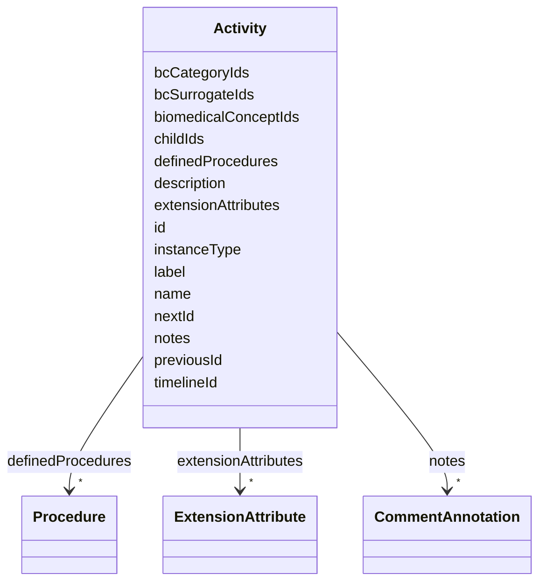

# Class: Activity 


URI: [usdm:Activity](https://www.cdisc.org/usdm/Activity)





<!-- no inheritance hierarchy -->

## Slots

| Name | Cardinality and Range | Description | Inheritance |
| ---  | --- | --- | --- |
| [id](id.md) | 1 <br/> [String](String.md) |  | direct |
| [extensionAttributes](extensionAttributes.md) | * <br/> [ExtensionAttribute](ExtensionAttribute.md) |  | direct |
| [name](name.md) | 1 <br/> [String](String.md) |  | direct |
| [label](label.md) | 0..1 <br/> [String](String.md) |  | direct |
| [description](description.md) | 0..1 <br/> [String](String.md) |  | direct |
| [previousId](previousId.md) | 0..1 <br/> [String](String.md) |  | direct |
| [nextId](nextId.md) | 0..1 <br/> [String](String.md) |  | direct |
| [childIds](childIds.md) | * <br/> [String](String.md) |  | direct |
| [definedProcedures](definedProcedures.md) | * <br/> [Procedure](Procedure.md) |  | direct |
| [biomedicalConceptIds](biomedicalConceptIds.md) | * <br/> [String](String.md) |  | direct |
| [bcCategoryIds](bcCategoryIds.md) | * <br/> [String](String.md) |  | direct |
| [bcSurrogateIds](bcSurrogateIds.md) | * <br/> [String](String.md) |  | direct |
| [timelineId](timelineId.md) | 0..1 <br/> [String](String.md) |  | direct |
| [notes](notes.md) | * <br/> [CommentAnnotation](CommentAnnotation.md) |  | direct |
| [instanceType](instanceType.md) | 1 <br/> [String](String.md) |  | direct |


## Usages

| used by | used in | type | used |
| ---  | --- | --- | --- |
| [InterventionalStudyDesign](InterventionalStudyDesign.md) | [activities](activities.md) | range | [Activity](Activity.md) |
| [ObservationalStudyDesign](ObservationalStudyDesign.md) | [activities](activities.md) | range | [Activity](Activity.md) |


## Identifier and Mapping Information


### Schema Source


* from schema: https://www.cdisc.org/usdm


## Mappings

| Mapping Type | Mapped Value |
| ---  | ---  |
| self | usdm:Activity |
| native | usdm:Activity |


## LinkML Source

<!-- TODO: investigate https://stackoverflow.com/questions/37606292/how-to-create-tabbed-code-blocks-in-mkdocs-or-sphinx -->

### Direct

<details>
```yaml
name: Activity
from_schema: https://www.cdisc.org/usdm
attributes:
  id:
    name: id
    from_schema: https://www.cdisc.org/usdm
    identifier: true
    domain_of:
    - Abbreviation
    - Activity
    - Address
    - AdministrableProduct
    - AdministrableProductIdentifier
    - AdministrableProductProperty
    - Administration
    - AliasCode
    - AnalysisPopulation
    - AssignedPerson
    - BiomedicalConcept
    - BiomedicalConceptCategory
    - BiomedicalConceptProperty
    - BiomedicalConceptSurrogate
    - BiospecimenRetention
    - Characteristic
    - Code
    - CommentAnnotation
    - Condition
    - ConditionAssignment
    - DocumentContentReference
    - Duration
    - EligibilityCriterion
    - EligibilityCriterionItem
    - Encounter
    - Endpoint
    - Estimand
    - ExtensionAttribute
    - ExtensionClass
    - GeographicScope
    - GovernanceDate
    - Indication
    - Ingredient
    - IntercurrentEvent
    - InterventionalStudyDesign
    - Masking
    - MedicalDevice
    - MedicalDeviceIdentifier
    - NarrativeContent
    - NarrativeContentItem
    - Objective
    - ObservationalStudyDesign
    - Organization
    - ParameterMap
    - PersonName
    - Procedure
    - ProductOrganizationRole
    - Quantity
    - Range
    - ReferenceIdentifier
    - ResponseCode
    - ScheduleTimeline
    - ScheduleTimelineExit
    - ScheduledActivityInstance
    - ScheduledDecisionInstance
    - Strength
    - Study
    - StudyAmendment
    - StudyAmendmentImpact
    - StudyAmendmentReason
    - StudyArm
    - StudyCell
    - StudyChange
    - StudyCohort
    - StudyDefinitionDocument
    - StudyDefinitionDocumentVersion
    - StudyDesignPopulation
    - StudyElement
    - StudyEpoch
    - StudyIdentifier
    - StudyIntervention
    - StudyRole
    - StudySite
    - StudyTitle
    - StudyVersion
    - SubjectEnrollment
    - Substance
    - SyntaxTemplateDictionary
    - Timing
    - TransitionRule
    range: string
    required: true
    pattern: ^[\s\S]+$
  extensionAttributes:
    name: extensionAttributes
    from_schema: https://www.cdisc.org/usdm
    domain_of:
    - Abbreviation
    - Activity
    - Address
    - AdministrableProduct
    - AdministrableProductIdentifier
    - AdministrableProductProperty
    - Administration
    - AliasCode
    - AnalysisPopulation
    - AssignedPerson
    - BiomedicalConcept
    - BiomedicalConceptCategory
    - BiomedicalConceptProperty
    - BiomedicalConceptSurrogate
    - BiospecimenRetention
    - Characteristic
    - Code
    - CommentAnnotation
    - Condition
    - ConditionAssignment
    - DocumentContentReference
    - Duration
    - EligibilityCriterion
    - EligibilityCriterionItem
    - Encounter
    - Endpoint
    - Estimand
    - ExtensionAttribute
    - ExtensionClass
    - GeographicScope
    - GovernanceDate
    - Indication
    - Ingredient
    - IntercurrentEvent
    - InterventionalStudyDesign
    - Masking
    - MedicalDevice
    - MedicalDeviceIdentifier
    - NarrativeContent
    - NarrativeContentItem
    - Objective
    - ObservationalStudyDesign
    - Organization
    - ParameterMap
    - PersonName
    - Procedure
    - ProductOrganizationRole
    - Quantity
    - Range
    - ReferenceIdentifier
    - ResponseCode
    - ScheduleTimeline
    - ScheduleTimelineExit
    - ScheduledActivityInstance
    - ScheduledDecisionInstance
    - Strength
    - Study
    - StudyAmendment
    - StudyAmendmentImpact
    - StudyAmendmentReason
    - StudyArm
    - StudyCell
    - StudyChange
    - StudyCohort
    - StudyDefinitionDocument
    - StudyDefinitionDocumentVersion
    - StudyDesignPopulation
    - StudyElement
    - StudyEpoch
    - StudyIdentifier
    - StudyIntervention
    - StudyRole
    - StudySite
    - StudyTitle
    - StudyVersion
    - SubjectEnrollment
    - Substance
    - SyntaxTemplateDictionary
    - Timing
    - TransitionRule
    range: ExtensionAttribute
    required: false
    multivalued: true
    inlined: true
    inlined_as_list: true
  name:
    name: name
    from_schema: https://www.cdisc.org/usdm
    rank: 1000
    domain_of:
    - Activity
    - AdministrableProduct
    - AdministrableProductProperty
    - Administration
    - AnalysisPopulation
    - AssignedPerson
    - BiomedicalConcept
    - BiomedicalConceptCategory
    - BiomedicalConceptProperty
    - BiomedicalConceptSurrogate
    - BiospecimenRetention
    - Characteristic
    - Condition
    - EligibilityCriterion
    - EligibilityCriterionItem
    - Encounter
    - Endpoint
    - Estimand
    - GovernanceDate
    - Indication
    - IntercurrentEvent
    - InterventionalStudyDesign
    - MedicalDevice
    - NarrativeContent
    - NarrativeContentItem
    - Objective
    - ObservationalStudyDesign
    - Organization
    - Procedure
    - ProductOrganizationRole
    - ResponseCode
    - ScheduleTimeline
    - ScheduledActivityInstance
    - ScheduledDecisionInstance
    - Strength
    - Study
    - StudyAmendment
    - StudyArm
    - StudyChange
    - StudyCohort
    - StudyDefinitionDocument
    - StudyDesignPopulation
    - StudyElement
    - StudyEpoch
    - StudyIntervention
    - StudyRole
    - StudySite
    - SubjectEnrollment
    - Substance
    - SyntaxTemplateDictionary
    - Timing
    - TransitionRule
    range: string
    required: true
    pattern: ^[\s\S]+$
  label:
    name: label
    from_schema: https://www.cdisc.org/usdm
    rank: 1000
    domain_of:
    - Activity
    - AdministrableProduct
    - Administration
    - AnalysisPopulation
    - AssignedPerson
    - BiomedicalConcept
    - BiomedicalConceptCategory
    - BiomedicalConceptProperty
    - BiomedicalConceptSurrogate
    - BiospecimenRetention
    - Characteristic
    - Condition
    - EligibilityCriterion
    - EligibilityCriterionItem
    - Encounter
    - Endpoint
    - Estimand
    - GovernanceDate
    - Indication
    - IntercurrentEvent
    - InterventionalStudyDesign
    - MedicalDevice
    - Objective
    - ObservationalStudyDesign
    - Organization
    - Procedure
    - ProductOrganizationRole
    - ResponseCode
    - ScheduleTimeline
    - ScheduledActivityInstance
    - ScheduledDecisionInstance
    - Strength
    - Study
    - StudyAmendment
    - StudyArm
    - StudyChange
    - StudyCohort
    - StudyDefinitionDocument
    - StudyDesignPopulation
    - StudyElement
    - StudyEpoch
    - StudyIntervention
    - StudyRole
    - StudySite
    - SubjectEnrollment
    - Substance
    - SyntaxTemplateDictionary
    - Timing
    - TransitionRule
    range: string
    required: false
  description:
    name: description
    from_schema: https://www.cdisc.org/usdm
    rank: 1000
    domain_of:
    - Activity
    - AdministrableProduct
    - Administration
    - AnalysisPopulation
    - AssignedPerson
    - BiomedicalConceptCategory
    - BiomedicalConceptSurrogate
    - BiospecimenRetention
    - Characteristic
    - Condition
    - EligibilityCriterion
    - EligibilityCriterionItem
    - Encounter
    - Endpoint
    - Estimand
    - GovernanceDate
    - Indication
    - IntercurrentEvent
    - InterventionalStudyDesign
    - MedicalDevice
    - Objective
    - ObservationalStudyDesign
    - Procedure
    - ProductOrganizationRole
    - ScheduleTimeline
    - ScheduledActivityInstance
    - ScheduledDecisionInstance
    - Strength
    - Study
    - StudyAmendment
    - StudyArm
    - StudyChange
    - StudyCohort
    - StudyDefinitionDocument
    - StudyDesignPopulation
    - StudyElement
    - StudyEpoch
    - StudyIntervention
    - StudyRole
    - StudySite
    - SubjectEnrollment
    - Substance
    - SyntaxTemplateDictionary
    - Timing
    - TransitionRule
    range: string
    required: false
  previousId:
    name: previousId
    from_schema: https://www.cdisc.org/usdm
    rank: 1000
    domain_of:
    - Activity
    - EligibilityCriterion
    - Encounter
    - NarrativeContent
    - StudyAmendment
    - StudyEpoch
    range: string
    required: false
  nextId:
    name: nextId
    from_schema: https://www.cdisc.org/usdm
    rank: 1000
    domain_of:
    - Activity
    - EligibilityCriterion
    - Encounter
    - NarrativeContent
    - StudyEpoch
    range: string
    required: false
  childIds:
    name: childIds
    from_schema: https://www.cdisc.org/usdm
    rank: 1000
    domain_of:
    - Activity
    - BiomedicalConceptCategory
    - NarrativeContent
    - StudyDefinitionDocument
    range: string
    required: false
    multivalued: true
  definedProcedures:
    name: definedProcedures
    from_schema: https://www.cdisc.org/usdm
    rank: 1000
    domain_of:
    - Activity
    range: Procedure
    required: false
    multivalued: true
    inlined: true
    inlined_as_list: true
  biomedicalConceptIds:
    name: biomedicalConceptIds
    from_schema: https://www.cdisc.org/usdm
    rank: 1000
    domain_of:
    - Activity
    range: string
    required: false
    multivalued: true
  bcCategoryIds:
    name: bcCategoryIds
    from_schema: https://www.cdisc.org/usdm
    rank: 1000
    domain_of:
    - Activity
    range: string
    required: false
    multivalued: true
  bcSurrogateIds:
    name: bcSurrogateIds
    from_schema: https://www.cdisc.org/usdm
    rank: 1000
    domain_of:
    - Activity
    range: string
    required: false
    multivalued: true
  timelineId:
    name: timelineId
    from_schema: https://www.cdisc.org/usdm
    rank: 1000
    domain_of:
    - Activity
    - ScheduledActivityInstance
    range: string
    required: false
  notes:
    name: notes
    from_schema: https://www.cdisc.org/usdm
    domain_of:
    - Abbreviation
    - Activity
    - AdministrableProduct
    - Administration
    - AnalysisPopulation
    - BiomedicalConcept
    - BiomedicalConceptCategory
    - BiomedicalConceptProperty
    - BiomedicalConceptSurrogate
    - Characteristic
    - Condition
    - EligibilityCriterion
    - EligibilityCriterionItem
    - Encounter
    - Endpoint
    - Estimand
    - Indication
    - IntercurrentEvent
    - InterventionalStudyDesign
    - MedicalDevice
    - Objective
    - ObservationalStudyDesign
    - Procedure
    - StudyAmendment
    - StudyAmendmentImpact
    - StudyArm
    - StudyCohort
    - StudyDefinitionDocument
    - StudyDefinitionDocumentVersion
    - StudyDesignPopulation
    - StudyElement
    - StudyEpoch
    - StudyIntervention
    - StudyRole
    - StudyVersion
    range: CommentAnnotation
    required: false
    multivalued: true
    inlined: true
    inlined_as_list: true
  instanceType:
    name: instanceType
    from_schema: https://www.cdisc.org/usdm
    designates_type: true
    domain_of:
    - Abbreviation
    - Activity
    - Address
    - AdministrableProduct
    - AdministrableProductIdentifier
    - AdministrableProductProperty
    - Administration
    - AliasCode
    - AnalysisPopulation
    - AssignedPerson
    - BiomedicalConcept
    - BiomedicalConceptCategory
    - BiomedicalConceptProperty
    - BiomedicalConceptSurrogate
    - BiospecimenRetention
    - Characteristic
    - Code
    - CommentAnnotation
    - Condition
    - ConditionAssignment
    - DocumentContentReference
    - Duration
    - EligibilityCriterion
    - EligibilityCriterionItem
    - Encounter
    - Endpoint
    - Estimand
    - ExtensionAttribute
    - ExtensionClass
    - GeographicScope
    - GovernanceDate
    - Indication
    - Ingredient
    - IntercurrentEvent
    - InterventionalStudyDesign
    - Masking
    - MedicalDevice
    - MedicalDeviceIdentifier
    - NarrativeContent
    - NarrativeContentItem
    - Objective
    - ObservationalStudyDesign
    - Organization
    - ParameterMap
    - PersonName
    - Procedure
    - ProductOrganizationRole
    - Quantity
    - Range
    - ReferenceIdentifier
    - ResponseCode
    - ScheduleTimeline
    - ScheduleTimelineExit
    - ScheduledActivityInstance
    - ScheduledDecisionInstance
    - Strength
    - Study
    - StudyAmendment
    - StudyAmendmentImpact
    - StudyAmendmentReason
    - StudyArm
    - StudyCell
    - StudyChange
    - StudyCohort
    - StudyDefinitionDocument
    - StudyDefinitionDocumentVersion
    - StudyDesignPopulation
    - StudyElement
    - StudyEpoch
    - StudyIdentifier
    - StudyIntervention
    - StudyRole
    - StudySite
    - StudyTitle
    - StudyVersion
    - SubjectEnrollment
    - Substance
    - SyntaxTemplateDictionary
    - Timing
    - TransitionRule
    range: string
    required: true
    equals_string: Activity

```
</details>

### Induced

<details>
```yaml
name: Activity
from_schema: https://www.cdisc.org/usdm
attributes:
  id:
    name: id
    from_schema: https://www.cdisc.org/usdm
    identifier: true
    alias: id
    owner: Activity
    domain_of:
    - Abbreviation
    - Activity
    - Address
    - AdministrableProduct
    - AdministrableProductIdentifier
    - AdministrableProductProperty
    - Administration
    - AliasCode
    - AnalysisPopulation
    - AssignedPerson
    - BiomedicalConcept
    - BiomedicalConceptCategory
    - BiomedicalConceptProperty
    - BiomedicalConceptSurrogate
    - BiospecimenRetention
    - Characteristic
    - Code
    - CommentAnnotation
    - Condition
    - ConditionAssignment
    - DocumentContentReference
    - Duration
    - EligibilityCriterion
    - EligibilityCriterionItem
    - Encounter
    - Endpoint
    - Estimand
    - ExtensionAttribute
    - ExtensionClass
    - GeographicScope
    - GovernanceDate
    - Indication
    - Ingredient
    - IntercurrentEvent
    - InterventionalStudyDesign
    - Masking
    - MedicalDevice
    - MedicalDeviceIdentifier
    - NarrativeContent
    - NarrativeContentItem
    - Objective
    - ObservationalStudyDesign
    - Organization
    - ParameterMap
    - PersonName
    - Procedure
    - ProductOrganizationRole
    - Quantity
    - Range
    - ReferenceIdentifier
    - ResponseCode
    - ScheduleTimeline
    - ScheduleTimelineExit
    - ScheduledActivityInstance
    - ScheduledDecisionInstance
    - Strength
    - Study
    - StudyAmendment
    - StudyAmendmentImpact
    - StudyAmendmentReason
    - StudyArm
    - StudyCell
    - StudyChange
    - StudyCohort
    - StudyDefinitionDocument
    - StudyDefinitionDocumentVersion
    - StudyDesignPopulation
    - StudyElement
    - StudyEpoch
    - StudyIdentifier
    - StudyIntervention
    - StudyRole
    - StudySite
    - StudyTitle
    - StudyVersion
    - SubjectEnrollment
    - Substance
    - SyntaxTemplateDictionary
    - Timing
    - TransitionRule
    range: string
    required: true
    pattern: ^[\s\S]+$
  extensionAttributes:
    name: extensionAttributes
    from_schema: https://www.cdisc.org/usdm
    alias: extensionAttributes
    owner: Activity
    domain_of:
    - Abbreviation
    - Activity
    - Address
    - AdministrableProduct
    - AdministrableProductIdentifier
    - AdministrableProductProperty
    - Administration
    - AliasCode
    - AnalysisPopulation
    - AssignedPerson
    - BiomedicalConcept
    - BiomedicalConceptCategory
    - BiomedicalConceptProperty
    - BiomedicalConceptSurrogate
    - BiospecimenRetention
    - Characteristic
    - Code
    - CommentAnnotation
    - Condition
    - ConditionAssignment
    - DocumentContentReference
    - Duration
    - EligibilityCriterion
    - EligibilityCriterionItem
    - Encounter
    - Endpoint
    - Estimand
    - ExtensionAttribute
    - ExtensionClass
    - GeographicScope
    - GovernanceDate
    - Indication
    - Ingredient
    - IntercurrentEvent
    - InterventionalStudyDesign
    - Masking
    - MedicalDevice
    - MedicalDeviceIdentifier
    - NarrativeContent
    - NarrativeContentItem
    - Objective
    - ObservationalStudyDesign
    - Organization
    - ParameterMap
    - PersonName
    - Procedure
    - ProductOrganizationRole
    - Quantity
    - Range
    - ReferenceIdentifier
    - ResponseCode
    - ScheduleTimeline
    - ScheduleTimelineExit
    - ScheduledActivityInstance
    - ScheduledDecisionInstance
    - Strength
    - Study
    - StudyAmendment
    - StudyAmendmentImpact
    - StudyAmendmentReason
    - StudyArm
    - StudyCell
    - StudyChange
    - StudyCohort
    - StudyDefinitionDocument
    - StudyDefinitionDocumentVersion
    - StudyDesignPopulation
    - StudyElement
    - StudyEpoch
    - StudyIdentifier
    - StudyIntervention
    - StudyRole
    - StudySite
    - StudyTitle
    - StudyVersion
    - SubjectEnrollment
    - Substance
    - SyntaxTemplateDictionary
    - Timing
    - TransitionRule
    range: ExtensionAttribute
    required: false
    multivalued: true
    inlined: true
    inlined_as_list: true
  name:
    name: name
    from_schema: https://www.cdisc.org/usdm
    rank: 1000
    alias: name
    owner: Activity
    domain_of:
    - Activity
    - AdministrableProduct
    - AdministrableProductProperty
    - Administration
    - AnalysisPopulation
    - AssignedPerson
    - BiomedicalConcept
    - BiomedicalConceptCategory
    - BiomedicalConceptProperty
    - BiomedicalConceptSurrogate
    - BiospecimenRetention
    - Characteristic
    - Condition
    - EligibilityCriterion
    - EligibilityCriterionItem
    - Encounter
    - Endpoint
    - Estimand
    - GovernanceDate
    - Indication
    - IntercurrentEvent
    - InterventionalStudyDesign
    - MedicalDevice
    - NarrativeContent
    - NarrativeContentItem
    - Objective
    - ObservationalStudyDesign
    - Organization
    - Procedure
    - ProductOrganizationRole
    - ResponseCode
    - ScheduleTimeline
    - ScheduledActivityInstance
    - ScheduledDecisionInstance
    - Strength
    - Study
    - StudyAmendment
    - StudyArm
    - StudyChange
    - StudyCohort
    - StudyDefinitionDocument
    - StudyDesignPopulation
    - StudyElement
    - StudyEpoch
    - StudyIntervention
    - StudyRole
    - StudySite
    - SubjectEnrollment
    - Substance
    - SyntaxTemplateDictionary
    - Timing
    - TransitionRule
    range: string
    required: true
    pattern: ^[\s\S]+$
  label:
    name: label
    from_schema: https://www.cdisc.org/usdm
    rank: 1000
    alias: label
    owner: Activity
    domain_of:
    - Activity
    - AdministrableProduct
    - Administration
    - AnalysisPopulation
    - AssignedPerson
    - BiomedicalConcept
    - BiomedicalConceptCategory
    - BiomedicalConceptProperty
    - BiomedicalConceptSurrogate
    - BiospecimenRetention
    - Characteristic
    - Condition
    - EligibilityCriterion
    - EligibilityCriterionItem
    - Encounter
    - Endpoint
    - Estimand
    - GovernanceDate
    - Indication
    - IntercurrentEvent
    - InterventionalStudyDesign
    - MedicalDevice
    - Objective
    - ObservationalStudyDesign
    - Organization
    - Procedure
    - ProductOrganizationRole
    - ResponseCode
    - ScheduleTimeline
    - ScheduledActivityInstance
    - ScheduledDecisionInstance
    - Strength
    - Study
    - StudyAmendment
    - StudyArm
    - StudyChange
    - StudyCohort
    - StudyDefinitionDocument
    - StudyDesignPopulation
    - StudyElement
    - StudyEpoch
    - StudyIntervention
    - StudyRole
    - StudySite
    - SubjectEnrollment
    - Substance
    - SyntaxTemplateDictionary
    - Timing
    - TransitionRule
    range: string
    required: false
  description:
    name: description
    from_schema: https://www.cdisc.org/usdm
    rank: 1000
    alias: description
    owner: Activity
    domain_of:
    - Activity
    - AdministrableProduct
    - Administration
    - AnalysisPopulation
    - AssignedPerson
    - BiomedicalConceptCategory
    - BiomedicalConceptSurrogate
    - BiospecimenRetention
    - Characteristic
    - Condition
    - EligibilityCriterion
    - EligibilityCriterionItem
    - Encounter
    - Endpoint
    - Estimand
    - GovernanceDate
    - Indication
    - IntercurrentEvent
    - InterventionalStudyDesign
    - MedicalDevice
    - Objective
    - ObservationalStudyDesign
    - Procedure
    - ProductOrganizationRole
    - ScheduleTimeline
    - ScheduledActivityInstance
    - ScheduledDecisionInstance
    - Strength
    - Study
    - StudyAmendment
    - StudyArm
    - StudyChange
    - StudyCohort
    - StudyDefinitionDocument
    - StudyDesignPopulation
    - StudyElement
    - StudyEpoch
    - StudyIntervention
    - StudyRole
    - StudySite
    - SubjectEnrollment
    - Substance
    - SyntaxTemplateDictionary
    - Timing
    - TransitionRule
    range: string
    required: false
  previousId:
    name: previousId
    from_schema: https://www.cdisc.org/usdm
    rank: 1000
    alias: previousId
    owner: Activity
    domain_of:
    - Activity
    - EligibilityCriterion
    - Encounter
    - NarrativeContent
    - StudyAmendment
    - StudyEpoch
    range: string
    required: false
  nextId:
    name: nextId
    from_schema: https://www.cdisc.org/usdm
    rank: 1000
    alias: nextId
    owner: Activity
    domain_of:
    - Activity
    - EligibilityCriterion
    - Encounter
    - NarrativeContent
    - StudyEpoch
    range: string
    required: false
  childIds:
    name: childIds
    from_schema: https://www.cdisc.org/usdm
    rank: 1000
    alias: childIds
    owner: Activity
    domain_of:
    - Activity
    - BiomedicalConceptCategory
    - NarrativeContent
    - StudyDefinitionDocument
    range: string
    required: false
    multivalued: true
  definedProcedures:
    name: definedProcedures
    from_schema: https://www.cdisc.org/usdm
    rank: 1000
    alias: definedProcedures
    owner: Activity
    domain_of:
    - Activity
    range: Procedure
    required: false
    multivalued: true
    inlined: true
    inlined_as_list: true
  biomedicalConceptIds:
    name: biomedicalConceptIds
    from_schema: https://www.cdisc.org/usdm
    rank: 1000
    alias: biomedicalConceptIds
    owner: Activity
    domain_of:
    - Activity
    range: string
    required: false
    multivalued: true
  bcCategoryIds:
    name: bcCategoryIds
    from_schema: https://www.cdisc.org/usdm
    rank: 1000
    alias: bcCategoryIds
    owner: Activity
    domain_of:
    - Activity
    range: string
    required: false
    multivalued: true
  bcSurrogateIds:
    name: bcSurrogateIds
    from_schema: https://www.cdisc.org/usdm
    rank: 1000
    alias: bcSurrogateIds
    owner: Activity
    domain_of:
    - Activity
    range: string
    required: false
    multivalued: true
  timelineId:
    name: timelineId
    from_schema: https://www.cdisc.org/usdm
    rank: 1000
    alias: timelineId
    owner: Activity
    domain_of:
    - Activity
    - ScheduledActivityInstance
    range: string
    required: false
  notes:
    name: notes
    from_schema: https://www.cdisc.org/usdm
    alias: notes
    owner: Activity
    domain_of:
    - Abbreviation
    - Activity
    - AdministrableProduct
    - Administration
    - AnalysisPopulation
    - BiomedicalConcept
    - BiomedicalConceptCategory
    - BiomedicalConceptProperty
    - BiomedicalConceptSurrogate
    - Characteristic
    - Condition
    - EligibilityCriterion
    - EligibilityCriterionItem
    - Encounter
    - Endpoint
    - Estimand
    - Indication
    - IntercurrentEvent
    - InterventionalStudyDesign
    - MedicalDevice
    - Objective
    - ObservationalStudyDesign
    - Procedure
    - StudyAmendment
    - StudyAmendmentImpact
    - StudyArm
    - StudyCohort
    - StudyDefinitionDocument
    - StudyDefinitionDocumentVersion
    - StudyDesignPopulation
    - StudyElement
    - StudyEpoch
    - StudyIntervention
    - StudyRole
    - StudyVersion
    range: CommentAnnotation
    required: false
    multivalued: true
    inlined: true
    inlined_as_list: true
  instanceType:
    name: instanceType
    from_schema: https://www.cdisc.org/usdm
    designates_type: true
    alias: instanceType
    owner: Activity
    domain_of:
    - Abbreviation
    - Activity
    - Address
    - AdministrableProduct
    - AdministrableProductIdentifier
    - AdministrableProductProperty
    - Administration
    - AliasCode
    - AnalysisPopulation
    - AssignedPerson
    - BiomedicalConcept
    - BiomedicalConceptCategory
    - BiomedicalConceptProperty
    - BiomedicalConceptSurrogate
    - BiospecimenRetention
    - Characteristic
    - Code
    - CommentAnnotation
    - Condition
    - ConditionAssignment
    - DocumentContentReference
    - Duration
    - EligibilityCriterion
    - EligibilityCriterionItem
    - Encounter
    - Endpoint
    - Estimand
    - ExtensionAttribute
    - ExtensionClass
    - GeographicScope
    - GovernanceDate
    - Indication
    - Ingredient
    - IntercurrentEvent
    - InterventionalStudyDesign
    - Masking
    - MedicalDevice
    - MedicalDeviceIdentifier
    - NarrativeContent
    - NarrativeContentItem
    - Objective
    - ObservationalStudyDesign
    - Organization
    - ParameterMap
    - PersonName
    - Procedure
    - ProductOrganizationRole
    - Quantity
    - Range
    - ReferenceIdentifier
    - ResponseCode
    - ScheduleTimeline
    - ScheduleTimelineExit
    - ScheduledActivityInstance
    - ScheduledDecisionInstance
    - Strength
    - Study
    - StudyAmendment
    - StudyAmendmentImpact
    - StudyAmendmentReason
    - StudyArm
    - StudyCell
    - StudyChange
    - StudyCohort
    - StudyDefinitionDocument
    - StudyDefinitionDocumentVersion
    - StudyDesignPopulation
    - StudyElement
    - StudyEpoch
    - StudyIdentifier
    - StudyIntervention
    - StudyRole
    - StudySite
    - StudyTitle
    - StudyVersion
    - SubjectEnrollment
    - Substance
    - SyntaxTemplateDictionary
    - Timing
    - TransitionRule
    range: string
    required: true
    equals_string: Activity

```
</details>