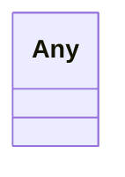

# Class: Any 


_Unconstrained range of union-typed attributes; their any_of narrows it to the allowed classes._


URI: [linkml:Any](https://w3id.org/linkml/Any)





<!-- no inheritance hierarchy -->

## Class Properties

| Property | Value |
| --- | --- |
| Class URI | [linkml:Any](https://w3id.org/linkml/Any) |


## Slots

| Name | Cardinality and Range | Description | Inheritance |
| ---  | --- | --- | --- |


## Usages

| used by | used in | type | used |
| ---  | --- | --- | --- |
| [Duration](Duration.md) | [quantity](quantity.md) | range | [Any](Any.md) |
| [ScheduleTimeline](ScheduleTimeline.md) | [instances](instances.md) | range | [Any](Any.md) |
| [Strength](Strength.md) | [numerator](numerator.md) | range | [Any](Any.md) |
| [StudyCohort](StudyCohort.md) | [plannedEnrollmentNumber](plannedEnrollmentNumber.md) | range | [Any](Any.md) |
| [StudyCohort](StudyCohort.md) | [plannedCompletionNumber](plannedCompletionNumber.md) | range | [Any](Any.md) |
| [StudyDesignPopulation](StudyDesignPopulation.md) | [plannedEnrollmentNumber](plannedEnrollmentNumber.md) | range | [Any](Any.md) |
| [StudyDesignPopulation](StudyDesignPopulation.md) | [plannedCompletionNumber](plannedCompletionNumber.md) | range | [Any](Any.md) |
| [StudyVersion](StudyVersion.md) | [studyDesigns](studyDesigns.md) | range | [Any](Any.md) |


## Identifier and Mapping Information


### Schema Source


* from schema: https://www.cdisc.org/usdm


## Mappings

| Mapping Type | Mapped Value |
| ---  | ---  |
| self | linkml:Any |
| native | usdm:Any |


## LinkML Source

<!-- TODO: investigate https://stackoverflow.com/questions/37606292/how-to-create-tabbed-code-blocks-in-mkdocs-or-sphinx -->

### Direct

<details>
```yaml
name: Any
description: Unconstrained range of union-typed attributes; their any_of narrows it
  to the allowed classes.
from_schema: https://www.cdisc.org/usdm
class_uri: linkml:Any

```
</details>

### Induced

<details>
```yaml
name: Any
description: Unconstrained range of union-typed attributes; their any_of narrows it
  to the allowed classes.
from_schema: https://www.cdisc.org/usdm
class_uri: linkml:Any

```
</details>