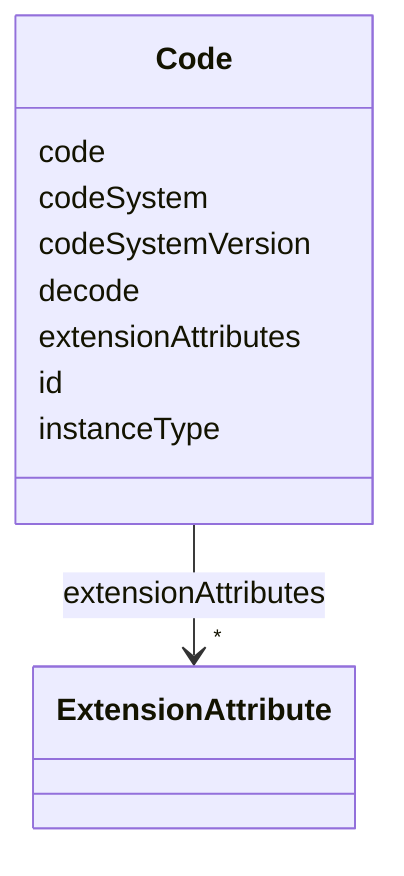

# Class: Code 


URI: [usdm:Code](https://www.cdisc.org/usdm/Code)





<!-- no inheritance hierarchy -->

## Slots

| Name | Cardinality and Range | Description | Inheritance |
| ---  | --- | --- | --- |
| [id](id.md) | 1 <br/> [String](String.md) |  | direct |
| [extensionAttributes](extensionAttributes.md) | * <br/> [ExtensionAttribute](ExtensionAttribute.md) |  | direct |
| [code](code.md) | 1 <br/> [String](String.md) |  | direct |
| [codeSystem](codeSystem.md) | 1 <br/> [String](String.md) |  | direct |
| [codeSystemVersion](codeSystemVersion.md) | 1 <br/> [String](String.md) |  | direct |
| [decode](decode.md) | 1 <br/> [String](String.md) |  | direct |
| [instanceType](instanceType.md) | 1 <br/> [String](String.md) |  | direct |


## Usages

| used by | used in | type | used |
| ---  | --- | --- | --- |
| [Address](Address.md) | [country](country.md) | range | [Code](Code.md) |
| [AdministrableProduct](AdministrableProduct.md) | [pharmacologicClass](pharmacologicClass.md) | range | [Code](Code.md) |
| [AdministrableProduct](AdministrableProduct.md) | [productDesignation](productDesignation.md) | range | [Code](Code.md) |
| [AdministrableProduct](AdministrableProduct.md) | [sourcing](sourcing.md) | range | [Code](Code.md) |
| [AdministrableProductProperty](AdministrableProductProperty.md) | [type](type.md) | range | [Code](Code.md) |
| [AliasCode](AliasCode.md) | [standardCode](standardCode.md) | range | [Code](Code.md) |
| [AliasCode](AliasCode.md) | [standardCodeAliases](standardCodeAliases.md) | range | [Code](Code.md) |
| [CommentAnnotation](CommentAnnotation.md) | [codes](codes.md) | range | [Code](Code.md) |
| [EligibilityCriterion](EligibilityCriterion.md) | [category](category.md) | range | [Code](Code.md) |
| [Encounter](Encounter.md) | [type](type.md) | range | [Code](Code.md) |
| [Encounter](Encounter.md) | [environmentalSettings](environmentalSettings.md) | range | [Code](Code.md) |
| [Encounter](Encounter.md) | [contactModes](contactModes.md) | range | [Code](Code.md) |
| [Endpoint](Endpoint.md) | [level](level.md) | range | [Code](Code.md) |
| [ExtensionAttribute](ExtensionAttribute.md) | [valueCode](valueCode.md) | range | [Code](Code.md) |
| [GeographicScope](GeographicScope.md) | [type](type.md) | range | [Code](Code.md) |
| [GovernanceDate](GovernanceDate.md) | [type](type.md) | range | [Code](Code.md) |
| [Indication](Indication.md) | [codes](codes.md) | range | [Code](Code.md) |
| [Ingredient](Ingredient.md) | [role](role.md) | range | [Code](Code.md) |
| [InterventionalStudyDesign](InterventionalStudyDesign.md) | [studyType](studyType.md) | range | [Code](Code.md) |
| [InterventionalStudyDesign](InterventionalStudyDesign.md) | [therapeuticAreas](therapeuticAreas.md) | range | [Code](Code.md) |
| [InterventionalStudyDesign](InterventionalStudyDesign.md) | [characteristics](characteristics.md) | range | [Code](Code.md) |
| [InterventionalStudyDesign](InterventionalStudyDesign.md) | [subTypes](subTypes.md) | range | [Code](Code.md) |
| [InterventionalStudyDesign](InterventionalStudyDesign.md) | [model](model.md) | range | [Code](Code.md) |
| [InterventionalStudyDesign](InterventionalStudyDesign.md) | [intentTypes](intentTypes.md) | range | [Code](Code.md) |
| [MedicalDevice](MedicalDevice.md) | [sourcing](sourcing.md) | range | [Code](Code.md) |
| [MedicalDeviceIdentifier](MedicalDeviceIdentifier.md) | [type](type.md) | range | [Code](Code.md) |
| [Objective](Objective.md) | [level](level.md) | range | [Code](Code.md) |
| [ObservationalStudyDesign](ObservationalStudyDesign.md) | [studyType](studyType.md) | range | [Code](Code.md) |
| [ObservationalStudyDesign](ObservationalStudyDesign.md) | [therapeuticAreas](therapeuticAreas.md) | range | [Code](Code.md) |
| [ObservationalStudyDesign](ObservationalStudyDesign.md) | [characteristics](characteristics.md) | range | [Code](Code.md) |
| [ObservationalStudyDesign](ObservationalStudyDesign.md) | [subTypes](subTypes.md) | range | [Code](Code.md) |
| [ObservationalStudyDesign](ObservationalStudyDesign.md) | [model](model.md) | range | [Code](Code.md) |
| [ObservationalStudyDesign](ObservationalStudyDesign.md) | [timePerspective](timePerspective.md) | range | [Code](Code.md) |
| [ObservationalStudyDesign](ObservationalStudyDesign.md) | [samplingMethod](samplingMethod.md) | range | [Code](Code.md) |
| [Organization](Organization.md) | [type](type.md) | range | [Code](Code.md) |
| [Procedure](Procedure.md) | [code](code.md) | range | [Code](Code.md) |
| [ProductOrganizationRole](ProductOrganizationRole.md) | [code](code.md) | range | [Code](Code.md) |
| [ReferenceIdentifier](ReferenceIdentifier.md) | [type](type.md) | range | [Code](Code.md) |
| [ResponseCode](ResponseCode.md) | [code](code.md) | range | [Code](Code.md) |
| [StudyAmendmentImpact](StudyAmendmentImpact.md) | [type](type.md) | range | [Code](Code.md) |
| [StudyAmendmentReason](StudyAmendmentReason.md) | [code](code.md) | range | [Code](Code.md) |
| [StudyArm](StudyArm.md) | [type](type.md) | range | [Code](Code.md) |
| [StudyArm](StudyArm.md) | [dataOriginType](dataOriginType.md) | range | [Code](Code.md) |
| [StudyCohort](StudyCohort.md) | [plannedSex](plannedSex.md) | range | [Code](Code.md) |
| [StudyDefinitionDocument](StudyDefinitionDocument.md) | [language](language.md) | range | [Code](Code.md) |
| [StudyDefinitionDocument](StudyDefinitionDocument.md) | [type](type.md) | range | [Code](Code.md) |
| [StudyDefinitionDocumentVersion](StudyDefinitionDocumentVersion.md) | [status](status.md) | range | [Code](Code.md) |
| [StudyDesignPopulation](StudyDesignPopulation.md) | [plannedSex](plannedSex.md) | range | [Code](Code.md) |
| [StudyEpoch](StudyEpoch.md) | [type](type.md) | range | [Code](Code.md) |
| [StudyIntervention](StudyIntervention.md) | [role](role.md) | range | [Code](Code.md) |
| [StudyIntervention](StudyIntervention.md) | [type](type.md) | range | [Code](Code.md) |
| [StudyIntervention](StudyIntervention.md) | [codes](codes.md) | range | [Code](Code.md) |
| [StudyRole](StudyRole.md) | [code](code.md) | range | [Code](Code.md) |
| [StudySite](StudySite.md) | [country](country.md) | range | [Code](Code.md) |
| [StudyTitle](StudyTitle.md) | [type](type.md) | range | [Code](Code.md) |
| [StudyVersion](StudyVersion.md) | [businessTherapeuticAreas](businessTherapeuticAreas.md) | range | [Code](Code.md) |
| [Substance](Substance.md) | [codes](codes.md) | range | [Code](Code.md) |
| [Timing](Timing.md) | [type](type.md) | range | [Code](Code.md) |
| [Timing](Timing.md) | [relativeToFrom](relativeToFrom.md) | range | [Code](Code.md) |


## Identifier and Mapping Information


### Schema Source


* from schema: https://www.cdisc.org/usdm


## Mappings

| Mapping Type | Mapped Value |
| ---  | ---  |
| self | usdm:Code |
| native | usdm:Code |


## LinkML Source

<!-- TODO: investigate https://stackoverflow.com/questions/37606292/how-to-create-tabbed-code-blocks-in-mkdocs-or-sphinx -->

### Direct

<details>
```yaml
name: Code
from_schema: https://www.cdisc.org/usdm
attributes:
  id:
    name: id
    from_schema: https://www.cdisc.org/usdm
    identifier: true
    domain_of:
    - Abbreviation
    - Activity
    - Address
    - AdministrableProduct
    - AdministrableProductIdentifier
    - AdministrableProductProperty
    - Administration
    - AliasCode
    - AnalysisPopulation
    - AssignedPerson
    - BiomedicalConcept
    - BiomedicalConceptCategory
    - BiomedicalConceptProperty
    - BiomedicalConceptSurrogate
    - BiospecimenRetention
    - Characteristic
    - Code
    - CommentAnnotation
    - Condition
    - ConditionAssignment
    - DocumentContentReference
    - Duration
    - EligibilityCriterion
    - EligibilityCriterionItem
    - Encounter
    - Endpoint
    - Estimand
    - ExtensionAttribute
    - ExtensionClass
    - GeographicScope
    - GovernanceDate
    - Indication
    - Ingredient
    - IntercurrentEvent
    - InterventionalStudyDesign
    - Masking
    - MedicalDevice
    - MedicalDeviceIdentifier
    - NarrativeContent
    - NarrativeContentItem
    - Objective
    - ObservationalStudyDesign
    - Organization
    - ParameterMap
    - PersonName
    - Procedure
    - ProductOrganizationRole
    - Quantity
    - Range
    - ReferenceIdentifier
    - ResponseCode
    - ScheduleTimeline
    - ScheduleTimelineExit
    - ScheduledActivityInstance
    - ScheduledDecisionInstance
    - Strength
    - Study
    - StudyAmendment
    - StudyAmendmentImpact
    - StudyAmendmentReason
    - StudyArm
    - StudyCell
    - StudyChange
    - StudyCohort
    - StudyDefinitionDocument
    - StudyDefinitionDocumentVersion
    - StudyDesignPopulation
    - StudyElement
    - StudyEpoch
    - StudyIdentifier
    - StudyIntervention
    - StudyRole
    - StudySite
    - StudyTitle
    - StudyVersion
    - SubjectEnrollment
    - Substance
    - SyntaxTemplateDictionary
    - Timing
    - TransitionRule
    range: string
    required: true
    pattern: ^[\s\S]+$
  extensionAttributes:
    name: extensionAttributes
    from_schema: https://www.cdisc.org/usdm
    domain_of:
    - Abbreviation
    - Activity
    - Address
    - AdministrableProduct
    - AdministrableProductIdentifier
    - AdministrableProductProperty
    - Administration
    - AliasCode
    - AnalysisPopulation
    - AssignedPerson
    - BiomedicalConcept
    - BiomedicalConceptCategory
    - BiomedicalConceptProperty
    - BiomedicalConceptSurrogate
    - BiospecimenRetention
    - Characteristic
    - Code
    - CommentAnnotation
    - Condition
    - ConditionAssignment
    - DocumentContentReference
    - Duration
    - EligibilityCriterion
    - EligibilityCriterionItem
    - Encounter
    - Endpoint
    - Estimand
    - ExtensionAttribute
    - ExtensionClass
    - GeographicScope
    - GovernanceDate
    - Indication
    - Ingredient
    - IntercurrentEvent
    - InterventionalStudyDesign
    - Masking
    - MedicalDevice
    - MedicalDeviceIdentifier
    - NarrativeContent
    - NarrativeContentItem
    - Objective
    - ObservationalStudyDesign
    - Organization
    - ParameterMap
    - PersonName
    - Procedure
    - ProductOrganizationRole
    - Quantity
    - Range
    - ReferenceIdentifier
    - ResponseCode
    - ScheduleTimeline
    - ScheduleTimelineExit
    - ScheduledActivityInstance
    - ScheduledDecisionInstance
    - Strength
    - Study
    - StudyAmendment
    - StudyAmendmentImpact
    - StudyAmendmentReason
    - StudyArm
    - StudyCell
    - StudyChange
    - StudyCohort
    - StudyDefinitionDocument
    - StudyDefinitionDocumentVersion
    - StudyDesignPopulation
    - StudyElement
    - StudyEpoch
    - StudyIdentifier
    - StudyIntervention
    - StudyRole
    - StudySite
    - StudyTitle
    - StudyVersion
    - SubjectEnrollment
    - Substance
    - SyntaxTemplateDictionary
    - Timing
    - TransitionRule
    range: ExtensionAttribute
    required: false
    multivalued: true
    inlined: true
    inlined_as_list: true
  code:
    name: code
    from_schema: https://www.cdisc.org/usdm
    domain_of:
    - BiomedicalConcept
    - BiomedicalConceptCategory
    - BiomedicalConceptProperty
    - Code
    - GeographicScope
    - Procedure
    - ProductOrganizationRole
    - ResponseCode
    - StudyAmendmentReason
    - StudyRole
    range: string
    required: true
  codeSystem:
    name: codeSystem
    from_schema: https://www.cdisc.org/usdm
    rank: 1000
    domain_of:
    - Code
    range: string
    required: true
  codeSystemVersion:
    name: codeSystemVersion
    from_schema: https://www.cdisc.org/usdm
    rank: 1000
    domain_of:
    - Code
    range: string
    required: true
  decode:
    name: decode
    from_schema: https://www.cdisc.org/usdm
    rank: 1000
    domain_of:
    - Code
    range: string
    required: true
  instanceType:
    name: instanceType
    from_schema: https://www.cdisc.org/usdm
    designates_type: true
    domain_of:
    - Abbreviation
    - Activity
    - Address
    - AdministrableProduct
    - AdministrableProductIdentifier
    - AdministrableProductProperty
    - Administration
    - AliasCode
    - AnalysisPopulation
    - AssignedPerson
    - BiomedicalConcept
    - BiomedicalConceptCategory
    - BiomedicalConceptProperty
    - BiomedicalConceptSurrogate
    - BiospecimenRetention
    - Characteristic
    - Code
    - CommentAnnotation
    - Condition
    - ConditionAssignment
    - DocumentContentReference
    - Duration
    - EligibilityCriterion
    - EligibilityCriterionItem
    - Encounter
    - Endpoint
    - Estimand
    - ExtensionAttribute
    - ExtensionClass
    - GeographicScope
    - GovernanceDate
    - Indication
    - Ingredient
    - IntercurrentEvent
    - InterventionalStudyDesign
    - Masking
    - MedicalDevice
    - MedicalDeviceIdentifier
    - NarrativeContent
    - NarrativeContentItem
    - Objective
    - ObservationalStudyDesign
    - Organization
    - ParameterMap
    - PersonName
    - Procedure
    - ProductOrganizationRole
    - Quantity
    - Range
    - ReferenceIdentifier
    - ResponseCode
    - ScheduleTimeline
    - ScheduleTimelineExit
    - ScheduledActivityInstance
    - ScheduledDecisionInstance
    - Strength
    - Study
    - StudyAmendment
    - StudyAmendmentImpact
    - StudyAmendmentReason
    - StudyArm
    - StudyCell
    - StudyChange
    - StudyCohort
    - StudyDefinitionDocument
    - StudyDefinitionDocumentVersion
    - StudyDesignPopulation
    - StudyElement
    - StudyEpoch
    - StudyIdentifier
    - StudyIntervention
    - StudyRole
    - StudySite
    - StudyTitle
    - StudyVersion
    - SubjectEnrollment
    - Substance
    - SyntaxTemplateDictionary
    - Timing
    - TransitionRule
    range: string
    required: true
    equals_string: Code

```
</details>

### Induced

<details>
```yaml
name: Code
from_schema: https://www.cdisc.org/usdm
attributes:
  id:
    name: id
    from_schema: https://www.cdisc.org/usdm
    identifier: true
    alias: id
    owner: Code
    domain_of:
    - Abbreviation
    - Activity
    - Address
    - AdministrableProduct
    - AdministrableProductIdentifier
    - AdministrableProductProperty
    - Administration
    - AliasCode
    - AnalysisPopulation
    - AssignedPerson
    - BiomedicalConcept
    - BiomedicalConceptCategory
    - BiomedicalConceptProperty
    - BiomedicalConceptSurrogate
    - BiospecimenRetention
    - Characteristic
    - Code
    - CommentAnnotation
    - Condition
    - ConditionAssignment
    - DocumentContentReference
    - Duration
    - EligibilityCriterion
    - EligibilityCriterionItem
    - Encounter
    - Endpoint
    - Estimand
    - ExtensionAttribute
    - ExtensionClass
    - GeographicScope
    - GovernanceDate
    - Indication
    - Ingredient
    - IntercurrentEvent
    - InterventionalStudyDesign
    - Masking
    - MedicalDevice
    - MedicalDeviceIdentifier
    - NarrativeContent
    - NarrativeContentItem
    - Objective
    - ObservationalStudyDesign
    - Organization
    - ParameterMap
    - PersonName
    - Procedure
    - ProductOrganizationRole
    - Quantity
    - Range
    - ReferenceIdentifier
    - ResponseCode
    - ScheduleTimeline
    - ScheduleTimelineExit
    - ScheduledActivityInstance
    - ScheduledDecisionInstance
    - Strength
    - Study
    - StudyAmendment
    - StudyAmendmentImpact
    - StudyAmendmentReason
    - StudyArm
    - StudyCell
    - StudyChange
    - StudyCohort
    - StudyDefinitionDocument
    - StudyDefinitionDocumentVersion
    - StudyDesignPopulation
    - StudyElement
    - StudyEpoch
    - StudyIdentifier
    - StudyIntervention
    - StudyRole
    - StudySite
    - StudyTitle
    - StudyVersion
    - SubjectEnrollment
    - Substance
    - SyntaxTemplateDictionary
    - Timing
    - TransitionRule
    range: string
    required: true
    pattern: ^[\s\S]+$
  extensionAttributes:
    name: extensionAttributes
    from_schema: https://www.cdisc.org/usdm
    alias: extensionAttributes
    owner: Code
    domain_of:
    - Abbreviation
    - Activity
    - Address
    - AdministrableProduct
    - AdministrableProductIdentifier
    - AdministrableProductProperty
    - Administration
    - AliasCode
    - AnalysisPopulation
    - AssignedPerson
    - BiomedicalConcept
    - BiomedicalConceptCategory
    - BiomedicalConceptProperty
    - BiomedicalConceptSurrogate
    - BiospecimenRetention
    - Characteristic
    - Code
    - CommentAnnotation
    - Condition
    - ConditionAssignment
    - DocumentContentReference
    - Duration
    - EligibilityCriterion
    - EligibilityCriterionItem
    - Encounter
    - Endpoint
    - Estimand
    - ExtensionAttribute
    - ExtensionClass
    - GeographicScope
    - GovernanceDate
    - Indication
    - Ingredient
    - IntercurrentEvent
    - InterventionalStudyDesign
    - Masking
    - MedicalDevice
    - MedicalDeviceIdentifier
    - NarrativeContent
    - NarrativeContentItem
    - Objective
    - ObservationalStudyDesign
    - Organization
    - ParameterMap
    - PersonName
    - Procedure
    - ProductOrganizationRole
    - Quantity
    - Range
    - ReferenceIdentifier
    - ResponseCode
    - ScheduleTimeline
    - ScheduleTimelineExit
    - ScheduledActivityInstance
    - ScheduledDecisionInstance
    - Strength
    - Study
    - StudyAmendment
    - StudyAmendmentImpact
    - StudyAmendmentReason
    - StudyArm
    - StudyCell
    - StudyChange
    - StudyCohort
    - StudyDefinitionDocument
    - StudyDefinitionDocumentVersion
    - StudyDesignPopulation
    - StudyElement
    - StudyEpoch
    - StudyIdentifier
    - StudyIntervention
    - StudyRole
    - StudySite
    - StudyTitle
    - StudyVersion
    - SubjectEnrollment
    - Substance
    - SyntaxTemplateDictionary
    - Timing
    - TransitionRule
    range: ExtensionAttribute
    required: false
    multivalued: true
    inlined: true
    inlined_as_list: true
  code:
    name: code
    from_schema: https://www.cdisc.org/usdm
    alias: code
    owner: Code
    domain_of:
    - BiomedicalConcept
    - BiomedicalConceptCategory
    - BiomedicalConceptProperty
    - Code
    - GeographicScope
    - Procedure
    - ProductOrganizationRole
    - ResponseCode
    - StudyAmendmentReason
    - StudyRole
    range: string
    required: true
  codeSystem:
    name: codeSystem
    from_schema: https://www.cdisc.org/usdm
    rank: 1000
    alias: codeSystem
    owner: Code
    domain_of:
    - Code
    range: string
    required: true
  codeSystemVersion:
    name: codeSystemVersion
    from_schema: https://www.cdisc.org/usdm
    rank: 1000
    alias: codeSystemVersion
    owner: Code
    domain_of:
    - Code
    range: string
    required: true
  decode:
    name: decode
    from_schema: https://www.cdisc.org/usdm
    rank: 1000
    alias: decode
    owner: Code
    domain_of:
    - Code
    range: string
    required: true
  instanceType:
    name: instanceType
    from_schema: https://www.cdisc.org/usdm
    designates_type: true
    alias: instanceType
    owner: Code
    domain_of:
    - Abbreviation
    - Activity
    - Address
    - AdministrableProduct
    - AdministrableProductIdentifier
    - AdministrableProductProperty
    - Administration
    - AliasCode
    - AnalysisPopulation
    - AssignedPerson
    - BiomedicalConcept
    - BiomedicalConceptCategory
    - BiomedicalConceptProperty
    - BiomedicalConceptSurrogate
    - BiospecimenRetention
    - Characteristic
    - Code
    - CommentAnnotation
    - Condition
    - ConditionAssignment
    - DocumentContentReference
    - Duration
    - EligibilityCriterion
    - EligibilityCriterionItem
    - Encounter
    - Endpoint
    - Estimand
    - ExtensionAttribute
    - ExtensionClass
    - GeographicScope
    - GovernanceDate
    - Indication
    - Ingredient
    - IntercurrentEvent
    - InterventionalStudyDesign
    - Masking
    - MedicalDevice
    - MedicalDeviceIdentifier
    - NarrativeContent
    - NarrativeContentItem
    - Objective
    - ObservationalStudyDesign
    - Organization
    - ParameterMap
    - PersonName
    - Procedure
    - ProductOrganizationRole
    - Quantity
    - Range
    - ReferenceIdentifier
    - ResponseCode
    - ScheduleTimeline
    - ScheduleTimelineExit
    - ScheduledActivityInstance
    - ScheduledDecisionInstance
    - Strength
    - Study
    - StudyAmendment
    - StudyAmendmentImpact
    - StudyAmendmentReason
    - StudyArm
    - StudyCell
    - StudyChange
    - StudyCohort
    - StudyDefinitionDocument
    - StudyDefinitionDocumentVersion
    - StudyDesignPopulation
    - StudyElement
    - StudyEpoch
    - StudyIdentifier
    - StudyIntervention
    - StudyRole
    - StudySite
    - StudyTitle
    - StudyVersion
    - SubjectEnrollment
    - Substance
    - SyntaxTemplateDictionary
    - Timing
    - TransitionRule
    range: string
    required: true
    equals_string: Code

```
</details>