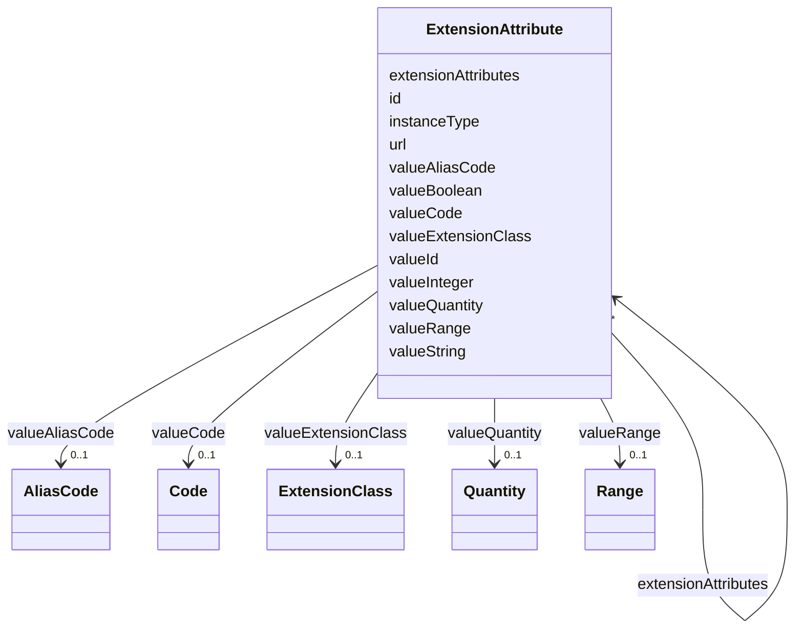

# Class: ExtensionAttribute 


URI: [usdm:ExtensionAttribute](https://www.cdisc.org/usdm/ExtensionAttribute)





<!-- no inheritance hierarchy -->

## Slots

| Name | Cardinality and Range | Description | Inheritance |
| ---  | --- | --- | --- |
| [id](id.md) | 1 <br/> [String](String.md) |  | direct |
| [url](url.md) | 1 <br/> [String](String.md) |  | direct |
| [valueString](valueString.md) | 0..1 <br/> [String](String.md) |  | direct |
| [valueBoolean](valueBoolean.md) | 0..1 <br/> [Boolean](Boolean.md) |  | direct |
| [valueInteger](valueInteger.md) | 0..1 <br/> [Integer](Integer.md) |  | direct |
| [valueId](valueId.md) | 0..1 <br/> [String](String.md) |  | direct |
| [valueQuantity](valueQuantity.md) | 0..1 <br/> [Quantity](Quantity.md) |  | direct |
| [valueRange](valueRange.md) | 0..1 <br/> [Range](Range.md) |  | direct |
| [valueCode](valueCode.md) | 0..1 <br/> [Code](Code.md) |  | direct |
| [valueAliasCode](valueAliasCode.md) | 0..1 <br/> [AliasCode](AliasCode.md) |  | direct |
| [valueExtensionClass](valueExtensionClass.md) | 0..1 <br/> [ExtensionClass](ExtensionClass.md) |  | direct |
| [extensionAttributes](extensionAttributes.md) | * <br/> [ExtensionAttribute](ExtensionAttribute.md) |  | direct |
| [instanceType](instanceType.md) | 1 <br/> [String](String.md) |  | direct |


## Usages

| used by | used in | type | used |
| ---  | --- | --- | --- |
| [Abbreviation](Abbreviation.md) | [extensionAttributes](extensionAttributes.md) | range | [ExtensionAttribute](ExtensionAttribute.md) |
| [Activity](Activity.md) | [extensionAttributes](extensionAttributes.md) | range | [ExtensionAttribute](ExtensionAttribute.md) |
| [Address](Address.md) | [extensionAttributes](extensionAttributes.md) | range | [ExtensionAttribute](ExtensionAttribute.md) |
| [AdministrableProduct](AdministrableProduct.md) | [extensionAttributes](extensionAttributes.md) | range | [ExtensionAttribute](ExtensionAttribute.md) |
| [AdministrableProductIdentifier](AdministrableProductIdentifier.md) | [extensionAttributes](extensionAttributes.md) | range | [ExtensionAttribute](ExtensionAttribute.md) |
| [AdministrableProductProperty](AdministrableProductProperty.md) | [extensionAttributes](extensionAttributes.md) | range | [ExtensionAttribute](ExtensionAttribute.md) |
| [Administration](Administration.md) | [extensionAttributes](extensionAttributes.md) | range | [ExtensionAttribute](ExtensionAttribute.md) |
| [AliasCode](AliasCode.md) | [extensionAttributes](extensionAttributes.md) | range | [ExtensionAttribute](ExtensionAttribute.md) |
| [AnalysisPopulation](AnalysisPopulation.md) | [extensionAttributes](extensionAttributes.md) | range | [ExtensionAttribute](ExtensionAttribute.md) |
| [AssignedPerson](AssignedPerson.md) | [extensionAttributes](extensionAttributes.md) | range | [ExtensionAttribute](ExtensionAttribute.md) |
| [BiomedicalConcept](BiomedicalConcept.md) | [extensionAttributes](extensionAttributes.md) | range | [ExtensionAttribute](ExtensionAttribute.md) |
| [BiomedicalConceptCategory](BiomedicalConceptCategory.md) | [extensionAttributes](extensionAttributes.md) | range | [ExtensionAttribute](ExtensionAttribute.md) |
| [BiomedicalConceptProperty](BiomedicalConceptProperty.md) | [extensionAttributes](extensionAttributes.md) | range | [ExtensionAttribute](ExtensionAttribute.md) |
| [BiomedicalConceptSurrogate](BiomedicalConceptSurrogate.md) | [extensionAttributes](extensionAttributes.md) | range | [ExtensionAttribute](ExtensionAttribute.md) |
| [BiospecimenRetention](BiospecimenRetention.md) | [extensionAttributes](extensionAttributes.md) | range | [ExtensionAttribute](ExtensionAttribute.md) |
| [Characteristic](Characteristic.md) | [extensionAttributes](extensionAttributes.md) | range | [ExtensionAttribute](ExtensionAttribute.md) |
| [Code](Code.md) | [extensionAttributes](extensionAttributes.md) | range | [ExtensionAttribute](ExtensionAttribute.md) |
| [CommentAnnotation](CommentAnnotation.md) | [extensionAttributes](extensionAttributes.md) | range | [ExtensionAttribute](ExtensionAttribute.md) |
| [Condition](Condition.md) | [extensionAttributes](extensionAttributes.md) | range | [ExtensionAttribute](ExtensionAttribute.md) |
| [ConditionAssignment](ConditionAssignment.md) | [extensionAttributes](extensionAttributes.md) | range | [ExtensionAttribute](ExtensionAttribute.md) |
| [DocumentContentReference](DocumentContentReference.md) | [extensionAttributes](extensionAttributes.md) | range | [ExtensionAttribute](ExtensionAttribute.md) |
| [Duration](Duration.md) | [extensionAttributes](extensionAttributes.md) | range | [ExtensionAttribute](ExtensionAttribute.md) |
| [EligibilityCriterion](EligibilityCriterion.md) | [extensionAttributes](extensionAttributes.md) | range | [ExtensionAttribute](ExtensionAttribute.md) |
| [EligibilityCriterionItem](EligibilityCriterionItem.md) | [extensionAttributes](extensionAttributes.md) | range | [ExtensionAttribute](ExtensionAttribute.md) |
| [Encounter](Encounter.md) | [extensionAttributes](extensionAttributes.md) | range | [ExtensionAttribute](ExtensionAttribute.md) |
| [Endpoint](Endpoint.md) | [extensionAttributes](extensionAttributes.md) | range | [ExtensionAttribute](ExtensionAttribute.md) |
| [Estimand](Estimand.md) | [extensionAttributes](extensionAttributes.md) | range | [ExtensionAttribute](ExtensionAttribute.md) |
| [ExtensionAttribute](ExtensionAttribute.md) | [extensionAttributes](extensionAttributes.md) | range | [ExtensionAttribute](ExtensionAttribute.md) |
| [ExtensionClass](ExtensionClass.md) | [extensionAttributes](extensionAttributes.md) | range | [ExtensionAttribute](ExtensionAttribute.md) |
| [GeographicScope](GeographicScope.md) | [extensionAttributes](extensionAttributes.md) | range | [ExtensionAttribute](ExtensionAttribute.md) |
| [GovernanceDate](GovernanceDate.md) | [extensionAttributes](extensionAttributes.md) | range | [ExtensionAttribute](ExtensionAttribute.md) |
| [Indication](Indication.md) | [extensionAttributes](extensionAttributes.md) | range | [ExtensionAttribute](ExtensionAttribute.md) |
| [Ingredient](Ingredient.md) | [extensionAttributes](extensionAttributes.md) | range | [ExtensionAttribute](ExtensionAttribute.md) |
| [IntercurrentEvent](IntercurrentEvent.md) | [extensionAttributes](extensionAttributes.md) | range | [ExtensionAttribute](ExtensionAttribute.md) |
| [InterventionalStudyDesign](InterventionalStudyDesign.md) | [extensionAttributes](extensionAttributes.md) | range | [ExtensionAttribute](ExtensionAttribute.md) |
| [Masking](Masking.md) | [extensionAttributes](extensionAttributes.md) | range | [ExtensionAttribute](ExtensionAttribute.md) |
| [MedicalDevice](MedicalDevice.md) | [extensionAttributes](extensionAttributes.md) | range | [ExtensionAttribute](ExtensionAttribute.md) |
| [MedicalDeviceIdentifier](MedicalDeviceIdentifier.md) | [extensionAttributes](extensionAttributes.md) | range | [ExtensionAttribute](ExtensionAttribute.md) |
| [NarrativeContent](NarrativeContent.md) | [extensionAttributes](extensionAttributes.md) | range | [ExtensionAttribute](ExtensionAttribute.md) |
| [NarrativeContentItem](NarrativeContentItem.md) | [extensionAttributes](extensionAttributes.md) | range | [ExtensionAttribute](ExtensionAttribute.md) |
| [Objective](Objective.md) | [extensionAttributes](extensionAttributes.md) | range | [ExtensionAttribute](ExtensionAttribute.md) |
| [ObservationalStudyDesign](ObservationalStudyDesign.md) | [extensionAttributes](extensionAttributes.md) | range | [ExtensionAttribute](ExtensionAttribute.md) |
| [Organization](Organization.md) | [extensionAttributes](extensionAttributes.md) | range | [ExtensionAttribute](ExtensionAttribute.md) |
| [ParameterMap](ParameterMap.md) | [extensionAttributes](extensionAttributes.md) | range | [ExtensionAttribute](ExtensionAttribute.md) |
| [PersonName](PersonName.md) | [extensionAttributes](extensionAttributes.md) | range | [ExtensionAttribute](ExtensionAttribute.md) |
| [Procedure](Procedure.md) | [extensionAttributes](extensionAttributes.md) | range | [ExtensionAttribute](ExtensionAttribute.md) |
| [ProductOrganizationRole](ProductOrganizationRole.md) | [extensionAttributes](extensionAttributes.md) | range | [ExtensionAttribute](ExtensionAttribute.md) |
| [Quantity](Quantity.md) | [extensionAttributes](extensionAttributes.md) | range | [ExtensionAttribute](ExtensionAttribute.md) |
| [Range](Range.md) | [extensionAttributes](extensionAttributes.md) | range | [ExtensionAttribute](ExtensionAttribute.md) |
| [ReferenceIdentifier](ReferenceIdentifier.md) | [extensionAttributes](extensionAttributes.md) | range | [ExtensionAttribute](ExtensionAttribute.md) |
| [ResponseCode](ResponseCode.md) | [extensionAttributes](extensionAttributes.md) | range | [ExtensionAttribute](ExtensionAttribute.md) |
| [ScheduleTimeline](ScheduleTimeline.md) | [extensionAttributes](extensionAttributes.md) | range | [ExtensionAttribute](ExtensionAttribute.md) |
| [ScheduleTimelineExit](ScheduleTimelineExit.md) | [extensionAttributes](extensionAttributes.md) | range | [ExtensionAttribute](ExtensionAttribute.md) |
| [ScheduledActivityInstance](ScheduledActivityInstance.md) | [extensionAttributes](extensionAttributes.md) | range | [ExtensionAttribute](ExtensionAttribute.md) |
| [ScheduledDecisionInstance](ScheduledDecisionInstance.md) | [extensionAttributes](extensionAttributes.md) | range | [ExtensionAttribute](ExtensionAttribute.md) |
| [Strength](Strength.md) | [extensionAttributes](extensionAttributes.md) | range | [ExtensionAttribute](ExtensionAttribute.md) |
| [Study](Study.md) | [extensionAttributes](extensionAttributes.md) | range | [ExtensionAttribute](ExtensionAttribute.md) |
| [StudyAmendment](StudyAmendment.md) | [extensionAttributes](extensionAttributes.md) | range | [ExtensionAttribute](ExtensionAttribute.md) |
| [StudyAmendmentImpact](StudyAmendmentImpact.md) | [extensionAttributes](extensionAttributes.md) | range | [ExtensionAttribute](ExtensionAttribute.md) |
| [StudyAmendmentReason](StudyAmendmentReason.md) | [extensionAttributes](extensionAttributes.md) | range | [ExtensionAttribute](ExtensionAttribute.md) |
| [StudyArm](StudyArm.md) | [extensionAttributes](extensionAttributes.md) | range | [ExtensionAttribute](ExtensionAttribute.md) |
| [StudyCell](StudyCell.md) | [extensionAttributes](extensionAttributes.md) | range | [ExtensionAttribute](ExtensionAttribute.md) |
| [StudyChange](StudyChange.md) | [extensionAttributes](extensionAttributes.md) | range | [ExtensionAttribute](ExtensionAttribute.md) |
| [StudyCohort](StudyCohort.md) | [extensionAttributes](extensionAttributes.md) | range | [ExtensionAttribute](ExtensionAttribute.md) |
| [StudyDefinitionDocument](StudyDefinitionDocument.md) | [extensionAttributes](extensionAttributes.md) | range | [ExtensionAttribute](ExtensionAttribute.md) |
| [StudyDefinitionDocumentVersion](StudyDefinitionDocumentVersion.md) | [extensionAttributes](extensionAttributes.md) | range | [ExtensionAttribute](ExtensionAttribute.md) |
| [StudyDesignPopulation](StudyDesignPopulation.md) | [extensionAttributes](extensionAttributes.md) | range | [ExtensionAttribute](ExtensionAttribute.md) |
| [StudyElement](StudyElement.md) | [extensionAttributes](extensionAttributes.md) | range | [ExtensionAttribute](ExtensionAttribute.md) |
| [StudyEpoch](StudyEpoch.md) | [extensionAttributes](extensionAttributes.md) | range | [ExtensionAttribute](ExtensionAttribute.md) |
| [StudyIdentifier](StudyIdentifier.md) | [extensionAttributes](extensionAttributes.md) | range | [ExtensionAttribute](ExtensionAttribute.md) |
| [StudyIntervention](StudyIntervention.md) | [extensionAttributes](extensionAttributes.md) | range | [ExtensionAttribute](ExtensionAttribute.md) |
| [StudyRole](StudyRole.md) | [extensionAttributes](extensionAttributes.md) | range | [ExtensionAttribute](ExtensionAttribute.md) |
| [StudySite](StudySite.md) | [extensionAttributes](extensionAttributes.md) | range | [ExtensionAttribute](ExtensionAttribute.md) |
| [StudyTitle](StudyTitle.md) | [extensionAttributes](extensionAttributes.md) | range | [ExtensionAttribute](ExtensionAttribute.md) |
| [StudyVersion](StudyVersion.md) | [extensionAttributes](extensionAttributes.md) | range | [ExtensionAttribute](ExtensionAttribute.md) |
| [SubjectEnrollment](SubjectEnrollment.md) | [extensionAttributes](extensionAttributes.md) | range | [ExtensionAttribute](ExtensionAttribute.md) |
| [Substance](Substance.md) | [extensionAttributes](extensionAttributes.md) | range | [ExtensionAttribute](ExtensionAttribute.md) |
| [SyntaxTemplateDictionary](SyntaxTemplateDictionary.md) | [extensionAttributes](extensionAttributes.md) | range | [ExtensionAttribute](ExtensionAttribute.md) |
| [Timing](Timing.md) | [extensionAttributes](extensionAttributes.md) | range | [ExtensionAttribute](ExtensionAttribute.md) |
| [TransitionRule](TransitionRule.md) | [extensionAttributes](extensionAttributes.md) | range | [ExtensionAttribute](ExtensionAttribute.md) |


## Identifier and Mapping Information


### Schema Source


* from schema: https://www.cdisc.org/usdm


## Mappings

| Mapping Type | Mapped Value |
| ---  | ---  |
| self | usdm:ExtensionAttribute |
| native | usdm:ExtensionAttribute |


## LinkML Source

<!-- TODO: investigate https://stackoverflow.com/questions/37606292/how-to-create-tabbed-code-blocks-in-mkdocs-or-sphinx -->

### Direct

<details>
```yaml
name: ExtensionAttribute
from_schema: https://www.cdisc.org/usdm
attributes:
  id:
    name: id
    from_schema: https://www.cdisc.org/usdm
    identifier: true
    domain_of:
    - Abbreviation
    - Activity
    - Address
    - AdministrableProduct
    - AdministrableProductIdentifier
    - AdministrableProductProperty
    - Administration
    - AliasCode
    - AnalysisPopulation
    - AssignedPerson
    - BiomedicalConcept
    - BiomedicalConceptCategory
    - BiomedicalConceptProperty
    - BiomedicalConceptSurrogate
    - BiospecimenRetention
    - Characteristic
    - Code
    - CommentAnnotation
    - Condition
    - ConditionAssignment
    - DocumentContentReference
    - Duration
    - EligibilityCriterion
    - EligibilityCriterionItem
    - Encounter
    - Endpoint
    - Estimand
    - ExtensionAttribute
    - ExtensionClass
    - GeographicScope
    - GovernanceDate
    - Indication
    - Ingredient
    - IntercurrentEvent
    - InterventionalStudyDesign
    - Masking
    - MedicalDevice
    - MedicalDeviceIdentifier
    - NarrativeContent
    - NarrativeContentItem
    - Objective
    - ObservationalStudyDesign
    - Organization
    - ParameterMap
    - PersonName
    - Procedure
    - ProductOrganizationRole
    - Quantity
    - Range
    - ReferenceIdentifier
    - ResponseCode
    - ScheduleTimeline
    - ScheduleTimelineExit
    - ScheduledActivityInstance
    - ScheduledDecisionInstance
    - Strength
    - Study
    - StudyAmendment
    - StudyAmendmentImpact
    - StudyAmendmentReason
    - StudyArm
    - StudyCell
    - StudyChange
    - StudyCohort
    - StudyDefinitionDocument
    - StudyDefinitionDocumentVersion
    - StudyDesignPopulation
    - StudyElement
    - StudyEpoch
    - StudyIdentifier
    - StudyIntervention
    - StudyRole
    - StudySite
    - StudyTitle
    - StudyVersion
    - SubjectEnrollment
    - Substance
    - SyntaxTemplateDictionary
    - Timing
    - TransitionRule
    range: string
    required: true
    pattern: ^[\s\S]+$
  url:
    name: url
    from_schema: https://www.cdisc.org/usdm
    rank: 1000
    domain_of:
    - ExtensionAttribute
    - ExtensionClass
    range: string
    required: true
  valueString:
    name: valueString
    from_schema: https://www.cdisc.org/usdm
    rank: 1000
    domain_of:
    - ExtensionAttribute
    range: string
    required: false
  valueBoolean:
    name: valueBoolean
    from_schema: https://www.cdisc.org/usdm
    rank: 1000
    domain_of:
    - ExtensionAttribute
    range: boolean
    required: false
  valueInteger:
    name: valueInteger
    from_schema: https://www.cdisc.org/usdm
    rank: 1000
    domain_of:
    - ExtensionAttribute
    range: integer
    required: false
  valueId:
    name: valueId
    from_schema: https://www.cdisc.org/usdm
    rank: 1000
    domain_of:
    - ExtensionAttribute
    range: string
    required: false
  valueQuantity:
    name: valueQuantity
    from_schema: https://www.cdisc.org/usdm
    rank: 1000
    domain_of:
    - ExtensionAttribute
    range: Quantity
    required: false
    inlined: true
  valueRange:
    name: valueRange
    from_schema: https://www.cdisc.org/usdm
    rank: 1000
    domain_of:
    - ExtensionAttribute
    range: Range
    required: false
    inlined: true
  valueCode:
    name: valueCode
    from_schema: https://www.cdisc.org/usdm
    rank: 1000
    domain_of:
    - ExtensionAttribute
    range: Code
    required: false
    inlined: true
  valueAliasCode:
    name: valueAliasCode
    from_schema: https://www.cdisc.org/usdm
    rank: 1000
    domain_of:
    - ExtensionAttribute
    range: AliasCode
    required: false
    inlined: true
  valueExtensionClass:
    name: valueExtensionClass
    from_schema: https://www.cdisc.org/usdm
    rank: 1000
    domain_of:
    - ExtensionAttribute
    range: ExtensionClass
    required: false
    inlined: true
  extensionAttributes:
    name: extensionAttributes
    from_schema: https://www.cdisc.org/usdm
    domain_of:
    - Abbreviation
    - Activity
    - Address
    - AdministrableProduct
    - AdministrableProductIdentifier
    - AdministrableProductProperty
    - Administration
    - AliasCode
    - AnalysisPopulation
    - AssignedPerson
    - BiomedicalConcept
    - BiomedicalConceptCategory
    - BiomedicalConceptProperty
    - BiomedicalConceptSurrogate
    - BiospecimenRetention
    - Characteristic
    - Code
    - CommentAnnotation
    - Condition
    - ConditionAssignment
    - DocumentContentReference
    - Duration
    - EligibilityCriterion
    - EligibilityCriterionItem
    - Encounter
    - Endpoint
    - Estimand
    - ExtensionAttribute
    - ExtensionClass
    - GeographicScope
    - GovernanceDate
    - Indication
    - Ingredient
    - IntercurrentEvent
    - InterventionalStudyDesign
    - Masking
    - MedicalDevice
    - MedicalDeviceIdentifier
    - NarrativeContent
    - NarrativeContentItem
    - Objective
    - ObservationalStudyDesign
    - Organization
    - ParameterMap
    - PersonName
    - Procedure
    - ProductOrganizationRole
    - Quantity
    - Range
    - ReferenceIdentifier
    - ResponseCode
    - ScheduleTimeline
    - ScheduleTimelineExit
    - ScheduledActivityInstance
    - ScheduledDecisionInstance
    - Strength
    - Study
    - StudyAmendment
    - StudyAmendmentImpact
    - StudyAmendmentReason
    - StudyArm
    - StudyCell
    - StudyChange
    - StudyCohort
    - StudyDefinitionDocument
    - StudyDefinitionDocumentVersion
    - StudyDesignPopulation
    - StudyElement
    - StudyEpoch
    - StudyIdentifier
    - StudyIntervention
    - StudyRole
    - StudySite
    - StudyTitle
    - StudyVersion
    - SubjectEnrollment
    - Substance
    - SyntaxTemplateDictionary
    - Timing
    - TransitionRule
    range: ExtensionAttribute
    required: false
    multivalued: true
    inlined: true
    inlined_as_list: true
  instanceType:
    name: instanceType
    from_schema: https://www.cdisc.org/usdm
    designates_type: true
    domain_of:
    - Abbreviation
    - Activity
    - Address
    - AdministrableProduct
    - AdministrableProductIdentifier
    - AdministrableProductProperty
    - Administration
    - AliasCode
    - AnalysisPopulation
    - AssignedPerson
    - BiomedicalConcept
    - BiomedicalConceptCategory
    - BiomedicalConceptProperty
    - BiomedicalConceptSurrogate
    - BiospecimenRetention
    - Characteristic
    - Code
    - CommentAnnotation
    - Condition
    - ConditionAssignment
    - DocumentContentReference
    - Duration
    - EligibilityCriterion
    - EligibilityCriterionItem
    - Encounter
    - Endpoint
    - Estimand
    - ExtensionAttribute
    - ExtensionClass
    - GeographicScope
    - GovernanceDate
    - Indication
    - Ingredient
    - IntercurrentEvent
    - InterventionalStudyDesign
    - Masking
    - MedicalDevice
    - MedicalDeviceIdentifier
    - NarrativeContent
    - NarrativeContentItem
    - Objective
    - ObservationalStudyDesign
    - Organization
    - ParameterMap
    - PersonName
    - Procedure
    - ProductOrganizationRole
    - Quantity
    - Range
    - ReferenceIdentifier
    - ResponseCode
    - ScheduleTimeline
    - ScheduleTimelineExit
    - ScheduledActivityInstance
    - ScheduledDecisionInstance
    - Strength
    - Study
    - StudyAmendment
    - StudyAmendmentImpact
    - StudyAmendmentReason
    - StudyArm
    - StudyCell
    - StudyChange
    - StudyCohort
    - StudyDefinitionDocument
    - StudyDefinitionDocumentVersion
    - StudyDesignPopulation
    - StudyElement
    - StudyEpoch
    - StudyIdentifier
    - StudyIntervention
    - StudyRole
    - StudySite
    - StudyTitle
    - StudyVersion
    - SubjectEnrollment
    - Substance
    - SyntaxTemplateDictionary
    - Timing
    - TransitionRule
    range: string
    required: true
    equals_string: ExtensionAttribute

```
</details>

### Induced

<details>
```yaml
name: ExtensionAttribute
from_schema: https://www.cdisc.org/usdm
attributes:
  id:
    name: id
    from_schema: https://www.cdisc.org/usdm
    identifier: true
    alias: id
    owner: ExtensionAttribute
    domain_of:
    - Abbreviation
    - Activity
    - Address
    - AdministrableProduct
    - AdministrableProductIdentifier
    - AdministrableProductProperty
    - Administration
    - AliasCode
    - AnalysisPopulation
    - AssignedPerson
    - BiomedicalConcept
    - BiomedicalConceptCategory
    - BiomedicalConceptProperty
    - BiomedicalConceptSurrogate
    - BiospecimenRetention
    - Characteristic
    - Code
    - CommentAnnotation
    - Condition
    - ConditionAssignment
    - DocumentContentReference
    - Duration
    - EligibilityCriterion
    - EligibilityCriterionItem
    - Encounter
    - Endpoint
    - Estimand
    - ExtensionAttribute
    - ExtensionClass
    - GeographicScope
    - GovernanceDate
    - Indication
    - Ingredient
    - IntercurrentEvent
    - InterventionalStudyDesign
    - Masking
    - MedicalDevice
    - MedicalDeviceIdentifier
    - NarrativeContent
    - NarrativeContentItem
    - Objective
    - ObservationalStudyDesign
    - Organization
    - ParameterMap
    - PersonName
    - Procedure
    - ProductOrganizationRole
    - Quantity
    - Range
    - ReferenceIdentifier
    - ResponseCode
    - ScheduleTimeline
    - ScheduleTimelineExit
    - ScheduledActivityInstance
    - ScheduledDecisionInstance
    - Strength
    - Study
    - StudyAmendment
    - StudyAmendmentImpact
    - StudyAmendmentReason
    - StudyArm
    - StudyCell
    - StudyChange
    - StudyCohort
    - StudyDefinitionDocument
    - StudyDefinitionDocumentVersion
    - StudyDesignPopulation
    - StudyElement
    - StudyEpoch
    - StudyIdentifier
    - StudyIntervention
    - StudyRole
    - StudySite
    - StudyTitle
    - StudyVersion
    - SubjectEnrollment
    - Substance
    - SyntaxTemplateDictionary
    - Timing
    - TransitionRule
    range: string
    required: true
    pattern: ^[\s\S]+$
  url:
    name: url
    from_schema: https://www.cdisc.org/usdm
    rank: 1000
    alias: url
    owner: ExtensionAttribute
    domain_of:
    - ExtensionAttribute
    - ExtensionClass
    range: string
    required: true
  valueString:
    name: valueString
    from_schema: https://www.cdisc.org/usdm
    rank: 1000
    alias: valueString
    owner: ExtensionAttribute
    domain_of:
    - ExtensionAttribute
    range: string
    required: false
  valueBoolean:
    name: valueBoolean
    from_schema: https://www.cdisc.org/usdm
    rank: 1000
    alias: valueBoolean
    owner: ExtensionAttribute
    domain_of:
    - ExtensionAttribute
    range: boolean
    required: false
  valueInteger:
    name: valueInteger
    from_schema: https://www.cdisc.org/usdm
    rank: 1000
    alias: valueInteger
    owner: ExtensionAttribute
    domain_of:
    - ExtensionAttribute
    range: integer
    required: false
  valueId:
    name: valueId
    from_schema: https://www.cdisc.org/usdm
    rank: 1000
    alias: valueId
    owner: ExtensionAttribute
    domain_of:
    - ExtensionAttribute
    range: string
    required: false
  valueQuantity:
    name: valueQuantity
    from_schema: https://www.cdisc.org/usdm
    rank: 1000
    alias: valueQuantity
    owner: ExtensionAttribute
    domain_of:
    - ExtensionAttribute
    range: Quantity
    required: false
    inlined: true
  valueRange:
    name: valueRange
    from_schema: https://www.cdisc.org/usdm
    rank: 1000
    alias: valueRange
    owner: ExtensionAttribute
    domain_of:
    - ExtensionAttribute
    range: Range
    required: false
    inlined: true
  valueCode:
    name: valueCode
    from_schema: https://www.cdisc.org/usdm
    rank: 1000
    alias: valueCode
    owner: ExtensionAttribute
    domain_of:
    - ExtensionAttribute
    range: Code
    required: false
    inlined: true
  valueAliasCode:
    name: valueAliasCode
    from_schema: https://www.cdisc.org/usdm
    rank: 1000
    alias: valueAliasCode
    owner: ExtensionAttribute
    domain_of:
    - ExtensionAttribute
    range: AliasCode
    required: false
    inlined: true
  valueExtensionClass:
    name: valueExtensionClass
    from_schema: https://www.cdisc.org/usdm
    rank: 1000
    alias: valueExtensionClass
    owner: ExtensionAttribute
    domain_of:
    - ExtensionAttribute
    range: ExtensionClass
    required: false
    inlined: true
  extensionAttributes:
    name: extensionAttributes
    from_schema: https://www.cdisc.org/usdm
    alias: extensionAttributes
    owner: ExtensionAttribute
    domain_of:
    - Abbreviation
    - Activity
    - Address
    - AdministrableProduct
    - AdministrableProductIdentifier
    - AdministrableProductProperty
    - Administration
    - AliasCode
    - AnalysisPopulation
    - AssignedPerson
    - BiomedicalConcept
    - BiomedicalConceptCategory
    - BiomedicalConceptProperty
    - BiomedicalConceptSurrogate
    - BiospecimenRetention
    - Characteristic
    - Code
    - CommentAnnotation
    - Condition
    - ConditionAssignment
    - DocumentContentReference
    - Duration
    - EligibilityCriterion
    - EligibilityCriterionItem
    - Encounter
    - Endpoint
    - Estimand
    - ExtensionAttribute
    - ExtensionClass
    - GeographicScope
    - GovernanceDate
    - Indication
    - Ingredient
    - IntercurrentEvent
    - InterventionalStudyDesign
    - Masking
    - MedicalDevice
    - MedicalDeviceIdentifier
    - NarrativeContent
    - NarrativeContentItem
    - Objective
    - ObservationalStudyDesign
    - Organization
    - ParameterMap
    - PersonName
    - Procedure
    - ProductOrganizationRole
    - Quantity
    - Range
    - ReferenceIdentifier
    - ResponseCode
    - ScheduleTimeline
    - ScheduleTimelineExit
    - ScheduledActivityInstance
    - ScheduledDecisionInstance
    - Strength
    - Study
    - StudyAmendment
    - StudyAmendmentImpact
    - StudyAmendmentReason
    - StudyArm
    - StudyCell
    - StudyChange
    - StudyCohort
    - StudyDefinitionDocument
    - StudyDefinitionDocumentVersion
    - StudyDesignPopulation
    - StudyElement
    - StudyEpoch
    - StudyIdentifier
    - StudyIntervention
    - StudyRole
    - StudySite
    - StudyTitle
    - StudyVersion
    - SubjectEnrollment
    - Substance
    - SyntaxTemplateDictionary
    - Timing
    - TransitionRule
    range: ExtensionAttribute
    required: false
    multivalued: true
    inlined: true
    inlined_as_list: true
  instanceType:
    name: instanceType
    from_schema: https://www.cdisc.org/usdm
    designates_type: true
    alias: instanceType
    owner: ExtensionAttribute
    domain_of:
    - Abbreviation
    - Activity
    - Address
    - AdministrableProduct
    - AdministrableProductIdentifier
    - AdministrableProductProperty
    - Administration
    - AliasCode
    - AnalysisPopulation
    - AssignedPerson
    - BiomedicalConcept
    - BiomedicalConceptCategory
    - BiomedicalConceptProperty
    - BiomedicalConceptSurrogate
    - BiospecimenRetention
    - Characteristic
    - Code
    - CommentAnnotation
    - Condition
    - ConditionAssignment
    - DocumentContentReference
    - Duration
    - EligibilityCriterion
    - EligibilityCriterionItem
    - Encounter
    - Endpoint
    - Estimand
    - ExtensionAttribute
    - ExtensionClass
    - GeographicScope
    - GovernanceDate
    - Indication
    - Ingredient
    - IntercurrentEvent
    - InterventionalStudyDesign
    - Masking
    - MedicalDevice
    - MedicalDeviceIdentifier
    - NarrativeContent
    - NarrativeContentItem
    - Objective
    - ObservationalStudyDesign
    - Organization
    - ParameterMap
    - PersonName
    - Procedure
    - ProductOrganizationRole
    - Quantity
    - Range
    - ReferenceIdentifier
    - ResponseCode
    - ScheduleTimeline
    - ScheduleTimelineExit
    - ScheduledActivityInstance
    - ScheduledDecisionInstance
    - Strength
    - Study
    - StudyAmendment
    - StudyAmendmentImpact
    - StudyAmendmentReason
    - StudyArm
    - StudyCell
    - StudyChange
    - StudyCohort
    - StudyDefinitionDocument
    - StudyDefinitionDocumentVersion
    - StudyDesignPopulation
    - StudyElement
    - StudyEpoch
    - StudyIdentifier
    - StudyIntervention
    - StudyRole
    - StudySite
    - StudyTitle
    - StudyVersion
    - SubjectEnrollment
    - Substance
    - SyntaxTemplateDictionary
    - Timing
    - TransitionRule
    range: string
    required: true
    equals_string: ExtensionAttribute

```
</details>