# Class: ObservationalStudyDesign 


URI: [usdm:ObservationalStudyDesign](https://www.cdisc.org/usdm/ObservationalStudyDesign)

```mermaid
 classDiagram
    class ObservationalStudyDesign
    click ObservationalStudyDesign href "../ObservationalStudyDesign/"
      ObservationalStudyDesign : activities
        
          
    
        
        
        ObservationalStudyDesign --> "*" Activity : activities
        click Activity href "../Activity/"
    

        
      ObservationalStudyDesign : analysisPopulations
        
          
    
        
        
        ObservationalStudyDesign --> "*" AnalysisPopulation : analysisPopulations
        click AnalysisPopulation href "../AnalysisPopulation/"
    

        
      ObservationalStudyDesign : arms
        
          
    
        
        
        ObservationalStudyDesign --> "1..*" StudyArm : arms
        click StudyArm href "../StudyArm/"
    

        
      ObservationalStudyDesign : biospecimenRetentions
        
          
    
        
        
        ObservationalStudyDesign --> "*" BiospecimenRetention : biospecimenRetentions
        click BiospecimenRetention href "../BiospecimenRetention/"
    

        
      ObservationalStudyDesign : characteristics
        
          
    
        
        
        ObservationalStudyDesign --> "*" Code : characteristics
        click Code href "../Code/"
    

        
      ObservationalStudyDesign : description
        
      ObservationalStudyDesign : documentVersionIds
        
      ObservationalStudyDesign : elements
        
          
    
        
        
        ObservationalStudyDesign --> "*" StudyElement : elements
        click StudyElement href "../StudyElement/"
    

        
      ObservationalStudyDesign : eligibilityCriteria
        
          
    
        
        
        ObservationalStudyDesign --> "1..*" EligibilityCriterion : eligibilityCriteria
        click EligibilityCriterion href "../EligibilityCriterion/"
    

        
      ObservationalStudyDesign : encounters
        
          
    
        
        
        ObservationalStudyDesign --> "*" Encounter : encounters
        click Encounter href "../Encounter/"
    

        
      ObservationalStudyDesign : epochs
        
          
    
        
        
        ObservationalStudyDesign --> "1..*" StudyEpoch : epochs
        click StudyEpoch href "../StudyEpoch/"
    

        
      ObservationalStudyDesign : estimands
        
          
    
        
        
        ObservationalStudyDesign --> "*" Estimand : estimands
        click Estimand href "../Estimand/"
    

        
      ObservationalStudyDesign : extensionAttributes
        
          
    
        
        
        ObservationalStudyDesign --> "*" ExtensionAttribute : extensionAttributes
        click ExtensionAttribute href "../ExtensionAttribute/"
    

        
      ObservationalStudyDesign : id
        
      ObservationalStudyDesign : indications
        
          
    
        
        
        ObservationalStudyDesign --> "*" Indication : indications
        click Indication href "../Indication/"
    

        
      ObservationalStudyDesign : instanceType
        
      ObservationalStudyDesign : label
        
      ObservationalStudyDesign : model
        
          
    
        
        
        ObservationalStudyDesign --> "1" Code : model
        click Code href "../Code/"
    

        
      ObservationalStudyDesign : name
        
      ObservationalStudyDesign : notes
        
          
    
        
        
        ObservationalStudyDesign --> "*" CommentAnnotation : notes
        click CommentAnnotation href "../CommentAnnotation/"
    

        
      ObservationalStudyDesign : objectives
        
          
    
        
        
        ObservationalStudyDesign --> "*" Objective : objectives
        click Objective href "../Objective/"
    

        
      ObservationalStudyDesign : population
        
          
    
        
        
        ObservationalStudyDesign --> "1" StudyDesignPopulation : population
        click StudyDesignPopulation href "../StudyDesignPopulation/"
    

        
      ObservationalStudyDesign : rationale
        
      ObservationalStudyDesign : samplingMethod
        
          
    
        
        
        ObservationalStudyDesign --> "0..1" Code : samplingMethod
        click Code href "../Code/"
    

        
      ObservationalStudyDesign : scheduleTimelines
        
          
    
        
        
        ObservationalStudyDesign --> "*" ScheduleTimeline : scheduleTimelines
        click ScheduleTimeline href "../ScheduleTimeline/"
    

        
      ObservationalStudyDesign : studyCells
        
          
    
        
        
        ObservationalStudyDesign --> "1..*" StudyCell : studyCells
        click StudyCell href "../StudyCell/"
    

        
      ObservationalStudyDesign : studyInterventionIds
        
      ObservationalStudyDesign : studyPhase
        
          
    
        
        
        ObservationalStudyDesign --> "0..1" AliasCode : studyPhase
        click AliasCode href "../AliasCode/"
    

        
      ObservationalStudyDesign : studyType
        
          
    
        
        
        ObservationalStudyDesign --> "0..1" Code : studyType
        click Code href "../Code/"
    

        
      ObservationalStudyDesign : subTypes
        
          
    
        
        
        ObservationalStudyDesign --> "*" Code : subTypes
        click Code href "../Code/"
    

        
      ObservationalStudyDesign : therapeuticAreas
        
          
    
        
        
        ObservationalStudyDesign --> "*" Code : therapeuticAreas
        click Code href "../Code/"
    

        
      ObservationalStudyDesign : timePerspective
        
          
    
        
        
        ObservationalStudyDesign --> "1" Code : timePerspective
        click Code href "../Code/"
    

        
      
```





<!-- no inheritance hierarchy -->

## Slots

| Name | Cardinality and Range | Description | Inheritance |
| ---  | --- | --- | --- |
| [id](id.md) | 1 <br/> [String](String.md) |  | direct |
| [extensionAttributes](extensionAttributes.md) | * <br/> [ExtensionAttribute](ExtensionAttribute.md) |  | direct |
| [name](name.md) | 1 <br/> [String](String.md) |  | direct |
| [label](label.md) | 0..1 <br/> [String](String.md) |  | direct |
| [description](description.md) | 0..1 <br/> [String](String.md) |  | direct |
| [studyType](studyType.md) | 0..1 <br/> [Code](Code.md) |  | direct |
| [studyPhase](studyPhase.md) | 0..1 <br/> [AliasCode](AliasCode.md) |  | direct |
| [therapeuticAreas](therapeuticAreas.md) | * <br/> [Code](Code.md) |  | direct |
| [characteristics](characteristics.md) | * <br/> [Code](Code.md) |  | direct |
| [encounters](encounters.md) | * <br/> [Encounter](Encounter.md) |  | direct |
| [activities](activities.md) | * <br/> [Activity](Activity.md) |  | direct |
| [arms](arms.md) | 1..* <br/> [StudyArm](StudyArm.md) |  | direct |
| [studyCells](studyCells.md) | 1..* <br/> [StudyCell](StudyCell.md) |  | direct |
| [rationale](rationale.md) | 1 <br/> [String](String.md) |  | direct |
| [epochs](epochs.md) | 1..* <br/> [StudyEpoch](StudyEpoch.md) |  | direct |
| [elements](elements.md) | * <br/> [StudyElement](StudyElement.md) |  | direct |
| [estimands](estimands.md) | * <br/> [Estimand](Estimand.md) |  | direct |
| [indications](indications.md) | * <br/> [Indication](Indication.md) |  | direct |
| [studyInterventionIds](studyInterventionIds.md) | * <br/> [String](String.md) |  | direct |
| [objectives](objectives.md) | * <br/> [Objective](Objective.md) |  | direct |
| [population](population.md) | 1 <br/> [StudyDesignPopulation](StudyDesignPopulation.md) |  | direct |
| [scheduleTimelines](scheduleTimelines.md) | * <br/> [ScheduleTimeline](ScheduleTimeline.md) |  | direct |
| [biospecimenRetentions](biospecimenRetentions.md) | * <br/> [BiospecimenRetention](BiospecimenRetention.md) |  | direct |
| [documentVersionIds](documentVersionIds.md) | * <br/> [String](String.md) |  | direct |
| [eligibilityCriteria](eligibilityCriteria.md) | 1..* <br/> [EligibilityCriterion](EligibilityCriterion.md) |  | direct |
| [analysisPopulations](analysisPopulations.md) | * <br/> [AnalysisPopulation](AnalysisPopulation.md) |  | direct |
| [notes](notes.md) | * <br/> [CommentAnnotation](CommentAnnotation.md) |  | direct |
| [subTypes](subTypes.md) | * <br/> [Code](Code.md) |  | direct |
| [model](model.md) | 1 <br/> [Code](Code.md) |  | direct |
| [timePerspective](timePerspective.md) | 1 <br/> [Code](Code.md) |  | direct |
| [samplingMethod](samplingMethod.md) | 0..1 <br/> [Code](Code.md) |  | direct |
| [instanceType](instanceType.md) | 1 <br/> [String](String.md) |  | direct |


## Usages

| used by | used in | type | used |
| ---  | --- | --- | --- |
| [StudyVersion](StudyVersion.md) | [studyDesigns](studyDesigns.md) | any_of[range] | [ObservationalStudyDesign](ObservationalStudyDesign.md) |


## Identifier and Mapping Information


### Schema Source


* from schema: https://www.cdisc.org/usdm


## Mappings

| Mapping Type | Mapped Value |
| ---  | ---  |
| self | usdm:ObservationalStudyDesign |
| native | usdm:ObservationalStudyDesign |


## LinkML Source

<!-- TODO: investigate https://stackoverflow.com/questions/37606292/how-to-create-tabbed-code-blocks-in-mkdocs-or-sphinx -->

### Direct

<details>
```yaml
name: ObservationalStudyDesign
from_schema: https://www.cdisc.org/usdm
attributes:
  id:
    name: id
    from_schema: https://www.cdisc.org/usdm
    identifier: true
    domain_of:
    - Abbreviation
    - Activity
    - Address
    - AdministrableProduct
    - AdministrableProductIdentifier
    - AdministrableProductProperty
    - Administration
    - AliasCode
    - AnalysisPopulation
    - AssignedPerson
    - BiomedicalConcept
    - BiomedicalConceptCategory
    - BiomedicalConceptProperty
    - BiomedicalConceptSurrogate
    - BiospecimenRetention
    - Characteristic
    - Code
    - CommentAnnotation
    - Condition
    - ConditionAssignment
    - DocumentContentReference
    - Duration
    - EligibilityCriterion
    - EligibilityCriterionItem
    - Encounter
    - Endpoint
    - Estimand
    - ExtensionAttribute
    - ExtensionClass
    - GeographicScope
    - GovernanceDate
    - Indication
    - Ingredient
    - IntercurrentEvent
    - InterventionalStudyDesign
    - Masking
    - MedicalDevice
    - MedicalDeviceIdentifier
    - NarrativeContent
    - NarrativeContentItem
    - Objective
    - ObservationalStudyDesign
    - Organization
    - ParameterMap
    - PersonName
    - Procedure
    - ProductOrganizationRole
    - Quantity
    - Range
    - ReferenceIdentifier
    - ResponseCode
    - ScheduleTimeline
    - ScheduleTimelineExit
    - ScheduledActivityInstance
    - ScheduledDecisionInstance
    - Strength
    - Study
    - StudyAmendment
    - StudyAmendmentImpact
    - StudyAmendmentReason
    - StudyArm
    - StudyCell
    - StudyChange
    - StudyCohort
    - StudyDefinitionDocument
    - StudyDefinitionDocumentVersion
    - StudyDesignPopulation
    - StudyElement
    - StudyEpoch
    - StudyIdentifier
    - StudyIntervention
    - StudyRole
    - StudySite
    - StudyTitle
    - StudyVersion
    - SubjectEnrollment
    - Substance
    - SyntaxTemplateDictionary
    - Timing
    - TransitionRule
    range: string
    required: true
    pattern: ^[\s\S]+$
  extensionAttributes:
    name: extensionAttributes
    from_schema: https://www.cdisc.org/usdm
    domain_of:
    - Abbreviation
    - Activity
    - Address
    - AdministrableProduct
    - AdministrableProductIdentifier
    - AdministrableProductProperty
    - Administration
    - AliasCode
    - AnalysisPopulation
    - AssignedPerson
    - BiomedicalConcept
    - BiomedicalConceptCategory
    - BiomedicalConceptProperty
    - BiomedicalConceptSurrogate
    - BiospecimenRetention
    - Characteristic
    - Code
    - CommentAnnotation
    - Condition
    - ConditionAssignment
    - DocumentContentReference
    - Duration
    - EligibilityCriterion
    - EligibilityCriterionItem
    - Encounter
    - Endpoint
    - Estimand
    - ExtensionAttribute
    - ExtensionClass
    - GeographicScope
    - GovernanceDate
    - Indication
    - Ingredient
    - IntercurrentEvent
    - InterventionalStudyDesign
    - Masking
    - MedicalDevice
    - MedicalDeviceIdentifier
    - NarrativeContent
    - NarrativeContentItem
    - Objective
    - ObservationalStudyDesign
    - Organization
    - ParameterMap
    - PersonName
    - Procedure
    - ProductOrganizationRole
    - Quantity
    - Range
    - ReferenceIdentifier
    - ResponseCode
    - ScheduleTimeline
    - ScheduleTimelineExit
    - ScheduledActivityInstance
    - ScheduledDecisionInstance
    - Strength
    - Study
    - StudyAmendment
    - StudyAmendmentImpact
    - StudyAmendmentReason
    - StudyArm
    - StudyCell
    - StudyChange
    - StudyCohort
    - StudyDefinitionDocument
    - StudyDefinitionDocumentVersion
    - StudyDesignPopulation
    - StudyElement
    - StudyEpoch
    - StudyIdentifier
    - StudyIntervention
    - StudyRole
    - StudySite
    - StudyTitle
    - StudyVersion
    - SubjectEnrollment
    - Substance
    - SyntaxTemplateDictionary
    - Timing
    - TransitionRule
    range: ExtensionAttribute
    required: false
    multivalued: true
    inlined: true
    inlined_as_list: true
  name:
    name: name
    from_schema: https://www.cdisc.org/usdm
    domain_of:
    - Activity
    - AdministrableProduct
    - AdministrableProductProperty
    - Administration
    - AnalysisPopulation
    - AssignedPerson
    - BiomedicalConcept
    - BiomedicalConceptCategory
    - BiomedicalConceptProperty
    - BiomedicalConceptSurrogate
    - BiospecimenRetention
    - Characteristic
    - Condition
    - EligibilityCriterion
    - EligibilityCriterionItem
    - Encounter
    - Endpoint
    - Estimand
    - GovernanceDate
    - Indication
    - IntercurrentEvent
    - InterventionalStudyDesign
    - MedicalDevice
    - NarrativeContent
    - NarrativeContentItem
    - Objective
    - ObservationalStudyDesign
    - Organization
    - Procedure
    - ProductOrganizationRole
    - ResponseCode
    - ScheduleTimeline
    - ScheduledActivityInstance
    - ScheduledDecisionInstance
    - Strength
    - Study
    - StudyAmendment
    - StudyArm
    - StudyChange
    - StudyCohort
    - StudyDefinitionDocument
    - StudyDesignPopulation
    - StudyElement
    - StudyEpoch
    - StudyIntervention
    - StudyRole
    - StudySite
    - SubjectEnrollment
    - Substance
    - SyntaxTemplateDictionary
    - Timing
    - TransitionRule
    range: string
    required: true
    pattern: ^[\s\S]+$
  label:
    name: label
    from_schema: https://www.cdisc.org/usdm
    domain_of:
    - Activity
    - AdministrableProduct
    - Administration
    - AnalysisPopulation
    - AssignedPerson
    - BiomedicalConcept
    - BiomedicalConceptCategory
    - BiomedicalConceptProperty
    - BiomedicalConceptSurrogate
    - BiospecimenRetention
    - Characteristic
    - Condition
    - EligibilityCriterion
    - EligibilityCriterionItem
    - Encounter
    - Endpoint
    - Estimand
    - GovernanceDate
    - Indication
    - IntercurrentEvent
    - InterventionalStudyDesign
    - MedicalDevice
    - Objective
    - ObservationalStudyDesign
    - Organization
    - Procedure
    - ProductOrganizationRole
    - ResponseCode
    - ScheduleTimeline
    - ScheduledActivityInstance
    - ScheduledDecisionInstance
    - Strength
    - Study
    - StudyAmendment
    - StudyArm
    - StudyChange
    - StudyCohort
    - StudyDefinitionDocument
    - StudyDesignPopulation
    - StudyElement
    - StudyEpoch
    - StudyIntervention
    - StudyRole
    - StudySite
    - SubjectEnrollment
    - Substance
    - SyntaxTemplateDictionary
    - Timing
    - TransitionRule
    range: string
    required: false
  description:
    name: description
    from_schema: https://www.cdisc.org/usdm
    domain_of:
    - Activity
    - AdministrableProduct
    - Administration
    - AnalysisPopulation
    - AssignedPerson
    - BiomedicalConceptCategory
    - BiomedicalConceptSurrogate
    - BiospecimenRetention
    - Characteristic
    - Condition
    - EligibilityCriterion
    - EligibilityCriterionItem
    - Encounter
    - Endpoint
    - Estimand
    - GovernanceDate
    - Indication
    - IntercurrentEvent
    - InterventionalStudyDesign
    - MedicalDevice
    - Objective
    - ObservationalStudyDesign
    - Procedure
    - ProductOrganizationRole
    - ScheduleTimeline
    - ScheduledActivityInstance
    - ScheduledDecisionInstance
    - Strength
    - Study
    - StudyAmendment
    - StudyArm
    - StudyChange
    - StudyCohort
    - StudyDefinitionDocument
    - StudyDesignPopulation
    - StudyElement
    - StudyEpoch
    - StudyIntervention
    - StudyRole
    - StudySite
    - SubjectEnrollment
    - Substance
    - SyntaxTemplateDictionary
    - Timing
    - TransitionRule
    range: string
    required: false
  studyType:
    name: studyType
    from_schema: https://www.cdisc.org/usdm
    domain_of:
    - InterventionalStudyDesign
    - ObservationalStudyDesign
    range: Code
    required: false
    inlined: true
  studyPhase:
    name: studyPhase
    from_schema: https://www.cdisc.org/usdm
    domain_of:
    - InterventionalStudyDesign
    - ObservationalStudyDesign
    range: AliasCode
    required: false
    inlined: true
  therapeuticAreas:
    name: therapeuticAreas
    from_schema: https://www.cdisc.org/usdm
    domain_of:
    - InterventionalStudyDesign
    - ObservationalStudyDesign
    range: Code
    required: false
    multivalued: true
    inlined: true
    inlined_as_list: true
  characteristics:
    name: characteristics
    from_schema: https://www.cdisc.org/usdm
    domain_of:
    - InterventionalStudyDesign
    - ObservationalStudyDesign
    - StudyCohort
    range: Code
    required: false
    multivalued: true
    inlined: true
    inlined_as_list: true
  encounters:
    name: encounters
    from_schema: https://www.cdisc.org/usdm
    domain_of:
    - InterventionalStudyDesign
    - ObservationalStudyDesign
    range: Encounter
    required: false
    multivalued: true
    inlined: true
    inlined_as_list: true
  activities:
    name: activities
    from_schema: https://www.cdisc.org/usdm
    domain_of:
    - InterventionalStudyDesign
    - ObservationalStudyDesign
    range: Activity
    required: false
    multivalued: true
    inlined: true
    inlined_as_list: true
  arms:
    name: arms
    from_schema: https://www.cdisc.org/usdm
    domain_of:
    - InterventionalStudyDesign
    - ObservationalStudyDesign
    range: StudyArm
    required: true
    multivalued: true
    inlined: true
    inlined_as_list: true
  studyCells:
    name: studyCells
    from_schema: https://www.cdisc.org/usdm
    domain_of:
    - InterventionalStudyDesign
    - ObservationalStudyDesign
    range: StudyCell
    required: true
    multivalued: true
    inlined: true
    inlined_as_list: true
  rationale:
    name: rationale
    from_schema: https://www.cdisc.org/usdm
    domain_of:
    - InterventionalStudyDesign
    - ObservationalStudyDesign
    - StudyChange
    - StudyVersion
    range: string
    required: true
  epochs:
    name: epochs
    from_schema: https://www.cdisc.org/usdm
    domain_of:
    - InterventionalStudyDesign
    - ObservationalStudyDesign
    range: StudyEpoch
    required: true
    multivalued: true
    inlined: true
    inlined_as_list: true
  elements:
    name: elements
    from_schema: https://www.cdisc.org/usdm
    domain_of:
    - InterventionalStudyDesign
    - ObservationalStudyDesign
    range: StudyElement
    required: false
    multivalued: true
    inlined: true
    inlined_as_list: true
  estimands:
    name: estimands
    from_schema: https://www.cdisc.org/usdm
    domain_of:
    - InterventionalStudyDesign
    - ObservationalStudyDesign
    range: Estimand
    required: false
    multivalued: true
    inlined: true
    inlined_as_list: true
  indications:
    name: indications
    from_schema: https://www.cdisc.org/usdm
    domain_of:
    - InterventionalStudyDesign
    - ObservationalStudyDesign
    range: Indication
    required: false
    multivalued: true
    inlined: true
    inlined_as_list: true
  studyInterventionIds:
    name: studyInterventionIds
    from_schema: https://www.cdisc.org/usdm
    domain_of:
    - InterventionalStudyDesign
    - ObservationalStudyDesign
    - StudyElement
    range: string
    required: false
    multivalued: true
  objectives:
    name: objectives
    from_schema: https://www.cdisc.org/usdm
    domain_of:
    - InterventionalStudyDesign
    - ObservationalStudyDesign
    range: Objective
    required: false
    multivalued: true
    inlined: true
    inlined_as_list: true
  population:
    name: population
    from_schema: https://www.cdisc.org/usdm
    domain_of:
    - InterventionalStudyDesign
    - ObservationalStudyDesign
    range: StudyDesignPopulation
    required: true
    inlined: true
  scheduleTimelines:
    name: scheduleTimelines
    from_schema: https://www.cdisc.org/usdm
    domain_of:
    - InterventionalStudyDesign
    - ObservationalStudyDesign
    range: ScheduleTimeline
    required: false
    multivalued: true
    inlined: true
    inlined_as_list: true
  biospecimenRetentions:
    name: biospecimenRetentions
    from_schema: https://www.cdisc.org/usdm
    domain_of:
    - InterventionalStudyDesign
    - ObservationalStudyDesign
    range: BiospecimenRetention
    required: false
    multivalued: true
    inlined: true
    inlined_as_list: true
  documentVersionIds:
    name: documentVersionIds
    from_schema: https://www.cdisc.org/usdm
    domain_of:
    - InterventionalStudyDesign
    - ObservationalStudyDesign
    - StudyVersion
    range: string
    required: false
    multivalued: true
  eligibilityCriteria:
    name: eligibilityCriteria
    from_schema: https://www.cdisc.org/usdm
    domain_of:
    - InterventionalStudyDesign
    - ObservationalStudyDesign
    range: EligibilityCriterion
    required: true
    multivalued: true
    inlined: true
    inlined_as_list: true
  analysisPopulations:
    name: analysisPopulations
    from_schema: https://www.cdisc.org/usdm
    domain_of:
    - InterventionalStudyDesign
    - ObservationalStudyDesign
    range: AnalysisPopulation
    required: false
    multivalued: true
    inlined: true
    inlined_as_list: true
  notes:
    name: notes
    from_schema: https://www.cdisc.org/usdm
    domain_of:
    - Abbreviation
    - Activity
    - AdministrableProduct
    - Administration
    - AnalysisPopulation
    - BiomedicalConcept
    - BiomedicalConceptCategory
    - BiomedicalConceptProperty
    - BiomedicalConceptSurrogate
    - Characteristic
    - Condition
    - EligibilityCriterion
    - EligibilityCriterionItem
    - Encounter
    - Endpoint
    - Estimand
    - Indication
    - IntercurrentEvent
    - InterventionalStudyDesign
    - MedicalDevice
    - Objective
    - ObservationalStudyDesign
    - Procedure
    - StudyAmendment
    - StudyAmendmentImpact
    - StudyArm
    - StudyCohort
    - StudyDefinitionDocument
    - StudyDefinitionDocumentVersion
    - StudyDesignPopulation
    - StudyElement
    - StudyEpoch
    - StudyIntervention
    - StudyRole
    - StudyVersion
    range: CommentAnnotation
    required: false
    multivalued: true
    inlined: true
    inlined_as_list: true
  subTypes:
    name: subTypes
    from_schema: https://www.cdisc.org/usdm
    domain_of:
    - InterventionalStudyDesign
    - ObservationalStudyDesign
    range: Code
    required: false
    multivalued: true
    inlined: true
    inlined_as_list: true
  model:
    name: model
    from_schema: https://www.cdisc.org/usdm
    domain_of:
    - InterventionalStudyDesign
    - ObservationalStudyDesign
    range: Code
    required: true
    inlined: true
  timePerspective:
    name: timePerspective
    from_schema: https://www.cdisc.org/usdm
    rank: 1000
    domain_of:
    - ObservationalStudyDesign
    range: Code
    required: true
    inlined: true
  samplingMethod:
    name: samplingMethod
    from_schema: https://www.cdisc.org/usdm
    rank: 1000
    domain_of:
    - ObservationalStudyDesign
    range: Code
    required: false
    inlined: true
  instanceType:
    name: instanceType
    from_schema: https://www.cdisc.org/usdm
    designates_type: true
    domain_of:
    - Abbreviation
    - Activity
    - Address
    - AdministrableProduct
    - AdministrableProductIdentifier
    - AdministrableProductProperty
    - Administration
    - AliasCode
    - AnalysisPopulation
    - AssignedPerson
    - BiomedicalConcept
    - BiomedicalConceptCategory
    - BiomedicalConceptProperty
    - BiomedicalConceptSurrogate
    - BiospecimenRetention
    - Characteristic
    - Code
    - CommentAnnotation
    - Condition
    - ConditionAssignment
    - DocumentContentReference
    - Duration
    - EligibilityCriterion
    - EligibilityCriterionItem
    - Encounter
    - Endpoint
    - Estimand
    - ExtensionAttribute
    - ExtensionClass
    - GeographicScope
    - GovernanceDate
    - Indication
    - Ingredient
    - IntercurrentEvent
    - InterventionalStudyDesign
    - Masking
    - MedicalDevice
    - MedicalDeviceIdentifier
    - NarrativeContent
    - NarrativeContentItem
    - Objective
    - ObservationalStudyDesign
    - Organization
    - ParameterMap
    - PersonName
    - Procedure
    - ProductOrganizationRole
    - Quantity
    - Range
    - ReferenceIdentifier
    - ResponseCode
    - ScheduleTimeline
    - ScheduleTimelineExit
    - ScheduledActivityInstance
    - ScheduledDecisionInstance
    - Strength
    - Study
    - StudyAmendment
    - StudyAmendmentImpact
    - StudyAmendmentReason
    - StudyArm
    - StudyCell
    - StudyChange
    - StudyCohort
    - StudyDefinitionDocument
    - StudyDefinitionDocumentVersion
    - StudyDesignPopulation
    - StudyElement
    - StudyEpoch
    - StudyIdentifier
    - StudyIntervention
    - StudyRole
    - StudySite
    - StudyTitle
    - StudyVersion
    - SubjectEnrollment
    - Substance
    - SyntaxTemplateDictionary
    - Timing
    - TransitionRule
    range: string
    required: true
    equals_string: ObservationalStudyDesign

```
</details>

### Induced

<details>
```yaml
name: ObservationalStudyDesign
from_schema: https://www.cdisc.org/usdm
attributes:
  id:
    name: id
    from_schema: https://www.cdisc.org/usdm
    identifier: true
    alias: id
    owner: ObservationalStudyDesign
    domain_of:
    - Abbreviation
    - Activity
    - Address
    - AdministrableProduct
    - AdministrableProductIdentifier
    - AdministrableProductProperty
    - Administration
    - AliasCode
    - AnalysisPopulation
    - AssignedPerson
    - BiomedicalConcept
    - BiomedicalConceptCategory
    - BiomedicalConceptProperty
    - BiomedicalConceptSurrogate
    - BiospecimenRetention
    - Characteristic
    - Code
    - CommentAnnotation
    - Condition
    - ConditionAssignment
    - DocumentContentReference
    - Duration
    - EligibilityCriterion
    - EligibilityCriterionItem
    - Encounter
    - Endpoint
    - Estimand
    - ExtensionAttribute
    - ExtensionClass
    - GeographicScope
    - GovernanceDate
    - Indication
    - Ingredient
    - IntercurrentEvent
    - InterventionalStudyDesign
    - Masking
    - MedicalDevice
    - MedicalDeviceIdentifier
    - NarrativeContent
    - NarrativeContentItem
    - Objective
    - ObservationalStudyDesign
    - Organization
    - ParameterMap
    - PersonName
    - Procedure
    - ProductOrganizationRole
    - Quantity
    - Range
    - ReferenceIdentifier
    - ResponseCode
    - ScheduleTimeline
    - ScheduleTimelineExit
    - ScheduledActivityInstance
    - ScheduledDecisionInstance
    - Strength
    - Study
    - StudyAmendment
    - StudyAmendmentImpact
    - StudyAmendmentReason
    - StudyArm
    - StudyCell
    - StudyChange
    - StudyCohort
    - StudyDefinitionDocument
    - StudyDefinitionDocumentVersion
    - StudyDesignPopulation
    - StudyElement
    - StudyEpoch
    - StudyIdentifier
    - StudyIntervention
    - StudyRole
    - StudySite
    - StudyTitle
    - StudyVersion
    - SubjectEnrollment
    - Substance
    - SyntaxTemplateDictionary
    - Timing
    - TransitionRule
    range: string
    required: true
    pattern: ^[\s\S]+$
  extensionAttributes:
    name: extensionAttributes
    from_schema: https://www.cdisc.org/usdm
    alias: extensionAttributes
    owner: ObservationalStudyDesign
    domain_of:
    - Abbreviation
    - Activity
    - Address
    - AdministrableProduct
    - AdministrableProductIdentifier
    - AdministrableProductProperty
    - Administration
    - AliasCode
    - AnalysisPopulation
    - AssignedPerson
    - BiomedicalConcept
    - BiomedicalConceptCategory
    - BiomedicalConceptProperty
    - BiomedicalConceptSurrogate
    - BiospecimenRetention
    - Characteristic
    - Code
    - CommentAnnotation
    - Condition
    - ConditionAssignment
    - DocumentContentReference
    - Duration
    - EligibilityCriterion
    - EligibilityCriterionItem
    - Encounter
    - Endpoint
    - Estimand
    - ExtensionAttribute
    - ExtensionClass
    - GeographicScope
    - GovernanceDate
    - Indication
    - Ingredient
    - IntercurrentEvent
    - InterventionalStudyDesign
    - Masking
    - MedicalDevice
    - MedicalDeviceIdentifier
    - NarrativeContent
    - NarrativeContentItem
    - Objective
    - ObservationalStudyDesign
    - Organization
    - ParameterMap
    - PersonName
    - Procedure
    - ProductOrganizationRole
    - Quantity
    - Range
    - ReferenceIdentifier
    - ResponseCode
    - ScheduleTimeline
    - ScheduleTimelineExit
    - ScheduledActivityInstance
    - ScheduledDecisionInstance
    - Strength
    - Study
    - StudyAmendment
    - StudyAmendmentImpact
    - StudyAmendmentReason
    - StudyArm
    - StudyCell
    - StudyChange
    - StudyCohort
    - StudyDefinitionDocument
    - StudyDefinitionDocumentVersion
    - StudyDesignPopulation
    - StudyElement
    - StudyEpoch
    - StudyIdentifier
    - StudyIntervention
    - StudyRole
    - StudySite
    - StudyTitle
    - StudyVersion
    - SubjectEnrollment
    - Substance
    - SyntaxTemplateDictionary
    - Timing
    - TransitionRule
    range: ExtensionAttribute
    required: false
    multivalued: true
    inlined: true
    inlined_as_list: true
  name:
    name: name
    from_schema: https://www.cdisc.org/usdm
    alias: name
    owner: ObservationalStudyDesign
    domain_of:
    - Activity
    - AdministrableProduct
    - AdministrableProductProperty
    - Administration
    - AnalysisPopulation
    - AssignedPerson
    - BiomedicalConcept
    - BiomedicalConceptCategory
    - BiomedicalConceptProperty
    - BiomedicalConceptSurrogate
    - BiospecimenRetention
    - Characteristic
    - Condition
    - EligibilityCriterion
    - EligibilityCriterionItem
    - Encounter
    - Endpoint
    - Estimand
    - GovernanceDate
    - Indication
    - IntercurrentEvent
    - InterventionalStudyDesign
    - MedicalDevice
    - NarrativeContent
    - NarrativeContentItem
    - Objective
    - ObservationalStudyDesign
    - Organization
    - Procedure
    - ProductOrganizationRole
    - ResponseCode
    - ScheduleTimeline
    - ScheduledActivityInstance
    - ScheduledDecisionInstance
    - Strength
    - Study
    - StudyAmendment
    - StudyArm
    - StudyChange
    - StudyCohort
    - StudyDefinitionDocument
    - StudyDesignPopulation
    - StudyElement
    - StudyEpoch
    - StudyIntervention
    - StudyRole
    - StudySite
    - SubjectEnrollment
    - Substance
    - SyntaxTemplateDictionary
    - Timing
    - TransitionRule
    range: string
    required: true
    pattern: ^[\s\S]+$
  label:
    name: label
    from_schema: https://www.cdisc.org/usdm
    alias: label
    owner: ObservationalStudyDesign
    domain_of:
    - Activity
    - AdministrableProduct
    - Administration
    - AnalysisPopulation
    - AssignedPerson
    - BiomedicalConcept
    - BiomedicalConceptCategory
    - BiomedicalConceptProperty
    - BiomedicalConceptSurrogate
    - BiospecimenRetention
    - Characteristic
    - Condition
    - EligibilityCriterion
    - EligibilityCriterionItem
    - Encounter
    - Endpoint
    - Estimand
    - GovernanceDate
    - Indication
    - IntercurrentEvent
    - InterventionalStudyDesign
    - MedicalDevice
    - Objective
    - ObservationalStudyDesign
    - Organization
    - Procedure
    - ProductOrganizationRole
    - ResponseCode
    - ScheduleTimeline
    - ScheduledActivityInstance
    - ScheduledDecisionInstance
    - Strength
    - Study
    - StudyAmendment
    - StudyArm
    - StudyChange
    - StudyCohort
    - StudyDefinitionDocument
    - StudyDesignPopulation
    - StudyElement
    - StudyEpoch
    - StudyIntervention
    - StudyRole
    - StudySite
    - SubjectEnrollment
    - Substance
    - SyntaxTemplateDictionary
    - Timing
    - TransitionRule
    range: string
    required: false
  description:
    name: description
    from_schema: https://www.cdisc.org/usdm
    alias: description
    owner: ObservationalStudyDesign
    domain_of:
    - Activity
    - AdministrableProduct
    - Administration
    - AnalysisPopulation
    - AssignedPerson
    - BiomedicalConceptCategory
    - BiomedicalConceptSurrogate
    - BiospecimenRetention
    - Characteristic
    - Condition
    - EligibilityCriterion
    - EligibilityCriterionItem
    - Encounter
    - Endpoint
    - Estimand
    - GovernanceDate
    - Indication
    - IntercurrentEvent
    - InterventionalStudyDesign
    - MedicalDevice
    - Objective
    - ObservationalStudyDesign
    - Procedure
    - ProductOrganizationRole
    - ScheduleTimeline
    - ScheduledActivityInstance
    - ScheduledDecisionInstance
    - Strength
    - Study
    - StudyAmendment
    - StudyArm
    - StudyChange
    - StudyCohort
    - StudyDefinitionDocument
    - StudyDesignPopulation
    - StudyElement
    - StudyEpoch
    - StudyIntervention
    - StudyRole
    - StudySite
    - SubjectEnrollment
    - Substance
    - SyntaxTemplateDictionary
    - Timing
    - TransitionRule
    range: string
    required: false
  studyType:
    name: studyType
    from_schema: https://www.cdisc.org/usdm
    alias: studyType
    owner: ObservationalStudyDesign
    domain_of:
    - InterventionalStudyDesign
    - ObservationalStudyDesign
    range: Code
    required: false
    inlined: true
  studyPhase:
    name: studyPhase
    from_schema: https://www.cdisc.org/usdm
    alias: studyPhase
    owner: ObservationalStudyDesign
    domain_of:
    - InterventionalStudyDesign
    - ObservationalStudyDesign
    range: AliasCode
    required: false
    inlined: true
  therapeuticAreas:
    name: therapeuticAreas
    from_schema: https://www.cdisc.org/usdm
    alias: therapeuticAreas
    owner: ObservationalStudyDesign
    domain_of:
    - InterventionalStudyDesign
    - ObservationalStudyDesign
    range: Code
    required: false
    multivalued: true
    inlined: true
    inlined_as_list: true
  characteristics:
    name: characteristics
    from_schema: https://www.cdisc.org/usdm
    alias: characteristics
    owner: ObservationalStudyDesign
    domain_of:
    - InterventionalStudyDesign
    - ObservationalStudyDesign
    - StudyCohort
    range: Code
    required: false
    multivalued: true
    inlined: true
    inlined_as_list: true
  encounters:
    name: encounters
    from_schema: https://www.cdisc.org/usdm
    alias: encounters
    owner: ObservationalStudyDesign
    domain_of:
    - InterventionalStudyDesign
    - ObservationalStudyDesign
    range: Encounter
    required: false
    multivalued: true
    inlined: true
    inlined_as_list: true
  activities:
    name: activities
    from_schema: https://www.cdisc.org/usdm
    alias: activities
    owner: ObservationalStudyDesign
    domain_of:
    - InterventionalStudyDesign
    - ObservationalStudyDesign
    range: Activity
    required: false
    multivalued: true
    inlined: true
    inlined_as_list: true
  arms:
    name: arms
    from_schema: https://www.cdisc.org/usdm
    alias: arms
    owner: ObservationalStudyDesign
    domain_of:
    - InterventionalStudyDesign
    - ObservationalStudyDesign
    range: StudyArm
    required: true
    multivalued: true
    inlined: true
    inlined_as_list: true
  studyCells:
    name: studyCells
    from_schema: https://www.cdisc.org/usdm
    alias: studyCells
    owner: ObservationalStudyDesign
    domain_of:
    - InterventionalStudyDesign
    - ObservationalStudyDesign
    range: StudyCell
    required: true
    multivalued: true
    inlined: true
    inlined_as_list: true
  rationale:
    name: rationale
    from_schema: https://www.cdisc.org/usdm
    alias: rationale
    owner: ObservationalStudyDesign
    domain_of:
    - InterventionalStudyDesign
    - ObservationalStudyDesign
    - StudyChange
    - StudyVersion
    range: string
    required: true
  epochs:
    name: epochs
    from_schema: https://www.cdisc.org/usdm
    alias: epochs
    owner: ObservationalStudyDesign
    domain_of:
    - InterventionalStudyDesign
    - ObservationalStudyDesign
    range: StudyEpoch
    required: true
    multivalued: true
    inlined: true
    inlined_as_list: true
  elements:
    name: elements
    from_schema: https://www.cdisc.org/usdm
    alias: elements
    owner: ObservationalStudyDesign
    domain_of:
    - InterventionalStudyDesign
    - ObservationalStudyDesign
    range: StudyElement
    required: false
    multivalued: true
    inlined: true
    inlined_as_list: true
  estimands:
    name: estimands
    from_schema: https://www.cdisc.org/usdm
    alias: estimands
    owner: ObservationalStudyDesign
    domain_of:
    - InterventionalStudyDesign
    - ObservationalStudyDesign
    range: Estimand
    required: false
    multivalued: true
    inlined: true
    inlined_as_list: true
  indications:
    name: indications
    from_schema: https://www.cdisc.org/usdm
    alias: indications
    owner: ObservationalStudyDesign
    domain_of:
    - InterventionalStudyDesign
    - ObservationalStudyDesign
    range: Indication
    required: false
    multivalued: true
    inlined: true
    inlined_as_list: true
  studyInterventionIds:
    name: studyInterventionIds
    from_schema: https://www.cdisc.org/usdm
    alias: studyInterventionIds
    owner: ObservationalStudyDesign
    domain_of:
    - InterventionalStudyDesign
    - ObservationalStudyDesign
    - StudyElement
    range: string
    required: false
    multivalued: true
  objectives:
    name: objectives
    from_schema: https://www.cdisc.org/usdm
    alias: objectives
    owner: ObservationalStudyDesign
    domain_of:
    - InterventionalStudyDesign
    - ObservationalStudyDesign
    range: Objective
    required: false
    multivalued: true
    inlined: true
    inlined_as_list: true
  population:
    name: population
    from_schema: https://www.cdisc.org/usdm
    alias: population
    owner: ObservationalStudyDesign
    domain_of:
    - InterventionalStudyDesign
    - ObservationalStudyDesign
    range: StudyDesignPopulation
    required: true
    inlined: true
  scheduleTimelines:
    name: scheduleTimelines
    from_schema: https://www.cdisc.org/usdm
    alias: scheduleTimelines
    owner: ObservationalStudyDesign
    domain_of:
    - InterventionalStudyDesign
    - ObservationalStudyDesign
    range: ScheduleTimeline
    required: false
    multivalued: true
    inlined: true
    inlined_as_list: true
  biospecimenRetentions:
    name: biospecimenRetentions
    from_schema: https://www.cdisc.org/usdm
    alias: biospecimenRetentions
    owner: ObservationalStudyDesign
    domain_of:
    - InterventionalStudyDesign
    - ObservationalStudyDesign
    range: BiospecimenRetention
    required: false
    multivalued: true
    inlined: true
    inlined_as_list: true
  documentVersionIds:
    name: documentVersionIds
    from_schema: https://www.cdisc.org/usdm
    alias: documentVersionIds
    owner: ObservationalStudyDesign
    domain_of:
    - InterventionalStudyDesign
    - ObservationalStudyDesign
    - StudyVersion
    range: string
    required: false
    multivalued: true
  eligibilityCriteria:
    name: eligibilityCriteria
    from_schema: https://www.cdisc.org/usdm
    alias: eligibilityCriteria
    owner: ObservationalStudyDesign
    domain_of:
    - InterventionalStudyDesign
    - ObservationalStudyDesign
    range: EligibilityCriterion
    required: true
    multivalued: true
    inlined: true
    inlined_as_list: true
  analysisPopulations:
    name: analysisPopulations
    from_schema: https://www.cdisc.org/usdm
    alias: analysisPopulations
    owner: ObservationalStudyDesign
    domain_of:
    - InterventionalStudyDesign
    - ObservationalStudyDesign
    range: AnalysisPopulation
    required: false
    multivalued: true
    inlined: true
    inlined_as_list: true
  notes:
    name: notes
    from_schema: https://www.cdisc.org/usdm
    alias: notes
    owner: ObservationalStudyDesign
    domain_of:
    - Abbreviation
    - Activity
    - AdministrableProduct
    - Administration
    - AnalysisPopulation
    - BiomedicalConcept
    - BiomedicalConceptCategory
    - BiomedicalConceptProperty
    - BiomedicalConceptSurrogate
    - Characteristic
    - Condition
    - EligibilityCriterion
    - EligibilityCriterionItem
    - Encounter
    - Endpoint
    - Estimand
    - Indication
    - IntercurrentEvent
    - InterventionalStudyDesign
    - MedicalDevice
    - Objective
    - ObservationalStudyDesign
    - Procedure
    - StudyAmendment
    - StudyAmendmentImpact
    - StudyArm
    - StudyCohort
    - StudyDefinitionDocument
    - StudyDefinitionDocumentVersion
    - StudyDesignPopulation
    - StudyElement
    - StudyEpoch
    - StudyIntervention
    - StudyRole
    - StudyVersion
    range: CommentAnnotation
    required: false
    multivalued: true
    inlined: true
    inlined_as_list: true
  subTypes:
    name: subTypes
    from_schema: https://www.cdisc.org/usdm
    alias: subTypes
    owner: ObservationalStudyDesign
    domain_of:
    - InterventionalStudyDesign
    - ObservationalStudyDesign
    range: Code
    required: false
    multivalued: true
    inlined: true
    inlined_as_list: true
  model:
    name: model
    from_schema: https://www.cdisc.org/usdm
    alias: model
    owner: ObservationalStudyDesign
    domain_of:
    - InterventionalStudyDesign
    - ObservationalStudyDesign
    range: Code
    required: true
    inlined: true
  timePerspective:
    name: timePerspective
    from_schema: https://www.cdisc.org/usdm
    rank: 1000
    alias: timePerspective
    owner: ObservationalStudyDesign
    domain_of:
    - ObservationalStudyDesign
    range: Code
    required: true
    inlined: true
  samplingMethod:
    name: samplingMethod
    from_schema: https://www.cdisc.org/usdm
    rank: 1000
    alias: samplingMethod
    owner: ObservationalStudyDesign
    domain_of:
    - ObservationalStudyDesign
    range: Code
    required: false
    inlined: true
  instanceType:
    name: instanceType
    from_schema: https://www.cdisc.org/usdm
    designates_type: true
    alias: instanceType
    owner: ObservationalStudyDesign
    domain_of:
    - Abbreviation
    - Activity
    - Address
    - AdministrableProduct
    - AdministrableProductIdentifier
    - AdministrableProductProperty
    - Administration
    - AliasCode
    - AnalysisPopulation
    - AssignedPerson
    - BiomedicalConcept
    - BiomedicalConceptCategory
    - BiomedicalConceptProperty
    - BiomedicalConceptSurrogate
    - BiospecimenRetention
    - Characteristic
    - Code
    - CommentAnnotation
    - Condition
    - ConditionAssignment
    - DocumentContentReference
    - Duration
    - EligibilityCriterion
    - EligibilityCriterionItem
    - Encounter
    - Endpoint
    - Estimand
    - ExtensionAttribute
    - ExtensionClass
    - GeographicScope
    - GovernanceDate
    - Indication
    - Ingredient
    - IntercurrentEvent
    - InterventionalStudyDesign
    - Masking
    - MedicalDevice
    - MedicalDeviceIdentifier
    - NarrativeContent
    - NarrativeContentItem
    - Objective
    - ObservationalStudyDesign
    - Organization
    - ParameterMap
    - PersonName
    - Procedure
    - ProductOrganizationRole
    - Quantity
    - Range
    - ReferenceIdentifier
    - ResponseCode
    - ScheduleTimeline
    - ScheduleTimelineExit
    - ScheduledActivityInstance
    - ScheduledDecisionInstance
    - Strength
    - Study
    - StudyAmendment
    - StudyAmendmentImpact
    - StudyAmendmentReason
    - StudyArm
    - StudyCell
    - StudyChange
    - StudyCohort
    - StudyDefinitionDocument
    - StudyDefinitionDocumentVersion
    - StudyDesignPopulation
    - StudyElement
    - StudyEpoch
    - StudyIdentifier
    - StudyIntervention
    - StudyRole
    - StudySite
    - StudyTitle
    - StudyVersion
    - SubjectEnrollment
    - Substance
    - SyntaxTemplateDictionary
    - Timing
    - TransitionRule
    range: string
    required: true
    equals_string: ObservationalStudyDesign

```
</details>