# Class: StudyVersion 


URI: [usdm:StudyVersion](https://www.cdisc.org/usdm/StudyVersion)

```mermaid
 classDiagram
    class StudyVersion
    click StudyVersion href "../StudyVersion/"
      StudyVersion : abbreviations
        
          
    
        
        
        StudyVersion --> "*" Abbreviation : abbreviations
        click Abbreviation href "../Abbreviation/"
    

        
      StudyVersion : administrableProducts
        
          
    
        
        
        StudyVersion --> "*" AdministrableProduct : administrableProducts
        click AdministrableProduct href "../AdministrableProduct/"
    

        
      StudyVersion : amendments
        
          
    
        
        
        StudyVersion --> "*" StudyAmendment : amendments
        click StudyAmendment href "../StudyAmendment/"
    

        
      StudyVersion : bcCategories
        
          
    
        
        
        StudyVersion --> "*" BiomedicalConceptCategory : bcCategories
        click BiomedicalConceptCategory href "../BiomedicalConceptCategory/"
    

        
      StudyVersion : bcSurrogates
        
          
    
        
        
        StudyVersion --> "*" BiomedicalConceptSurrogate : bcSurrogates
        click BiomedicalConceptSurrogate href "../BiomedicalConceptSurrogate/"
    

        
      StudyVersion : biomedicalConcepts
        
          
    
        
        
        StudyVersion --> "*" BiomedicalConcept : biomedicalConcepts
        click BiomedicalConcept href "../BiomedicalConcept/"
    

        
      StudyVersion : businessTherapeuticAreas
        
          
    
        
        
        StudyVersion --> "*" Code : businessTherapeuticAreas
        click Code href "../Code/"
    

        
      StudyVersion : conditions
        
          
    
        
        
        StudyVersion --> "*" Condition : conditions
        click Condition href "../Condition/"
    

        
      StudyVersion : dateValues
        
          
    
        
        
        StudyVersion --> "*" GovernanceDate : dateValues
        click GovernanceDate href "../GovernanceDate/"
    

        
      StudyVersion : dictionaries
        
          
    
        
        
        StudyVersion --> "*" SyntaxTemplateDictionary : dictionaries
        click SyntaxTemplateDictionary href "../SyntaxTemplateDictionary/"
    

        
      StudyVersion : documentVersionIds
        
      StudyVersion : eligibilityCriterionItems
        
          
    
        
        
        StudyVersion --> "*" EligibilityCriterionItem : eligibilityCriterionItems
        click EligibilityCriterionItem href "../EligibilityCriterionItem/"
    

        
      StudyVersion : extensionAttributes
        
          
    
        
        
        StudyVersion --> "*" ExtensionAttribute : extensionAttributes
        click ExtensionAttribute href "../ExtensionAttribute/"
    

        
      StudyVersion : id
        
      StudyVersion : instanceType
        
      StudyVersion : medicalDevices
        
          
    
        
        
        StudyVersion --> "*" MedicalDevice : medicalDevices
        click MedicalDevice href "../MedicalDevice/"
    

        
      StudyVersion : narrativeContentItems
        
          
    
        
        
        StudyVersion --> "*" NarrativeContentItem : narrativeContentItems
        click NarrativeContentItem href "../NarrativeContentItem/"
    

        
      StudyVersion : notes
        
          
    
        
        
        StudyVersion --> "*" CommentAnnotation : notes
        click CommentAnnotation href "../CommentAnnotation/"
    

        
      StudyVersion : organizations
        
          
    
        
        
        StudyVersion --> "*" Organization : organizations
        click Organization href "../Organization/"
    

        
      StudyVersion : productOrganizationRoles
        
          
    
        
        
        StudyVersion --> "*" ProductOrganizationRole : productOrganizationRoles
        click ProductOrganizationRole href "../ProductOrganizationRole/"
    

        
      StudyVersion : rationale
        
      StudyVersion : referenceIdentifiers
        
          
    
        
        
        StudyVersion --> "*" ReferenceIdentifier : referenceIdentifiers
        click ReferenceIdentifier href "../ReferenceIdentifier/"
    

        
      StudyVersion : roles
        
          
    
        
        
        StudyVersion --> "*" StudyRole : roles
        click StudyRole href "../StudyRole/"
    

        
      StudyVersion : studyDesigns
        
          
    
        
        
        StudyVersion --> "*" Any : studyDesigns
        click Any href "../Any/"
    

        
      StudyVersion : studyIdentifiers
        
          
    
        
        
        StudyVersion --> "1..*" StudyIdentifier : studyIdentifiers
        click StudyIdentifier href "../StudyIdentifier/"
    

        
      StudyVersion : studyInterventions
        
          
    
        
        
        StudyVersion --> "*" StudyIntervention : studyInterventions
        click StudyIntervention href "../StudyIntervention/"
    

        
      StudyVersion : titles
        
          
    
        
        
        StudyVersion --> "1..*" StudyTitle : titles
        click StudyTitle href "../StudyTitle/"
    

        
      StudyVersion : versionIdentifier
        
      
```





<!-- no inheritance hierarchy -->

## Slots

| Name | Cardinality and Range | Description | Inheritance |
| ---  | --- | --- | --- |
| [id](id.md) | 1 <br/> [String](String.md) |  | direct |
| [extensionAttributes](extensionAttributes.md) | * <br/> [ExtensionAttribute](ExtensionAttribute.md) |  | direct |
| [versionIdentifier](versionIdentifier.md) | 1 <br/> [String](String.md) |  | direct |
| [rationale](rationale.md) | 1 <br/> [String](String.md) |  | direct |
| [documentVersionIds](documentVersionIds.md) | * <br/> [String](String.md) |  | direct |
| [dateValues](dateValues.md) | * <br/> [GovernanceDate](GovernanceDate.md) |  | direct |
| [amendments](amendments.md) | * <br/> [StudyAmendment](StudyAmendment.md) |  | direct |
| [businessTherapeuticAreas](businessTherapeuticAreas.md) | * <br/> [Code](Code.md) |  | direct |
| [studyIdentifiers](studyIdentifiers.md) | 1..* <br/> [StudyIdentifier](StudyIdentifier.md) |  | direct |
| [referenceIdentifiers](referenceIdentifiers.md) | * <br/> [ReferenceIdentifier](ReferenceIdentifier.md) |  | direct |
| [studyDesigns](studyDesigns.md) | * <br/> [InterventionalStudyDesign](InterventionalStudyDesign.md)&nbsp;or&nbsp;<br />[Any](Any.md)&nbsp;or&nbsp;<br />[ObservationalStudyDesign](ObservationalStudyDesign.md) |  | direct |
| [titles](titles.md) | 1..* <br/> [StudyTitle](StudyTitle.md) |  | direct |
| [eligibilityCriterionItems](eligibilityCriterionItems.md) | * <br/> [EligibilityCriterionItem](EligibilityCriterionItem.md) |  | direct |
| [narrativeContentItems](narrativeContentItems.md) | * <br/> [NarrativeContentItem](NarrativeContentItem.md) |  | direct |
| [abbreviations](abbreviations.md) | * <br/> [Abbreviation](Abbreviation.md) |  | direct |
| [roles](roles.md) | * <br/> [StudyRole](StudyRole.md) |  | direct |
| [organizations](organizations.md) | * <br/> [Organization](Organization.md) |  | direct |
| [studyInterventions](studyInterventions.md) | * <br/> [StudyIntervention](StudyIntervention.md) |  | direct |
| [administrableProducts](administrableProducts.md) | * <br/> [AdministrableProduct](AdministrableProduct.md) |  | direct |
| [medicalDevices](medicalDevices.md) | * <br/> [MedicalDevice](MedicalDevice.md) |  | direct |
| [productOrganizationRoles](productOrganizationRoles.md) | * <br/> [ProductOrganizationRole](ProductOrganizationRole.md) |  | direct |
| [biomedicalConcepts](biomedicalConcepts.md) | * <br/> [BiomedicalConcept](BiomedicalConcept.md) |  | direct |
| [bcCategories](bcCategories.md) | * <br/> [BiomedicalConceptCategory](BiomedicalConceptCategory.md) |  | direct |
| [bcSurrogates](bcSurrogates.md) | * <br/> [BiomedicalConceptSurrogate](BiomedicalConceptSurrogate.md) |  | direct |
| [dictionaries](dictionaries.md) | * <br/> [SyntaxTemplateDictionary](SyntaxTemplateDictionary.md) |  | direct |
| [conditions](conditions.md) | * <br/> [Condition](Condition.md) |  | direct |
| [notes](notes.md) | * <br/> [CommentAnnotation](CommentAnnotation.md) |  | direct |
| [instanceType](instanceType.md) | 1 <br/> [String](String.md) |  | direct |


## Usages

| used by | used in | type | used |
| ---  | --- | --- | --- |
| [Study](Study.md) | [versions](versions.md) | range | [StudyVersion](StudyVersion.md) |


## Identifier and Mapping Information


### Schema Source


* from schema: https://www.cdisc.org/usdm


## Mappings

| Mapping Type | Mapped Value |
| ---  | ---  |
| self | usdm:StudyVersion |
| native | usdm:StudyVersion |


## LinkML Source

<!-- TODO: investigate https://stackoverflow.com/questions/37606292/how-to-create-tabbed-code-blocks-in-mkdocs-or-sphinx -->

### Direct

<details>
```yaml
name: StudyVersion
from_schema: https://www.cdisc.org/usdm
attributes:
  id:
    name: id
    from_schema: https://www.cdisc.org/usdm
    identifier: true
    domain_of:
    - Abbreviation
    - Activity
    - Address
    - AdministrableProduct
    - AdministrableProductIdentifier
    - AdministrableProductProperty
    - Administration
    - AliasCode
    - AnalysisPopulation
    - AssignedPerson
    - BiomedicalConcept
    - BiomedicalConceptCategory
    - BiomedicalConceptProperty
    - BiomedicalConceptSurrogate
    - BiospecimenRetention
    - Characteristic
    - Code
    - CommentAnnotation
    - Condition
    - ConditionAssignment
    - DocumentContentReference
    - Duration
    - EligibilityCriterion
    - EligibilityCriterionItem
    - Encounter
    - Endpoint
    - Estimand
    - ExtensionAttribute
    - ExtensionClass
    - GeographicScope
    - GovernanceDate
    - Indication
    - Ingredient
    - IntercurrentEvent
    - InterventionalStudyDesign
    - Masking
    - MedicalDevice
    - MedicalDeviceIdentifier
    - NarrativeContent
    - NarrativeContentItem
    - Objective
    - ObservationalStudyDesign
    - Organization
    - ParameterMap
    - PersonName
    - Procedure
    - ProductOrganizationRole
    - Quantity
    - Range
    - ReferenceIdentifier
    - ResponseCode
    - ScheduleTimeline
    - ScheduleTimelineExit
    - ScheduledActivityInstance
    - ScheduledDecisionInstance
    - Strength
    - Study
    - StudyAmendment
    - StudyAmendmentImpact
    - StudyAmendmentReason
    - StudyArm
    - StudyCell
    - StudyChange
    - StudyCohort
    - StudyDefinitionDocument
    - StudyDefinitionDocumentVersion
    - StudyDesignPopulation
    - StudyElement
    - StudyEpoch
    - StudyIdentifier
    - StudyIntervention
    - StudyRole
    - StudySite
    - StudyTitle
    - StudyVersion
    - SubjectEnrollment
    - Substance
    - SyntaxTemplateDictionary
    - Timing
    - TransitionRule
    range: string
    required: true
    pattern: ^[\s\S]+$
  extensionAttributes:
    name: extensionAttributes
    from_schema: https://www.cdisc.org/usdm
    domain_of:
    - Abbreviation
    - Activity
    - Address
    - AdministrableProduct
    - AdministrableProductIdentifier
    - AdministrableProductProperty
    - Administration
    - AliasCode
    - AnalysisPopulation
    - AssignedPerson
    - BiomedicalConcept
    - BiomedicalConceptCategory
    - BiomedicalConceptProperty
    - BiomedicalConceptSurrogate
    - BiospecimenRetention
    - Characteristic
    - Code
    - CommentAnnotation
    - Condition
    - ConditionAssignment
    - DocumentContentReference
    - Duration
    - EligibilityCriterion
    - EligibilityCriterionItem
    - Encounter
    - Endpoint
    - Estimand
    - ExtensionAttribute
    - ExtensionClass
    - GeographicScope
    - GovernanceDate
    - Indication
    - Ingredient
    - IntercurrentEvent
    - InterventionalStudyDesign
    - Masking
    - MedicalDevice
    - MedicalDeviceIdentifier
    - NarrativeContent
    - NarrativeContentItem
    - Objective
    - ObservationalStudyDesign
    - Organization
    - ParameterMap
    - PersonName
    - Procedure
    - ProductOrganizationRole
    - Quantity
    - Range
    - ReferenceIdentifier
    - ResponseCode
    - ScheduleTimeline
    - ScheduleTimelineExit
    - ScheduledActivityInstance
    - ScheduledDecisionInstance
    - Strength
    - Study
    - StudyAmendment
    - StudyAmendmentImpact
    - StudyAmendmentReason
    - StudyArm
    - StudyCell
    - StudyChange
    - StudyCohort
    - StudyDefinitionDocument
    - StudyDefinitionDocumentVersion
    - StudyDesignPopulation
    - StudyElement
    - StudyEpoch
    - StudyIdentifier
    - StudyIntervention
    - StudyRole
    - StudySite
    - StudyTitle
    - StudyVersion
    - SubjectEnrollment
    - Substance
    - SyntaxTemplateDictionary
    - Timing
    - TransitionRule
    range: ExtensionAttribute
    required: false
    multivalued: true
    inlined: true
    inlined_as_list: true
  versionIdentifier:
    name: versionIdentifier
    from_schema: https://www.cdisc.org/usdm
    rank: 1000
    domain_of:
    - StudyVersion
    range: string
    required: true
  rationale:
    name: rationale
    from_schema: https://www.cdisc.org/usdm
    domain_of:
    - InterventionalStudyDesign
    - ObservationalStudyDesign
    - StudyChange
    - StudyVersion
    range: string
    required: true
  documentVersionIds:
    name: documentVersionIds
    from_schema: https://www.cdisc.org/usdm
    domain_of:
    - InterventionalStudyDesign
    - ObservationalStudyDesign
    - StudyVersion
    range: string
    required: false
    multivalued: true
  dateValues:
    name: dateValues
    from_schema: https://www.cdisc.org/usdm
    domain_of:
    - StudyAmendment
    - StudyDefinitionDocumentVersion
    - StudyVersion
    range: GovernanceDate
    required: false
    multivalued: true
    inlined: true
    inlined_as_list: true
  amendments:
    name: amendments
    from_schema: https://www.cdisc.org/usdm
    rank: 1000
    domain_of:
    - StudyVersion
    range: StudyAmendment
    required: false
    multivalued: true
    inlined: true
    inlined_as_list: true
  businessTherapeuticAreas:
    name: businessTherapeuticAreas
    from_schema: https://www.cdisc.org/usdm
    rank: 1000
    domain_of:
    - StudyVersion
    range: Code
    required: false
    multivalued: true
    inlined: true
    inlined_as_list: true
  studyIdentifiers:
    name: studyIdentifiers
    from_schema: https://www.cdisc.org/usdm
    rank: 1000
    domain_of:
    - StudyVersion
    range: StudyIdentifier
    required: true
    multivalued: true
    inlined: true
    inlined_as_list: true
  referenceIdentifiers:
    name: referenceIdentifiers
    from_schema: https://www.cdisc.org/usdm
    rank: 1000
    domain_of:
    - StudyVersion
    range: ReferenceIdentifier
    required: false
    multivalued: true
    inlined: true
    inlined_as_list: true
  studyDesigns:
    name: studyDesigns
    from_schema: https://www.cdisc.org/usdm
    rank: 1000
    domain_of:
    - StudyVersion
    range: Any
    required: false
    multivalued: true
    inlined: true
    inlined_as_list: true
    any_of:
    - range: InterventionalStudyDesign
      inlined: true
    - range: ObservationalStudyDesign
      inlined: true
  titles:
    name: titles
    from_schema: https://www.cdisc.org/usdm
    rank: 1000
    domain_of:
    - StudyVersion
    range: StudyTitle
    required: true
    multivalued: true
    inlined: true
    inlined_as_list: true
  eligibilityCriterionItems:
    name: eligibilityCriterionItems
    from_schema: https://www.cdisc.org/usdm
    rank: 1000
    domain_of:
    - StudyVersion
    range: EligibilityCriterionItem
    required: false
    multivalued: true
    inlined: true
    inlined_as_list: true
  narrativeContentItems:
    name: narrativeContentItems
    from_schema: https://www.cdisc.org/usdm
    rank: 1000
    domain_of:
    - StudyVersion
    range: NarrativeContentItem
    required: false
    multivalued: true
    inlined: true
    inlined_as_list: true
  abbreviations:
    name: abbreviations
    from_schema: https://www.cdisc.org/usdm
    rank: 1000
    domain_of:
    - StudyVersion
    range: Abbreviation
    required: false
    multivalued: true
    inlined: true
    inlined_as_list: true
  roles:
    name: roles
    from_schema: https://www.cdisc.org/usdm
    rank: 1000
    domain_of:
    - StudyVersion
    range: StudyRole
    required: false
    multivalued: true
    inlined: true
    inlined_as_list: true
  organizations:
    name: organizations
    from_schema: https://www.cdisc.org/usdm
    rank: 1000
    domain_of:
    - StudyVersion
    range: Organization
    required: false
    multivalued: true
    inlined: true
    inlined_as_list: true
  studyInterventions:
    name: studyInterventions
    from_schema: https://www.cdisc.org/usdm
    rank: 1000
    domain_of:
    - StudyVersion
    range: StudyIntervention
    required: false
    multivalued: true
    inlined: true
    inlined_as_list: true
  administrableProducts:
    name: administrableProducts
    from_schema: https://www.cdisc.org/usdm
    rank: 1000
    domain_of:
    - StudyVersion
    range: AdministrableProduct
    required: false
    multivalued: true
    inlined: true
    inlined_as_list: true
  medicalDevices:
    name: medicalDevices
    from_schema: https://www.cdisc.org/usdm
    rank: 1000
    domain_of:
    - StudyVersion
    range: MedicalDevice
    required: false
    multivalued: true
    inlined: true
    inlined_as_list: true
  productOrganizationRoles:
    name: productOrganizationRoles
    from_schema: https://www.cdisc.org/usdm
    rank: 1000
    domain_of:
    - StudyVersion
    range: ProductOrganizationRole
    required: false
    multivalued: true
    inlined: true
    inlined_as_list: true
  biomedicalConcepts:
    name: biomedicalConcepts
    from_schema: https://www.cdisc.org/usdm
    rank: 1000
    domain_of:
    - StudyVersion
    range: BiomedicalConcept
    required: false
    multivalued: true
    inlined: true
    inlined_as_list: true
  bcCategories:
    name: bcCategories
    from_schema: https://www.cdisc.org/usdm
    rank: 1000
    domain_of:
    - StudyVersion
    range: BiomedicalConceptCategory
    required: false
    multivalued: true
    inlined: true
    inlined_as_list: true
  bcSurrogates:
    name: bcSurrogates
    from_schema: https://www.cdisc.org/usdm
    rank: 1000
    domain_of:
    - StudyVersion
    range: BiomedicalConceptSurrogate
    required: false
    multivalued: true
    inlined: true
    inlined_as_list: true
  dictionaries:
    name: dictionaries
    from_schema: https://www.cdisc.org/usdm
    rank: 1000
    domain_of:
    - StudyVersion
    range: SyntaxTemplateDictionary
    required: false
    multivalued: true
    inlined: true
    inlined_as_list: true
  conditions:
    name: conditions
    from_schema: https://www.cdisc.org/usdm
    rank: 1000
    domain_of:
    - StudyVersion
    range: Condition
    required: false
    multivalued: true
    inlined: true
    inlined_as_list: true
  notes:
    name: notes
    from_schema: https://www.cdisc.org/usdm
    domain_of:
    - Abbreviation
    - Activity
    - AdministrableProduct
    - Administration
    - AnalysisPopulation
    - BiomedicalConcept
    - BiomedicalConceptCategory
    - BiomedicalConceptProperty
    - BiomedicalConceptSurrogate
    - Characteristic
    - Condition
    - EligibilityCriterion
    - EligibilityCriterionItem
    - Encounter
    - Endpoint
    - Estimand
    - Indication
    - IntercurrentEvent
    - InterventionalStudyDesign
    - MedicalDevice
    - Objective
    - ObservationalStudyDesign
    - Procedure
    - StudyAmendment
    - StudyAmendmentImpact
    - StudyArm
    - StudyCohort
    - StudyDefinitionDocument
    - StudyDefinitionDocumentVersion
    - StudyDesignPopulation
    - StudyElement
    - StudyEpoch
    - StudyIntervention
    - StudyRole
    - StudyVersion
    range: CommentAnnotation
    required: false
    multivalued: true
    inlined: true
    inlined_as_list: true
  instanceType:
    name: instanceType
    from_schema: https://www.cdisc.org/usdm
    designates_type: true
    domain_of:
    - Abbreviation
    - Activity
    - Address
    - AdministrableProduct
    - AdministrableProductIdentifier
    - AdministrableProductProperty
    - Administration
    - AliasCode
    - AnalysisPopulation
    - AssignedPerson
    - BiomedicalConcept
    - BiomedicalConceptCategory
    - BiomedicalConceptProperty
    - BiomedicalConceptSurrogate
    - BiospecimenRetention
    - Characteristic
    - Code
    - CommentAnnotation
    - Condition
    - ConditionAssignment
    - DocumentContentReference
    - Duration
    - EligibilityCriterion
    - EligibilityCriterionItem
    - Encounter
    - Endpoint
    - Estimand
    - ExtensionAttribute
    - ExtensionClass
    - GeographicScope
    - GovernanceDate
    - Indication
    - Ingredient
    - IntercurrentEvent
    - InterventionalStudyDesign
    - Masking
    - MedicalDevice
    - MedicalDeviceIdentifier
    - NarrativeContent
    - NarrativeContentItem
    - Objective
    - ObservationalStudyDesign
    - Organization
    - ParameterMap
    - PersonName
    - Procedure
    - ProductOrganizationRole
    - Quantity
    - Range
    - ReferenceIdentifier
    - ResponseCode
    - ScheduleTimeline
    - ScheduleTimelineExit
    - ScheduledActivityInstance
    - ScheduledDecisionInstance
    - Strength
    - Study
    - StudyAmendment
    - StudyAmendmentImpact
    - StudyAmendmentReason
    - StudyArm
    - StudyCell
    - StudyChange
    - StudyCohort
    - StudyDefinitionDocument
    - StudyDefinitionDocumentVersion
    - StudyDesignPopulation
    - StudyElement
    - StudyEpoch
    - StudyIdentifier
    - StudyIntervention
    - StudyRole
    - StudySite
    - StudyTitle
    - StudyVersion
    - SubjectEnrollment
    - Substance
    - SyntaxTemplateDictionary
    - Timing
    - TransitionRule
    range: string
    required: true
    equals_string: StudyVersion

```
</details>

### Induced

<details>
```yaml
name: StudyVersion
from_schema: https://www.cdisc.org/usdm
attributes:
  id:
    name: id
    from_schema: https://www.cdisc.org/usdm
    identifier: true
    alias: id
    owner: StudyVersion
    domain_of:
    - Abbreviation
    - Activity
    - Address
    - AdministrableProduct
    - AdministrableProductIdentifier
    - AdministrableProductProperty
    - Administration
    - AliasCode
    - AnalysisPopulation
    - AssignedPerson
    - BiomedicalConcept
    - BiomedicalConceptCategory
    - BiomedicalConceptProperty
    - BiomedicalConceptSurrogate
    - BiospecimenRetention
    - Characteristic
    - Code
    - CommentAnnotation
    - Condition
    - ConditionAssignment
    - DocumentContentReference
    - Duration
    - EligibilityCriterion
    - EligibilityCriterionItem
    - Encounter
    - Endpoint
    - Estimand
    - ExtensionAttribute
    - ExtensionClass
    - GeographicScope
    - GovernanceDate
    - Indication
    - Ingredient
    - IntercurrentEvent
    - InterventionalStudyDesign
    - Masking
    - MedicalDevice
    - MedicalDeviceIdentifier
    - NarrativeContent
    - NarrativeContentItem
    - Objective
    - ObservationalStudyDesign
    - Organization
    - ParameterMap
    - PersonName
    - Procedure
    - ProductOrganizationRole
    - Quantity
    - Range
    - ReferenceIdentifier
    - ResponseCode
    - ScheduleTimeline
    - ScheduleTimelineExit
    - ScheduledActivityInstance
    - ScheduledDecisionInstance
    - Strength
    - Study
    - StudyAmendment
    - StudyAmendmentImpact
    - StudyAmendmentReason
    - StudyArm
    - StudyCell
    - StudyChange
    - StudyCohort
    - StudyDefinitionDocument
    - StudyDefinitionDocumentVersion
    - StudyDesignPopulation
    - StudyElement
    - StudyEpoch
    - StudyIdentifier
    - StudyIntervention
    - StudyRole
    - StudySite
    - StudyTitle
    - StudyVersion
    - SubjectEnrollment
    - Substance
    - SyntaxTemplateDictionary
    - Timing
    - TransitionRule
    range: string
    required: true
    pattern: ^[\s\S]+$
  extensionAttributes:
    name: extensionAttributes
    from_schema: https://www.cdisc.org/usdm
    alias: extensionAttributes
    owner: StudyVersion
    domain_of:
    - Abbreviation
    - Activity
    - Address
    - AdministrableProduct
    - AdministrableProductIdentifier
    - AdministrableProductProperty
    - Administration
    - AliasCode
    - AnalysisPopulation
    - AssignedPerson
    - BiomedicalConcept
    - BiomedicalConceptCategory
    - BiomedicalConceptProperty
    - BiomedicalConceptSurrogate
    - BiospecimenRetention
    - Characteristic
    - Code
    - CommentAnnotation
    - Condition
    - ConditionAssignment
    - DocumentContentReference
    - Duration
    - EligibilityCriterion
    - EligibilityCriterionItem
    - Encounter
    - Endpoint
    - Estimand
    - ExtensionAttribute
    - ExtensionClass
    - GeographicScope
    - GovernanceDate
    - Indication
    - Ingredient
    - IntercurrentEvent
    - InterventionalStudyDesign
    - Masking
    - MedicalDevice
    - MedicalDeviceIdentifier
    - NarrativeContent
    - NarrativeContentItem
    - Objective
    - ObservationalStudyDesign
    - Organization
    - ParameterMap
    - PersonName
    - Procedure
    - ProductOrganizationRole
    - Quantity
    - Range
    - ReferenceIdentifier
    - ResponseCode
    - ScheduleTimeline
    - ScheduleTimelineExit
    - ScheduledActivityInstance
    - ScheduledDecisionInstance
    - Strength
    - Study
    - StudyAmendment
    - StudyAmendmentImpact
    - StudyAmendmentReason
    - StudyArm
    - StudyCell
    - StudyChange
    - StudyCohort
    - StudyDefinitionDocument
    - StudyDefinitionDocumentVersion
    - StudyDesignPopulation
    - StudyElement
    - StudyEpoch
    - StudyIdentifier
    - StudyIntervention
    - StudyRole
    - StudySite
    - StudyTitle
    - StudyVersion
    - SubjectEnrollment
    - Substance
    - SyntaxTemplateDictionary
    - Timing
    - TransitionRule
    range: ExtensionAttribute
    required: false
    multivalued: true
    inlined: true
    inlined_as_list: true
  versionIdentifier:
    name: versionIdentifier
    from_schema: https://www.cdisc.org/usdm
    rank: 1000
    alias: versionIdentifier
    owner: StudyVersion
    domain_of:
    - StudyVersion
    range: string
    required: true
  rationale:
    name: rationale
    from_schema: https://www.cdisc.org/usdm
    alias: rationale
    owner: StudyVersion
    domain_of:
    - InterventionalStudyDesign
    - ObservationalStudyDesign
    - StudyChange
    - StudyVersion
    range: string
    required: true
  documentVersionIds:
    name: documentVersionIds
    from_schema: https://www.cdisc.org/usdm
    alias: documentVersionIds
    owner: StudyVersion
    domain_of:
    - InterventionalStudyDesign
    - ObservationalStudyDesign
    - StudyVersion
    range: string
    required: false
    multivalued: true
  dateValues:
    name: dateValues
    from_schema: https://www.cdisc.org/usdm
    alias: dateValues
    owner: StudyVersion
    domain_of:
    - StudyAmendment
    - StudyDefinitionDocumentVersion
    - StudyVersion
    range: GovernanceDate
    required: false
    multivalued: true
    inlined: true
    inlined_as_list: true
  amendments:
    name: amendments
    from_schema: https://www.cdisc.org/usdm
    rank: 1000
    alias: amendments
    owner: StudyVersion
    domain_of:
    - StudyVersion
    range: StudyAmendment
    required: false
    multivalued: true
    inlined: true
    inlined_as_list: true
  businessTherapeuticAreas:
    name: businessTherapeuticAreas
    from_schema: https://www.cdisc.org/usdm
    rank: 1000
    alias: businessTherapeuticAreas
    owner: StudyVersion
    domain_of:
    - StudyVersion
    range: Code
    required: false
    multivalued: true
    inlined: true
    inlined_as_list: true
  studyIdentifiers:
    name: studyIdentifiers
    from_schema: https://www.cdisc.org/usdm
    rank: 1000
    alias: studyIdentifiers
    owner: StudyVersion
    domain_of:
    - StudyVersion
    range: StudyIdentifier
    required: true
    multivalued: true
    inlined: true
    inlined_as_list: true
  referenceIdentifiers:
    name: referenceIdentifiers
    from_schema: https://www.cdisc.org/usdm
    rank: 1000
    alias: referenceIdentifiers
    owner: StudyVersion
    domain_of:
    - StudyVersion
    range: ReferenceIdentifier
    required: false
    multivalued: true
    inlined: true
    inlined_as_list: true
  studyDesigns:
    name: studyDesigns
    from_schema: https://www.cdisc.org/usdm
    rank: 1000
    alias: studyDesigns
    owner: StudyVersion
    domain_of:
    - StudyVersion
    range: Any
    required: false
    multivalued: true
    inlined: true
    inlined_as_list: true
    any_of:
    - range: InterventionalStudyDesign
      inlined: true
    - range: ObservationalStudyDesign
      inlined: true
  titles:
    name: titles
    from_schema: https://www.cdisc.org/usdm
    rank: 1000
    alias: titles
    owner: StudyVersion
    domain_of:
    - StudyVersion
    range: StudyTitle
    required: true
    multivalued: true
    inlined: true
    inlined_as_list: true
  eligibilityCriterionItems:
    name: eligibilityCriterionItems
    from_schema: https://www.cdisc.org/usdm
    rank: 1000
    alias: eligibilityCriterionItems
    owner: StudyVersion
    domain_of:
    - StudyVersion
    range: EligibilityCriterionItem
    required: false
    multivalued: true
    inlined: true
    inlined_as_list: true
  narrativeContentItems:
    name: narrativeContentItems
    from_schema: https://www.cdisc.org/usdm
    rank: 1000
    alias: narrativeContentItems
    owner: StudyVersion
    domain_of:
    - StudyVersion
    range: NarrativeContentItem
    required: false
    multivalued: true
    inlined: true
    inlined_as_list: true
  abbreviations:
    name: abbreviations
    from_schema: https://www.cdisc.org/usdm
    rank: 1000
    alias: abbreviations
    owner: StudyVersion
    domain_of:
    - StudyVersion
    range: Abbreviation
    required: false
    multivalued: true
    inlined: true
    inlined_as_list: true
  roles:
    name: roles
    from_schema: https://www.cdisc.org/usdm
    rank: 1000
    alias: roles
    owner: StudyVersion
    domain_of:
    - StudyVersion
    range: StudyRole
    required: false
    multivalued: true
    inlined: true
    inlined_as_list: true
  organizations:
    name: organizations
    from_schema: https://www.cdisc.org/usdm
    rank: 1000
    alias: organizations
    owner: StudyVersion
    domain_of:
    - StudyVersion
    range: Organization
    required: false
    multivalued: true
    inlined: true
    inlined_as_list: true
  studyInterventions:
    name: studyInterventions
    from_schema: https://www.cdisc.org/usdm
    rank: 1000
    alias: studyInterventions
    owner: StudyVersion
    domain_of:
    - StudyVersion
    range: StudyIntervention
    required: false
    multivalued: true
    inlined: true
    inlined_as_list: true
  administrableProducts:
    name: administrableProducts
    from_schema: https://www.cdisc.org/usdm
    rank: 1000
    alias: administrableProducts
    owner: StudyVersion
    domain_of:
    - StudyVersion
    range: AdministrableProduct
    required: false
    multivalued: true
    inlined: true
    inlined_as_list: true
  medicalDevices:
    name: medicalDevices
    from_schema: https://www.cdisc.org/usdm
    rank: 1000
    alias: medicalDevices
    owner: StudyVersion
    domain_of:
    - StudyVersion
    range: MedicalDevice
    required: false
    multivalued: true
    inlined: true
    inlined_as_list: true
  productOrganizationRoles:
    name: productOrganizationRoles
    from_schema: https://www.cdisc.org/usdm
    rank: 1000
    alias: productOrganizationRoles
    owner: StudyVersion
    domain_of:
    - StudyVersion
    range: ProductOrganizationRole
    required: false
    multivalued: true
    inlined: true
    inlined_as_list: true
  biomedicalConcepts:
    name: biomedicalConcepts
    from_schema: https://www.cdisc.org/usdm
    rank: 1000
    alias: biomedicalConcepts
    owner: StudyVersion
    domain_of:
    - StudyVersion
    range: BiomedicalConcept
    required: false
    multivalued: true
    inlined: true
    inlined_as_list: true
  bcCategories:
    name: bcCategories
    from_schema: https://www.cdisc.org/usdm
    rank: 1000
    alias: bcCategories
    owner: StudyVersion
    domain_of:
    - StudyVersion
    range: BiomedicalConceptCategory
    required: false
    multivalued: true
    inlined: true
    inlined_as_list: true
  bcSurrogates:
    name: bcSurrogates
    from_schema: https://www.cdisc.org/usdm
    rank: 1000
    alias: bcSurrogates
    owner: StudyVersion
    domain_of:
    - StudyVersion
    range: BiomedicalConceptSurrogate
    required: false
    multivalued: true
    inlined: true
    inlined_as_list: true
  dictionaries:
    name: dictionaries
    from_schema: https://www.cdisc.org/usdm
    rank: 1000
    alias: dictionaries
    owner: StudyVersion
    domain_of:
    - StudyVersion
    range: SyntaxTemplateDictionary
    required: false
    multivalued: true
    inlined: true
    inlined_as_list: true
  conditions:
    name: conditions
    from_schema: https://www.cdisc.org/usdm
    rank: 1000
    alias: conditions
    owner: StudyVersion
    domain_of:
    - StudyVersion
    range: Condition
    required: false
    multivalued: true
    inlined: true
    inlined_as_list: true
  notes:
    name: notes
    from_schema: https://www.cdisc.org/usdm
    alias: notes
    owner: StudyVersion
    domain_of:
    - Abbreviation
    - Activity
    - AdministrableProduct
    - Administration
    - AnalysisPopulation
    - BiomedicalConcept
    - BiomedicalConceptCategory
    - BiomedicalConceptProperty
    - BiomedicalConceptSurrogate
    - Characteristic
    - Condition
    - EligibilityCriterion
    - EligibilityCriterionItem
    - Encounter
    - Endpoint
    - Estimand
    - Indication
    - IntercurrentEvent
    - InterventionalStudyDesign
    - MedicalDevice
    - Objective
    - ObservationalStudyDesign
    - Procedure
    - StudyAmendment
    - StudyAmendmentImpact
    - StudyArm
    - StudyCohort
    - StudyDefinitionDocument
    - StudyDefinitionDocumentVersion
    - StudyDesignPopulation
    - StudyElement
    - StudyEpoch
    - StudyIntervention
    - StudyRole
    - StudyVersion
    range: CommentAnnotation
    required: false
    multivalued: true
    inlined: true
    inlined_as_list: true
  instanceType:
    name: instanceType
    from_schema: https://www.cdisc.org/usdm
    designates_type: true
    alias: instanceType
    owner: StudyVersion
    domain_of:
    - Abbreviation
    - Activity
    - Address
    - AdministrableProduct
    - AdministrableProductIdentifier
    - AdministrableProductProperty
    - Administration
    - AliasCode
    - AnalysisPopulation
    - AssignedPerson
    - BiomedicalConcept
    - BiomedicalConceptCategory
    - BiomedicalConceptProperty
    - BiomedicalConceptSurrogate
    - BiospecimenRetention
    - Characteristic
    - Code
    - CommentAnnotation
    - Condition
    - ConditionAssignment
    - DocumentContentReference
    - Duration
    - EligibilityCriterion
    - EligibilityCriterionItem
    - Encounter
    - Endpoint
    - Estimand
    - ExtensionAttribute
    - ExtensionClass
    - GeographicScope
    - GovernanceDate
    - Indication
    - Ingredient
    - IntercurrentEvent
    - InterventionalStudyDesign
    - Masking
    - MedicalDevice
    - MedicalDeviceIdentifier
    - NarrativeContent
    - NarrativeContentItem
    - Objective
    - ObservationalStudyDesign
    - Organization
    - ParameterMap
    - PersonName
    - Procedure
    - ProductOrganizationRole
    - Quantity
    - Range
    - ReferenceIdentifier
    - ResponseCode
    - ScheduleTimeline
    - ScheduleTimelineExit
    - ScheduledActivityInstance
    - ScheduledDecisionInstance
    - Strength
    - Study
    - StudyAmendment
    - StudyAmendmentImpact
    - StudyAmendmentReason
    - StudyArm
    - StudyCell
    - StudyChange
    - StudyCohort
    - StudyDefinitionDocument
    - StudyDefinitionDocumentVersion
    - StudyDesignPopulation
    - StudyElement
    - StudyEpoch
    - StudyIdentifier
    - StudyIntervention
    - StudyRole
    - StudySite
    - StudyTitle
    - StudyVersion
    - SubjectEnrollment
    - Substance
    - SyntaxTemplateDictionary
    - Timing
    - TransitionRule
    range: string
    required: true
    equals_string: StudyVersion

```
</details>