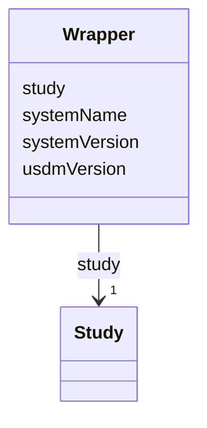

# Class: Wrapper 


URI: [usdm:Wrapper](https://www.cdisc.org/usdm/Wrapper)





<!-- no inheritance hierarchy -->

## Slots

| Name | Cardinality and Range | Description | Inheritance |
| ---  | --- | --- | --- |
| [study](study.md) | 1 <br/> [Study](Study.md) |  | direct |
| [usdmVersion](usdmVersion.md) | 1 <br/> [String](String.md) |  | direct |
| [systemName](systemName.md) | 0..1 <br/> [String](String.md) |  | direct |
| [systemVersion](systemVersion.md) | 0..1 <br/> [String](String.md) |  | direct |


## Identifier and Mapping Information


### Schema Source


* from schema: https://www.cdisc.org/usdm


## Mappings

| Mapping Type | Mapped Value |
| ---  | ---  |
| self | usdm:Wrapper |
| native | usdm:Wrapper |


## LinkML Source

<!-- TODO: investigate https://stackoverflow.com/questions/37606292/how-to-create-tabbed-code-blocks-in-mkdocs-or-sphinx -->

### Direct

<details>
```yaml
name: Wrapper
from_schema: https://www.cdisc.org/usdm
attributes:
  study:
    name: study
    from_schema: https://www.cdisc.org/usdm
    rank: 1000
    domain_of:
    - Wrapper
    range: Study
    required: true
    inlined: true
  usdmVersion:
    name: usdmVersion
    from_schema: https://www.cdisc.org/usdm
    rank: 1000
    domain_of:
    - Wrapper
    range: string
    required: true
  systemName:
    name: systemName
    from_schema: https://www.cdisc.org/usdm
    rank: 1000
    domain_of:
    - Wrapper
    range: string
    required: false
  systemVersion:
    name: systemVersion
    from_schema: https://www.cdisc.org/usdm
    rank: 1000
    domain_of:
    - Wrapper
    range: string
    required: false

```
</details>

### Induced

<details>
```yaml
name: Wrapper
from_schema: https://www.cdisc.org/usdm
attributes:
  study:
    name: study
    from_schema: https://www.cdisc.org/usdm
    rank: 1000
    alias: study
    owner: Wrapper
    domain_of:
    - Wrapper
    range: Study
    required: true
    inlined: true
  usdmVersion:
    name: usdmVersion
    from_schema: https://www.cdisc.org/usdm
    rank: 1000
    alias: usdmVersion
    owner: Wrapper
    domain_of:
    - Wrapper
    range: string
    required: true
  systemName:
    name: systemName
    from_schema: https://www.cdisc.org/usdm
    rank: 1000
    alias: systemName
    owner: Wrapper
    domain_of:
    - Wrapper
    range: string
    required: false
  systemVersion:
    name: systemVersion
    from_schema: https://www.cdisc.org/usdm
    rank: 1000
    alias: systemVersion
    owner: Wrapper
    domain_of:
    - Wrapper
    range: string
    required: false

```
</details>