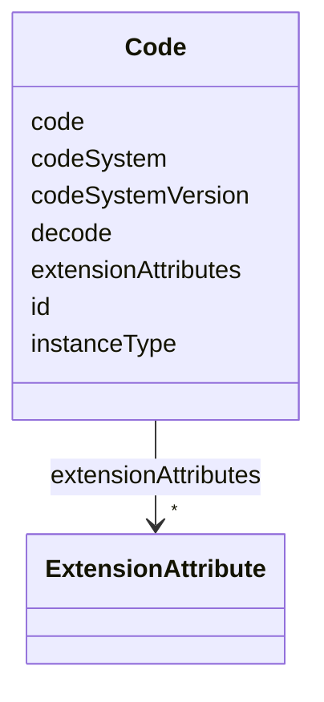

# Class: Code 


URI: [usdm:class/Code](https://www.cdisc.org/usdm/class/Code)





<!-- no inheritance hierarchy -->

## Slots

| Name | Cardinality and Range | Description | Inheritance |
| ---  | --- | --- | --- |
| [id](../slots/id.md) | 1 <br/> [String](../types/String.md) |  | direct |
| [extensionAttributes](../slots/extensionAttributes.md) | * <br/> [ExtensionAttribute](../classes/ExtensionAttribute.md) |  | direct |
| [code](../slots/code.md) | 1 <br/> [String](../types/String.md) |  | direct |
| [codeSystem](../slots/codeSystem.md) | 1 <br/> [String](../types/String.md) |  | direct |
| [codeSystemVersion](../slots/codeSystemVersion.md) | 1 <br/> [String](../types/String.md) |  | direct |
| [decode](../slots/decode.md) | 1 <br/> [String](../types/String.md) |  | direct |
| [instanceType](../slots/instanceType.md) | 1 <br/> [String](../types/String.md) |  | direct |


## Usages

| used by | used in | type | used |
| ---  | --- | --- | --- |
| [Address](../classes/Address.md) | [country](../slots/country.md) | range | [Code](../classes/Code.md) |
| [AdministrableProduct](../classes/AdministrableProduct.md) | [pharmacologicClass](../slots/pharmacologicClass.md) | range | [Code](../classes/Code.md) |
| [AdministrableProduct](../classes/AdministrableProduct.md) | [productDesignation](../slots/productDesignation.md) | range | [Code](../classes/Code.md) |
| [AdministrableProduct](../classes/AdministrableProduct.md) | [sourcing](../slots/sourcing.md) | range | [Code](../classes/Code.md) |
| [AdministrableProductProperty](../classes/AdministrableProductProperty.md) | [type](../slots/type.md) | range | [Code](../classes/Code.md) |
| [AliasCode](../classes/AliasCode.md) | [standardCode](../slots/standardCode.md) | range | [Code](../classes/Code.md) |
| [AliasCode](../classes/AliasCode.md) | [standardCodeAliases](../slots/standardCodeAliases.md) | range | [Code](../classes/Code.md) |
| [CommentAnnotation](../classes/CommentAnnotation.md) | [codes](../slots/codes.md) | range | [Code](../classes/Code.md) |
| [EligibilityCriterion](../classes/EligibilityCriterion.md) | [category](../slots/category.md) | range | [Code](../classes/Code.md) |
| [Encounter](../classes/Encounter.md) | [type](../slots/type.md) | range | [Code](../classes/Code.md) |
| [Encounter](../classes/Encounter.md) | [environmentalSettings](../slots/environmentalSettings.md) | range | [Code](../classes/Code.md) |
| [Encounter](../classes/Encounter.md) | [contactModes](../slots/contactModes.md) | range | [Code](../classes/Code.md) |
| [Endpoint](../classes/Endpoint.md) | [level](../slots/level.md) | range | [Code](../classes/Code.md) |
| [ExtensionAttribute](../classes/ExtensionAttribute.md) | [valueCode](../slots/valueCode.md) | range | [Code](../classes/Code.md) |
| [GeographicScope](../classes/GeographicScope.md) | [type](../slots/type.md) | range | [Code](../classes/Code.md) |
| [GovernanceDate](../classes/GovernanceDate.md) | [type](../slots/type.md) | range | [Code](../classes/Code.md) |
| [Indication](../classes/Indication.md) | [codes](../slots/codes.md) | range | [Code](../classes/Code.md) |
| [Ingredient](../classes/Ingredient.md) | [role](../slots/role.md) | range | [Code](../classes/Code.md) |
| [InterventionalStudyDesign](../classes/InterventionalStudyDesign.md) | [studyType](../slots/studyType.md) | range | [Code](../classes/Code.md) |
| [InterventionalStudyDesign](../classes/InterventionalStudyDesign.md) | [therapeuticAreas](../slots/therapeuticAreas.md) | range | [Code](../classes/Code.md) |
| [InterventionalStudyDesign](../classes/InterventionalStudyDesign.md) | [characteristics](../slots/characteristics.md) | range | [Code](../classes/Code.md) |
| [InterventionalStudyDesign](../classes/InterventionalStudyDesign.md) | [subTypes](../slots/subTypes.md) | range | [Code](../classes/Code.md) |
| [InterventionalStudyDesign](../classes/InterventionalStudyDesign.md) | [model](../slots/model.md) | range | [Code](../classes/Code.md) |
| [InterventionalStudyDesign](../classes/InterventionalStudyDesign.md) | [intentTypes](../slots/intentTypes.md) | range | [Code](../classes/Code.md) |
| [MedicalDevice](../classes/MedicalDevice.md) | [sourcing](../slots/sourcing.md) | range | [Code](../classes/Code.md) |
| [MedicalDeviceIdentifier](../classes/MedicalDeviceIdentifier.md) | [type](../slots/type.md) | range | [Code](../classes/Code.md) |
| [Objective](../classes/Objective.md) | [level](../slots/level.md) | range | [Code](../classes/Code.md) |
| [ObservationalStudyDesign](../classes/ObservationalStudyDesign.md) | [studyType](../slots/studyType.md) | range | [Code](../classes/Code.md) |
| [ObservationalStudyDesign](../classes/ObservationalStudyDesign.md) | [therapeuticAreas](../slots/therapeuticAreas.md) | range | [Code](../classes/Code.md) |
| [ObservationalStudyDesign](../classes/ObservationalStudyDesign.md) | [characteristics](../slots/characteristics.md) | range | [Code](../classes/Code.md) |
| [ObservationalStudyDesign](../classes/ObservationalStudyDesign.md) | [subTypes](../slots/subTypes.md) | range | [Code](../classes/Code.md) |
| [ObservationalStudyDesign](../classes/ObservationalStudyDesign.md) | [model](../slots/model.md) | range | [Code](../classes/Code.md) |
| [ObservationalStudyDesign](../classes/ObservationalStudyDesign.md) | [timePerspective](../slots/timePerspective.md) | range | [Code](../classes/Code.md) |
| [ObservationalStudyDesign](../classes/ObservationalStudyDesign.md) | [samplingMethod](../slots/samplingMethod.md) | range | [Code](../classes/Code.md) |
| [Organization](../classes/Organization.md) | [type](../slots/type.md) | range | [Code](../classes/Code.md) |
| [Procedure](../classes/Procedure.md) | [code](../slots/code.md) | range | [Code](../classes/Code.md) |
| [ProductOrganizationRole](../classes/ProductOrganizationRole.md) | [code](../slots/code.md) | range | [Code](../classes/Code.md) |
| [ReferenceIdentifier](../classes/ReferenceIdentifier.md) | [type](../slots/type.md) | range | [Code](../classes/Code.md) |
| [ResponseCode](../classes/ResponseCode.md) | [code](../slots/code.md) | range | [Code](../classes/Code.md) |
| [StudyAmendmentImpact](../classes/StudyAmendmentImpact.md) | [type](../slots/type.md) | range | [Code](../classes/Code.md) |
| [StudyAmendmentReason](../classes/StudyAmendmentReason.md) | [code](../slots/code.md) | range | [Code](../classes/Code.md) |
| [StudyArm](../classes/StudyArm.md) | [type](../slots/type.md) | range | [Code](../classes/Code.md) |
| [StudyArm](../classes/StudyArm.md) | [dataOriginType](../slots/dataOriginType.md) | range | [Code](../classes/Code.md) |
| [StudyCohort](../classes/StudyCohort.md) | [plannedSex](../slots/plannedSex.md) | range | [Code](../classes/Code.md) |
| [StudyDefinitionDocument](../classes/StudyDefinitionDocument.md) | [language](../slots/language.md) | range | [Code](../classes/Code.md) |
| [StudyDefinitionDocument](../classes/StudyDefinitionDocument.md) | [type](../slots/type.md) | range | [Code](../classes/Code.md) |
| [StudyDefinitionDocumentVersion](../classes/StudyDefinitionDocumentVersion.md) | [status](../slots/status.md) | range | [Code](../classes/Code.md) |
| [StudyDesignPopulation](../classes/StudyDesignPopulation.md) | [plannedSex](../slots/plannedSex.md) | range | [Code](../classes/Code.md) |
| [StudyEpoch](../classes/StudyEpoch.md) | [type](../slots/type.md) | range | [Code](../classes/Code.md) |
| [StudyIntervention](../classes/StudyIntervention.md) | [role](../slots/role.md) | range | [Code](../classes/Code.md) |
| [StudyIntervention](../classes/StudyIntervention.md) | [type](../slots/type.md) | range | [Code](../classes/Code.md) |
| [StudyIntervention](../classes/StudyIntervention.md) | [codes](../slots/codes.md) | range | [Code](../classes/Code.md) |
| [StudyRole](../classes/StudyRole.md) | [code](../slots/code.md) | range | [Code](../classes/Code.md) |
| [StudySite](../classes/StudySite.md) | [country](../slots/country.md) | range | [Code](../classes/Code.md) |
| [StudyTitle](../classes/StudyTitle.md) | [type](../slots/type.md) | range | [Code](../classes/Code.md) |
| [StudyVersion](../classes/StudyVersion.md) | [businessTherapeuticAreas](../slots/businessTherapeuticAreas.md) | range | [Code](../classes/Code.md) |
| [Substance](../classes/Substance.md) | [codes](../slots/codes.md) | range | [Code](../classes/Code.md) |
| [Timing](../classes/Timing.md) | [type](../slots/type.md) | range | [Code](../classes/Code.md) |
| [Timing](../classes/Timing.md) | [relativeToFrom](../slots/relativeToFrom.md) | range | [Code](../classes/Code.md) |


## Identifier and Mapping Information


### Schema Source


* from schema: https://www.cdisc.org/usdm


## Mappings

| Mapping Type | Mapped Value |
| ---  | ---  |
| self | usdm:Code |
| native | usdm:Code |


## LinkML Source

<!-- TODO: investigate https://stackoverflow.com/questions/37606292/how-to-create-tabbed-code-blocks-in-mkdocs-or-sphinx -->

### Direct

<details>
```yaml
name: Code
from_schema: https://www.cdisc.org/usdm
attributes:
  id:
    name: id
    from_schema: https://www.cdisc.org/usdm
    identifier: true
    domain_of:
    - Abbreviation
    - Activity
    - Address
    - AdministrableProduct
    - AdministrableProductIdentifier
    - AdministrableProductProperty
    - Administration
    - AliasCode
    - AnalysisPopulation
    - AssignedPerson
    - BiomedicalConcept
    - BiomedicalConceptCategory
    - BiomedicalConceptProperty
    - BiomedicalConceptSurrogate
    - BiospecimenRetention
    - Characteristic
    - Code
    - CommentAnnotation
    - Condition
    - ConditionAssignment
    - DocumentContentReference
    - Duration
    - EligibilityCriterion
    - EligibilityCriterionItem
    - Encounter
    - Endpoint
    - Estimand
    - ExtensionAttribute
    - ExtensionClass
    - GeographicScope
    - GovernanceDate
    - Indication
    - Ingredient
    - IntercurrentEvent
    - InterventionalStudyDesign
    - Masking
    - MedicalDevice
    - MedicalDeviceIdentifier
    - NarrativeContent
    - NarrativeContentItem
    - Objective
    - ObservationalStudyDesign
    - Organization
    - ParameterMap
    - PersonName
    - Procedure
    - ProductOrganizationRole
    - Quantity
    - Range
    - ReferenceIdentifier
    - ResponseCode
    - ScheduleTimeline
    - ScheduleTimelineExit
    - ScheduledActivityInstance
    - ScheduledDecisionInstance
    - Strength
    - Study
    - StudyAmendment
    - StudyAmendmentImpact
    - StudyAmendmentReason
    - StudyArm
    - StudyCell
    - StudyChange
    - StudyCohort
    - StudyDefinitionDocument
    - StudyDefinitionDocumentVersion
    - StudyDesignPopulation
    - StudyElement
    - StudyEpoch
    - StudyIdentifier
    - StudyIntervention
    - StudyRole
    - StudySite
    - StudyTitle
    - StudyVersion
    - SubjectEnrollment
    - Substance
    - SyntaxTemplateDictionary
    - Timing
    - TransitionRule
    range: string
    required: true
    pattern: ^[\s\S]+$
  extensionAttributes:
    name: extensionAttributes
    from_schema: https://www.cdisc.org/usdm
    domain_of:
    - Abbreviation
    - Activity
    - Address
    - AdministrableProduct
    - AdministrableProductIdentifier
    - AdministrableProductProperty
    - Administration
    - AliasCode
    - AnalysisPopulation
    - AssignedPerson
    - BiomedicalConcept
    - BiomedicalConceptCategory
    - BiomedicalConceptProperty
    - BiomedicalConceptSurrogate
    - BiospecimenRetention
    - Characteristic
    - Code
    - CommentAnnotation
    - Condition
    - ConditionAssignment
    - DocumentContentReference
    - Duration
    - EligibilityCriterion
    - EligibilityCriterionItem
    - Encounter
    - Endpoint
    - Estimand
    - ExtensionAttribute
    - ExtensionClass
    - GeographicScope
    - GovernanceDate
    - Indication
    - Ingredient
    - IntercurrentEvent
    - InterventionalStudyDesign
    - Masking
    - MedicalDevice
    - MedicalDeviceIdentifier
    - NarrativeContent
    - NarrativeContentItem
    - Objective
    - ObservationalStudyDesign
    - Organization
    - ParameterMap
    - PersonName
    - Procedure
    - ProductOrganizationRole
    - Quantity
    - Range
    - ReferenceIdentifier
    - ResponseCode
    - ScheduleTimeline
    - ScheduleTimelineExit
    - ScheduledActivityInstance
    - ScheduledDecisionInstance
    - Strength
    - Study
    - StudyAmendment
    - StudyAmendmentImpact
    - StudyAmendmentReason
    - StudyArm
    - StudyCell
    - StudyChange
    - StudyCohort
    - StudyDefinitionDocument
    - StudyDefinitionDocumentVersion
    - StudyDesignPopulation
    - StudyElement
    - StudyEpoch
    - StudyIdentifier
    - StudyIntervention
    - StudyRole
    - StudySite
    - StudyTitle
    - StudyVersion
    - SubjectEnrollment
    - Substance
    - SyntaxTemplateDictionary
    - Timing
    - TransitionRule
    range: ExtensionAttribute
    required: false
    multivalued: true
    inlined: true
    inlined_as_list: true
  code:
    name: code
    from_schema: https://www.cdisc.org/usdm
    domain_of:
    - BiomedicalConcept
    - BiomedicalConceptCategory
    - BiomedicalConceptProperty
    - Code
    - GeographicScope
    - Procedure
    - ProductOrganizationRole
    - ResponseCode
    - StudyAmendmentReason
    - StudyRole
    range: string
    required: true
  codeSystem:
    name: codeSystem
    from_schema: https://www.cdisc.org/usdm
    rank: 1000
    domain_of:
    - Code
    range: string
    required: true
  codeSystemVersion:
    name: codeSystemVersion
    from_schema: https://www.cdisc.org/usdm
    rank: 1000
    domain_of:
    - Code
    range: string
    required: true
  decode:
    name: decode
    from_schema: https://www.cdisc.org/usdm
    rank: 1000
    domain_of:
    - Code
    range: string
    required: true
  instanceType:
    name: instanceType
    from_schema: https://www.cdisc.org/usdm
    designates_type: true
    domain_of:
    - Abbreviation
    - Activity
    - Address
    - AdministrableProduct
    - AdministrableProductIdentifier
    - AdministrableProductProperty
    - Administration
    - AliasCode
    - AnalysisPopulation
    - AssignedPerson
    - BiomedicalConcept
    - BiomedicalConceptCategory
    - BiomedicalConceptProperty
    - BiomedicalConceptSurrogate
    - BiospecimenRetention
    - Characteristic
    - Code
    - CommentAnnotation
    - Condition
    - ConditionAssignment
    - DocumentContentReference
    - Duration
    - EligibilityCriterion
    - EligibilityCriterionItem
    - Encounter
    - Endpoint
    - Estimand
    - ExtensionAttribute
    - ExtensionClass
    - GeographicScope
    - GovernanceDate
    - Indication
    - Ingredient
    - IntercurrentEvent
    - InterventionalStudyDesign
    - Masking
    - MedicalDevice
    - MedicalDeviceIdentifier
    - NarrativeContent
    - NarrativeContentItem
    - Objective
    - ObservationalStudyDesign
    - Organization
    - ParameterMap
    - PersonName
    - Procedure
    - ProductOrganizationRole
    - Quantity
    - Range
    - ReferenceIdentifier
    - ResponseCode
    - ScheduleTimeline
    - ScheduleTimelineExit
    - ScheduledActivityInstance
    - ScheduledDecisionInstance
    - Strength
    - Study
    - StudyAmendment
    - StudyAmendmentImpact
    - StudyAmendmentReason
    - StudyArm
    - StudyCell
    - StudyChange
    - StudyCohort
    - StudyDefinitionDocument
    - StudyDefinitionDocumentVersion
    - StudyDesignPopulation
    - StudyElement
    - StudyEpoch
    - StudyIdentifier
    - StudyIntervention
    - StudyRole
    - StudySite
    - StudyTitle
    - StudyVersion
    - SubjectEnrollment
    - Substance
    - SyntaxTemplateDictionary
    - Timing
    - TransitionRule
    range: string
    required: true
    equals_string: Code

```
</details>

### Induced

<details>
```yaml
name: Code
from_schema: https://www.cdisc.org/usdm
attributes:
  id:
    name: id
    from_schema: https://www.cdisc.org/usdm
    identifier: true
    alias: id
    owner: Code
    domain_of:
    - Abbreviation
    - Activity
    - Address
    - AdministrableProduct
    - AdministrableProductIdentifier
    - AdministrableProductProperty
    - Administration
    - AliasCode
    - AnalysisPopulation
    - AssignedPerson
    - BiomedicalConcept
    - BiomedicalConceptCategory
    - BiomedicalConceptProperty
    - BiomedicalConceptSurrogate
    - BiospecimenRetention
    - Characteristic
    - Code
    - CommentAnnotation
    - Condition
    - ConditionAssignment
    - DocumentContentReference
    - Duration
    - EligibilityCriterion
    - EligibilityCriterionItem
    - Encounter
    - Endpoint
    - Estimand
    - ExtensionAttribute
    - ExtensionClass
    - GeographicScope
    - GovernanceDate
    - Indication
    - Ingredient
    - IntercurrentEvent
    - InterventionalStudyDesign
    - Masking
    - MedicalDevice
    - MedicalDeviceIdentifier
    - NarrativeContent
    - NarrativeContentItem
    - Objective
    - ObservationalStudyDesign
    - Organization
    - ParameterMap
    - PersonName
    - Procedure
    - ProductOrganizationRole
    - Quantity
    - Range
    - ReferenceIdentifier
    - ResponseCode
    - ScheduleTimeline
    - ScheduleTimelineExit
    - ScheduledActivityInstance
    - ScheduledDecisionInstance
    - Strength
    - Study
    - StudyAmendment
    - StudyAmendmentImpact
    - StudyAmendmentReason
    - StudyArm
    - StudyCell
    - StudyChange
    - StudyCohort
    - StudyDefinitionDocument
    - StudyDefinitionDocumentVersion
    - StudyDesignPopulation
    - StudyElement
    - StudyEpoch
    - StudyIdentifier
    - StudyIntervention
    - StudyRole
    - StudySite
    - StudyTitle
    - StudyVersion
    - SubjectEnrollment
    - Substance
    - SyntaxTemplateDictionary
    - Timing
    - TransitionRule
    range: string
    required: true
    pattern: ^[\s\S]+$
  extensionAttributes:
    name: extensionAttributes
    from_schema: https://www.cdisc.org/usdm
    alias: extensionAttributes
    owner: Code
    domain_of:
    - Abbreviation
    - Activity
    - Address
    - AdministrableProduct
    - AdministrableProductIdentifier
    - AdministrableProductProperty
    - Administration
    - AliasCode
    - AnalysisPopulation
    - AssignedPerson
    - BiomedicalConcept
    - BiomedicalConceptCategory
    - BiomedicalConceptProperty
    - BiomedicalConceptSurrogate
    - BiospecimenRetention
    - Characteristic
    - Code
    - CommentAnnotation
    - Condition
    - ConditionAssignment
    - DocumentContentReference
    - Duration
    - EligibilityCriterion
    - EligibilityCriterionItem
    - Encounter
    - Endpoint
    - Estimand
    - ExtensionAttribute
    - ExtensionClass
    - GeographicScope
    - GovernanceDate
    - Indication
    - Ingredient
    - IntercurrentEvent
    - InterventionalStudyDesign
    - Masking
    - MedicalDevice
    - MedicalDeviceIdentifier
    - NarrativeContent
    - NarrativeContentItem
    - Objective
    - ObservationalStudyDesign
    - Organization
    - ParameterMap
    - PersonName
    - Procedure
    - ProductOrganizationRole
    - Quantity
    - Range
    - ReferenceIdentifier
    - ResponseCode
    - ScheduleTimeline
    - ScheduleTimelineExit
    - ScheduledActivityInstance
    - ScheduledDecisionInstance
    - Strength
    - Study
    - StudyAmendment
    - StudyAmendmentImpact
    - StudyAmendmentReason
    - StudyArm
    - StudyCell
    - StudyChange
    - StudyCohort
    - StudyDefinitionDocument
    - StudyDefinitionDocumentVersion
    - StudyDesignPopulation
    - StudyElement
    - StudyEpoch
    - StudyIdentifier
    - StudyIntervention
    - StudyRole
    - StudySite
    - StudyTitle
    - StudyVersion
    - SubjectEnrollment
    - Substance
    - SyntaxTemplateDictionary
    - Timing
    - TransitionRule
    range: ExtensionAttribute
    required: false
    multivalued: true
    inlined: true
    inlined_as_list: true
  code:
    name: code
    from_schema: https://www.cdisc.org/usdm
    alias: code
    owner: Code
    domain_of:
    - BiomedicalConcept
    - BiomedicalConceptCategory
    - BiomedicalConceptProperty
    - Code
    - GeographicScope
    - Procedure
    - ProductOrganizationRole
    - ResponseCode
    - StudyAmendmentReason
    - StudyRole
    range: string
    required: true
  codeSystem:
    name: codeSystem
    from_schema: https://www.cdisc.org/usdm
    rank: 1000
    alias: codeSystem
    owner: Code
    domain_of:
    - Code
    range: string
    required: true
  codeSystemVersion:
    name: codeSystemVersion
    from_schema: https://www.cdisc.org/usdm
    rank: 1000
    alias: codeSystemVersion
    owner: Code
    domain_of:
    - Code
    range: string
    required: true
  decode:
    name: decode
    from_schema: https://www.cdisc.org/usdm
    rank: 1000
    alias: decode
    owner: Code
    domain_of:
    - Code
    range: string
    required: true
  instanceType:
    name: instanceType
    from_schema: https://www.cdisc.org/usdm
    designates_type: true
    alias: instanceType
    owner: Code
    domain_of:
    - Abbreviation
    - Activity
    - Address
    - AdministrableProduct
    - AdministrableProductIdentifier
    - AdministrableProductProperty
    - Administration
    - AliasCode
    - AnalysisPopulation
    - AssignedPerson
    - BiomedicalConcept
    - BiomedicalConceptCategory
    - BiomedicalConceptProperty
    - BiomedicalConceptSurrogate
    - BiospecimenRetention
    - Characteristic
    - Code
    - CommentAnnotation
    - Condition
    - ConditionAssignment
    - DocumentContentReference
    - Duration
    - EligibilityCriterion
    - EligibilityCriterionItem
    - Encounter
    - Endpoint
    - Estimand
    - ExtensionAttribute
    - ExtensionClass
    - GeographicScope
    - GovernanceDate
    - Indication
    - Ingredient
    - IntercurrentEvent
    - InterventionalStudyDesign
    - Masking
    - MedicalDevice
    - MedicalDeviceIdentifier
    - NarrativeContent
    - NarrativeContentItem
    - Objective
    - ObservationalStudyDesign
    - Organization
    - ParameterMap
    - PersonName
    - Procedure
    - ProductOrganizationRole
    - Quantity
    - Range
    - ReferenceIdentifier
    - ResponseCode
    - ScheduleTimeline
    - ScheduleTimelineExit
    - ScheduledActivityInstance
    - ScheduledDecisionInstance
    - Strength
    - Study
    - StudyAmendment
    - StudyAmendmentImpact
    - StudyAmendmentReason
    - StudyArm
    - StudyCell
    - StudyChange
    - StudyCohort
    - StudyDefinitionDocument
    - StudyDefinitionDocumentVersion
    - StudyDesignPopulation
    - StudyElement
    - StudyEpoch
    - StudyIdentifier
    - StudyIntervention
    - StudyRole
    - StudySite
    - StudyTitle
    - StudyVersion
    - SubjectEnrollment
    - Substance
    - SyntaxTemplateDictionary
    - Timing
    - TransitionRule
    range: string
    required: true
    equals_string: Code

```
</details>