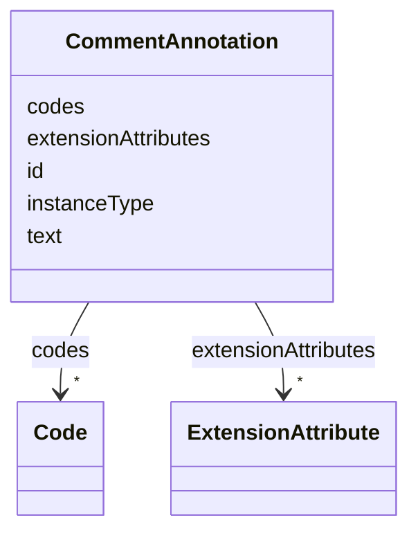

# Class: CommentAnnotation 


URI: [usdm:class/CommentAnnotation](https://www.cdisc.org/usdm/class/CommentAnnotation)





<!-- no inheritance hierarchy -->

## Slots

| Name | Cardinality and Range | Description | Inheritance |
| ---  | --- | --- | --- |
| [id](../slots/id.md) | 1 <br/> [String](../types/String.md) |  | direct |
| [extensionAttributes](../slots/extensionAttributes.md) | * <br/> [ExtensionAttribute](../classes/ExtensionAttribute.md) |  | direct |
| [text](../slots/text.md) | 1 <br/> [String](../types/String.md) |  | direct |
| [codes](../slots/codes.md) | * <br/> [Code](../classes/Code.md) |  | direct |
| [instanceType](../slots/instanceType.md) | 1 <br/> [String](../types/String.md) |  | direct |


## Usages

| used by | used in | type | used |
| ---  | --- | --- | --- |
| [Abbreviation](../classes/Abbreviation.md) | [notes](../slots/notes.md) | range | [CommentAnnotation](../classes/CommentAnnotation.md) |
| [Activity](../classes/Activity.md) | [notes](../slots/notes.md) | range | [CommentAnnotation](../classes/CommentAnnotation.md) |
| [AdministrableProduct](../classes/AdministrableProduct.md) | [notes](../slots/notes.md) | range | [CommentAnnotation](../classes/CommentAnnotation.md) |
| [Administration](../classes/Administration.md) | [notes](../slots/notes.md) | range | [CommentAnnotation](../classes/CommentAnnotation.md) |
| [AnalysisPopulation](../classes/AnalysisPopulation.md) | [notes](../slots/notes.md) | range | [CommentAnnotation](../classes/CommentAnnotation.md) |
| [BiomedicalConcept](../classes/BiomedicalConcept.md) | [notes](../slots/notes.md) | range | [CommentAnnotation](../classes/CommentAnnotation.md) |
| [BiomedicalConceptCategory](../classes/BiomedicalConceptCategory.md) | [notes](../slots/notes.md) | range | [CommentAnnotation](../classes/CommentAnnotation.md) |
| [BiomedicalConceptProperty](../classes/BiomedicalConceptProperty.md) | [notes](../slots/notes.md) | range | [CommentAnnotation](../classes/CommentAnnotation.md) |
| [BiomedicalConceptSurrogate](../classes/BiomedicalConceptSurrogate.md) | [notes](../slots/notes.md) | range | [CommentAnnotation](../classes/CommentAnnotation.md) |
| [Characteristic](../classes/Characteristic.md) | [notes](../slots/notes.md) | range | [CommentAnnotation](../classes/CommentAnnotation.md) |
| [Condition](../classes/Condition.md) | [notes](../slots/notes.md) | range | [CommentAnnotation](../classes/CommentAnnotation.md) |
| [EligibilityCriterion](../classes/EligibilityCriterion.md) | [notes](../slots/notes.md) | range | [CommentAnnotation](../classes/CommentAnnotation.md) |
| [EligibilityCriterionItem](../classes/EligibilityCriterionItem.md) | [notes](../slots/notes.md) | range | [CommentAnnotation](../classes/CommentAnnotation.md) |
| [Encounter](../classes/Encounter.md) | [notes](../slots/notes.md) | range | [CommentAnnotation](../classes/CommentAnnotation.md) |
| [Endpoint](../classes/Endpoint.md) | [notes](../slots/notes.md) | range | [CommentAnnotation](../classes/CommentAnnotation.md) |
| [Estimand](../classes/Estimand.md) | [notes](../slots/notes.md) | range | [CommentAnnotation](../classes/CommentAnnotation.md) |
| [Indication](../classes/Indication.md) | [notes](../slots/notes.md) | range | [CommentAnnotation](../classes/CommentAnnotation.md) |
| [IntercurrentEvent](../classes/IntercurrentEvent.md) | [notes](../slots/notes.md) | range | [CommentAnnotation](../classes/CommentAnnotation.md) |
| [InterventionalStudyDesign](../classes/InterventionalStudyDesign.md) | [notes](../slots/notes.md) | range | [CommentAnnotation](../classes/CommentAnnotation.md) |
| [MedicalDevice](../classes/MedicalDevice.md) | [notes](../slots/notes.md) | range | [CommentAnnotation](../classes/CommentAnnotation.md) |
| [Objective](../classes/Objective.md) | [notes](../slots/notes.md) | range | [CommentAnnotation](../classes/CommentAnnotation.md) |
| [ObservationalStudyDesign](../classes/ObservationalStudyDesign.md) | [notes](../slots/notes.md) | range | [CommentAnnotation](../classes/CommentAnnotation.md) |
| [Procedure](../classes/Procedure.md) | [notes](../slots/notes.md) | range | [CommentAnnotation](../classes/CommentAnnotation.md) |
| [StudyAmendment](../classes/StudyAmendment.md) | [notes](../slots/notes.md) | range | [CommentAnnotation](../classes/CommentAnnotation.md) |
| [StudyAmendmentImpact](../classes/StudyAmendmentImpact.md) | [notes](../slots/notes.md) | range | [CommentAnnotation](../classes/CommentAnnotation.md) |
| [StudyArm](../classes/StudyArm.md) | [notes](../slots/notes.md) | range | [CommentAnnotation](../classes/CommentAnnotation.md) |
| [StudyCohort](../classes/StudyCohort.md) | [notes](../slots/notes.md) | range | [CommentAnnotation](../classes/CommentAnnotation.md) |
| [StudyDefinitionDocument](../classes/StudyDefinitionDocument.md) | [notes](../slots/notes.md) | range | [CommentAnnotation](../classes/CommentAnnotation.md) |
| [StudyDefinitionDocumentVersion](../classes/StudyDefinitionDocumentVersion.md) | [notes](../slots/notes.md) | range | [CommentAnnotation](../classes/CommentAnnotation.md) |
| [StudyDesignPopulation](../classes/StudyDesignPopulation.md) | [notes](../slots/notes.md) | range | [CommentAnnotation](../classes/CommentAnnotation.md) |
| [StudyElement](../classes/StudyElement.md) | [notes](../slots/notes.md) | range | [CommentAnnotation](../classes/CommentAnnotation.md) |
| [StudyEpoch](../classes/StudyEpoch.md) | [notes](../slots/notes.md) | range | [CommentAnnotation](../classes/CommentAnnotation.md) |
| [StudyIntervention](../classes/StudyIntervention.md) | [notes](../slots/notes.md) | range | [CommentAnnotation](../classes/CommentAnnotation.md) |
| [StudyRole](../classes/StudyRole.md) | [notes](../slots/notes.md) | range | [CommentAnnotation](../classes/CommentAnnotation.md) |
| [StudyVersion](../classes/StudyVersion.md) | [notes](../slots/notes.md) | range | [CommentAnnotation](../classes/CommentAnnotation.md) |


## Identifier and Mapping Information


### Schema Source


* from schema: https://www.cdisc.org/usdm


## Mappings

| Mapping Type | Mapped Value |
| ---  | ---  |
| self | usdm:CommentAnnotation |
| native | usdm:CommentAnnotation |


## LinkML Source

<!-- TODO: investigate https://stackoverflow.com/questions/37606292/how-to-create-tabbed-code-blocks-in-mkdocs-or-sphinx -->

### Direct

<details>
```yaml
name: CommentAnnotation
from_schema: https://www.cdisc.org/usdm
attributes:
  id:
    name: id
    from_schema: https://www.cdisc.org/usdm
    identifier: true
    domain_of:
    - Abbreviation
    - Activity
    - Address
    - AdministrableProduct
    - AdministrableProductIdentifier
    - AdministrableProductProperty
    - Administration
    - AliasCode
    - AnalysisPopulation
    - AssignedPerson
    - BiomedicalConcept
    - BiomedicalConceptCategory
    - BiomedicalConceptProperty
    - BiomedicalConceptSurrogate
    - BiospecimenRetention
    - Characteristic
    - Code
    - CommentAnnotation
    - Condition
    - ConditionAssignment
    - DocumentContentReference
    - Duration
    - EligibilityCriterion
    - EligibilityCriterionItem
    - Encounter
    - Endpoint
    - Estimand
    - ExtensionAttribute
    - ExtensionClass
    - GeographicScope
    - GovernanceDate
    - Indication
    - Ingredient
    - IntercurrentEvent
    - InterventionalStudyDesign
    - Masking
    - MedicalDevice
    - MedicalDeviceIdentifier
    - NarrativeContent
    - NarrativeContentItem
    - Objective
    - ObservationalStudyDesign
    - Organization
    - ParameterMap
    - PersonName
    - Procedure
    - ProductOrganizationRole
    - Quantity
    - Range
    - ReferenceIdentifier
    - ResponseCode
    - ScheduleTimeline
    - ScheduleTimelineExit
    - ScheduledActivityInstance
    - ScheduledDecisionInstance
    - Strength
    - Study
    - StudyAmendment
    - StudyAmendmentImpact
    - StudyAmendmentReason
    - StudyArm
    - StudyCell
    - StudyChange
    - StudyCohort
    - StudyDefinitionDocument
    - StudyDefinitionDocumentVersion
    - StudyDesignPopulation
    - StudyElement
    - StudyEpoch
    - StudyIdentifier
    - StudyIntervention
    - StudyRole
    - StudySite
    - StudyTitle
    - StudyVersion
    - SubjectEnrollment
    - Substance
    - SyntaxTemplateDictionary
    - Timing
    - TransitionRule
    range: string
    required: true
    pattern: ^[\s\S]+$
  extensionAttributes:
    name: extensionAttributes
    from_schema: https://www.cdisc.org/usdm
    domain_of:
    - Abbreviation
    - Activity
    - Address
    - AdministrableProduct
    - AdministrableProductIdentifier
    - AdministrableProductProperty
    - Administration
    - AliasCode
    - AnalysisPopulation
    - AssignedPerson
    - BiomedicalConcept
    - BiomedicalConceptCategory
    - BiomedicalConceptProperty
    - BiomedicalConceptSurrogate
    - BiospecimenRetention
    - Characteristic
    - Code
    - CommentAnnotation
    - Condition
    - ConditionAssignment
    - DocumentContentReference
    - Duration
    - EligibilityCriterion
    - EligibilityCriterionItem
    - Encounter
    - Endpoint
    - Estimand
    - ExtensionAttribute
    - ExtensionClass
    - GeographicScope
    - GovernanceDate
    - Indication
    - Ingredient
    - IntercurrentEvent
    - InterventionalStudyDesign
    - Masking
    - MedicalDevice
    - MedicalDeviceIdentifier
    - NarrativeContent
    - NarrativeContentItem
    - Objective
    - ObservationalStudyDesign
    - Organization
    - ParameterMap
    - PersonName
    - Procedure
    - ProductOrganizationRole
    - Quantity
    - Range
    - ReferenceIdentifier
    - ResponseCode
    - ScheduleTimeline
    - ScheduleTimelineExit
    - ScheduledActivityInstance
    - ScheduledDecisionInstance
    - Strength
    - Study
    - StudyAmendment
    - StudyAmendmentImpact
    - StudyAmendmentReason
    - StudyArm
    - StudyCell
    - StudyChange
    - StudyCohort
    - StudyDefinitionDocument
    - StudyDefinitionDocumentVersion
    - StudyDesignPopulation
    - StudyElement
    - StudyEpoch
    - StudyIdentifier
    - StudyIntervention
    - StudyRole
    - StudySite
    - StudyTitle
    - StudyVersion
    - SubjectEnrollment
    - Substance
    - SyntaxTemplateDictionary
    - Timing
    - TransitionRule
    range: ExtensionAttribute
    required: false
    multivalued: true
    inlined: true
    inlined_as_list: true
  text:
    name: text
    from_schema: https://www.cdisc.org/usdm
    domain_of:
    - Address
    - AdministrableProductIdentifier
    - AdministrableProductProperty
    - AnalysisPopulation
    - Characteristic
    - CommentAnnotation
    - Condition
    - Duration
    - EligibilityCriterionItem
    - Endpoint
    - IntercurrentEvent
    - Masking
    - MedicalDeviceIdentifier
    - NarrativeContentItem
    - Objective
    - PersonName
    - ReferenceIdentifier
    - StudyAmendmentImpact
    - StudyIdentifier
    - StudyTitle
    - TransitionRule
    range: string
    required: true
  codes:
    name: codes
    from_schema: https://www.cdisc.org/usdm
    rank: 1000
    domain_of:
    - CommentAnnotation
    - Indication
    - StudyIntervention
    - Substance
    range: Code
    required: false
    multivalued: true
    inlined: true
    inlined_as_list: true
  instanceType:
    name: instanceType
    from_schema: https://www.cdisc.org/usdm
    designates_type: true
    domain_of:
    - Abbreviation
    - Activity
    - Address
    - AdministrableProduct
    - AdministrableProductIdentifier
    - AdministrableProductProperty
    - Administration
    - AliasCode
    - AnalysisPopulation
    - AssignedPerson
    - BiomedicalConcept
    - BiomedicalConceptCategory
    - BiomedicalConceptProperty
    - BiomedicalConceptSurrogate
    - BiospecimenRetention
    - Characteristic
    - Code
    - CommentAnnotation
    - Condition
    - ConditionAssignment
    - DocumentContentReference
    - Duration
    - EligibilityCriterion
    - EligibilityCriterionItem
    - Encounter
    - Endpoint
    - Estimand
    - ExtensionAttribute
    - ExtensionClass
    - GeographicScope
    - GovernanceDate
    - Indication
    - Ingredient
    - IntercurrentEvent
    - InterventionalStudyDesign
    - Masking
    - MedicalDevice
    - MedicalDeviceIdentifier
    - NarrativeContent
    - NarrativeContentItem
    - Objective
    - ObservationalStudyDesign
    - Organization
    - ParameterMap
    - PersonName
    - Procedure
    - ProductOrganizationRole
    - Quantity
    - Range
    - ReferenceIdentifier
    - ResponseCode
    - ScheduleTimeline
    - ScheduleTimelineExit
    - ScheduledActivityInstance
    - ScheduledDecisionInstance
    - Strength
    - Study
    - StudyAmendment
    - StudyAmendmentImpact
    - StudyAmendmentReason
    - StudyArm
    - StudyCell
    - StudyChange
    - StudyCohort
    - StudyDefinitionDocument
    - StudyDefinitionDocumentVersion
    - StudyDesignPopulation
    - StudyElement
    - StudyEpoch
    - StudyIdentifier
    - StudyIntervention
    - StudyRole
    - StudySite
    - StudyTitle
    - StudyVersion
    - SubjectEnrollment
    - Substance
    - SyntaxTemplateDictionary
    - Timing
    - TransitionRule
    range: string
    required: true
    equals_string: CommentAnnotation

```
</details>

### Induced

<details>
```yaml
name: CommentAnnotation
from_schema: https://www.cdisc.org/usdm
attributes:
  id:
    name: id
    from_schema: https://www.cdisc.org/usdm
    identifier: true
    alias: id
    owner: CommentAnnotation
    domain_of:
    - Abbreviation
    - Activity
    - Address
    - AdministrableProduct
    - AdministrableProductIdentifier
    - AdministrableProductProperty
    - Administration
    - AliasCode
    - AnalysisPopulation
    - AssignedPerson
    - BiomedicalConcept
    - BiomedicalConceptCategory
    - BiomedicalConceptProperty
    - BiomedicalConceptSurrogate
    - BiospecimenRetention
    - Characteristic
    - Code
    - CommentAnnotation
    - Condition
    - ConditionAssignment
    - DocumentContentReference
    - Duration
    - EligibilityCriterion
    - EligibilityCriterionItem
    - Encounter
    - Endpoint
    - Estimand
    - ExtensionAttribute
    - ExtensionClass
    - GeographicScope
    - GovernanceDate
    - Indication
    - Ingredient
    - IntercurrentEvent
    - InterventionalStudyDesign
    - Masking
    - MedicalDevice
    - MedicalDeviceIdentifier
    - NarrativeContent
    - NarrativeContentItem
    - Objective
    - ObservationalStudyDesign
    - Organization
    - ParameterMap
    - PersonName
    - Procedure
    - ProductOrganizationRole
    - Quantity
    - Range
    - ReferenceIdentifier
    - ResponseCode
    - ScheduleTimeline
    - ScheduleTimelineExit
    - ScheduledActivityInstance
    - ScheduledDecisionInstance
    - Strength
    - Study
    - StudyAmendment
    - StudyAmendmentImpact
    - StudyAmendmentReason
    - StudyArm
    - StudyCell
    - StudyChange
    - StudyCohort
    - StudyDefinitionDocument
    - StudyDefinitionDocumentVersion
    - StudyDesignPopulation
    - StudyElement
    - StudyEpoch
    - StudyIdentifier
    - StudyIntervention
    - StudyRole
    - StudySite
    - StudyTitle
    - StudyVersion
    - SubjectEnrollment
    - Substance
    - SyntaxTemplateDictionary
    - Timing
    - TransitionRule
    range: string
    required: true
    pattern: ^[\s\S]+$
  extensionAttributes:
    name: extensionAttributes
    from_schema: https://www.cdisc.org/usdm
    alias: extensionAttributes
    owner: CommentAnnotation
    domain_of:
    - Abbreviation
    - Activity
    - Address
    - AdministrableProduct
    - AdministrableProductIdentifier
    - AdministrableProductProperty
    - Administration
    - AliasCode
    - AnalysisPopulation
    - AssignedPerson
    - BiomedicalConcept
    - BiomedicalConceptCategory
    - BiomedicalConceptProperty
    - BiomedicalConceptSurrogate
    - BiospecimenRetention
    - Characteristic
    - Code
    - CommentAnnotation
    - Condition
    - ConditionAssignment
    - DocumentContentReference
    - Duration
    - EligibilityCriterion
    - EligibilityCriterionItem
    - Encounter
    - Endpoint
    - Estimand
    - ExtensionAttribute
    - ExtensionClass
    - GeographicScope
    - GovernanceDate
    - Indication
    - Ingredient
    - IntercurrentEvent
    - InterventionalStudyDesign
    - Masking
    - MedicalDevice
    - MedicalDeviceIdentifier
    - NarrativeContent
    - NarrativeContentItem
    - Objective
    - ObservationalStudyDesign
    - Organization
    - ParameterMap
    - PersonName
    - Procedure
    - ProductOrganizationRole
    - Quantity
    - Range
    - ReferenceIdentifier
    - ResponseCode
    - ScheduleTimeline
    - ScheduleTimelineExit
    - ScheduledActivityInstance
    - ScheduledDecisionInstance
    - Strength
    - Study
    - StudyAmendment
    - StudyAmendmentImpact
    - StudyAmendmentReason
    - StudyArm
    - StudyCell
    - StudyChange
    - StudyCohort
    - StudyDefinitionDocument
    - StudyDefinitionDocumentVersion
    - StudyDesignPopulation
    - StudyElement
    - StudyEpoch
    - StudyIdentifier
    - StudyIntervention
    - StudyRole
    - StudySite
    - StudyTitle
    - StudyVersion
    - SubjectEnrollment
    - Substance
    - SyntaxTemplateDictionary
    - Timing
    - TransitionRule
    range: ExtensionAttribute
    required: false
    multivalued: true
    inlined: true
    inlined_as_list: true
  text:
    name: text
    from_schema: https://www.cdisc.org/usdm
    alias: text
    owner: CommentAnnotation
    domain_of:
    - Address
    - AdministrableProductIdentifier
    - AdministrableProductProperty
    - AnalysisPopulation
    - Characteristic
    - CommentAnnotation
    - Condition
    - Duration
    - EligibilityCriterionItem
    - Endpoint
    - IntercurrentEvent
    - Masking
    - MedicalDeviceIdentifier
    - NarrativeContentItem
    - Objective
    - PersonName
    - ReferenceIdentifier
    - StudyAmendmentImpact
    - StudyIdentifier
    - StudyTitle
    - TransitionRule
    range: string
    required: true
  codes:
    name: codes
    from_schema: https://www.cdisc.org/usdm
    rank: 1000
    alias: codes
    owner: CommentAnnotation
    domain_of:
    - CommentAnnotation
    - Indication
    - StudyIntervention
    - Substance
    range: Code
    required: false
    multivalued: true
    inlined: true
    inlined_as_list: true
  instanceType:
    name: instanceType
    from_schema: https://www.cdisc.org/usdm
    designates_type: true
    alias: instanceType
    owner: CommentAnnotation
    domain_of:
    - Abbreviation
    - Activity
    - Address
    - AdministrableProduct
    - AdministrableProductIdentifier
    - AdministrableProductProperty
    - Administration
    - AliasCode
    - AnalysisPopulation
    - AssignedPerson
    - BiomedicalConcept
    - BiomedicalConceptCategory
    - BiomedicalConceptProperty
    - BiomedicalConceptSurrogate
    - BiospecimenRetention
    - Characteristic
    - Code
    - CommentAnnotation
    - Condition
    - ConditionAssignment
    - DocumentContentReference
    - Duration
    - EligibilityCriterion
    - EligibilityCriterionItem
    - Encounter
    - Endpoint
    - Estimand
    - ExtensionAttribute
    - ExtensionClass
    - GeographicScope
    - GovernanceDate
    - Indication
    - Ingredient
    - IntercurrentEvent
    - InterventionalStudyDesign
    - Masking
    - MedicalDevice
    - MedicalDeviceIdentifier
    - NarrativeContent
    - NarrativeContentItem
    - Objective
    - ObservationalStudyDesign
    - Organization
    - ParameterMap
    - PersonName
    - Procedure
    - ProductOrganizationRole
    - Quantity
    - Range
    - ReferenceIdentifier
    - ResponseCode
    - ScheduleTimeline
    - ScheduleTimelineExit
    - ScheduledActivityInstance
    - ScheduledDecisionInstance
    - Strength
    - Study
    - StudyAmendment
    - StudyAmendmentImpact
    - StudyAmendmentReason
    - StudyArm
    - StudyCell
    - StudyChange
    - StudyCohort
    - StudyDefinitionDocument
    - StudyDefinitionDocumentVersion
    - StudyDesignPopulation
    - StudyElement
    - StudyEpoch
    - StudyIdentifier
    - StudyIntervention
    - StudyRole
    - StudySite
    - StudyTitle
    - StudyVersion
    - SubjectEnrollment
    - Substance
    - SyntaxTemplateDictionary
    - Timing
    - TransitionRule
    range: string
    required: true
    equals_string: CommentAnnotation

```
</details>