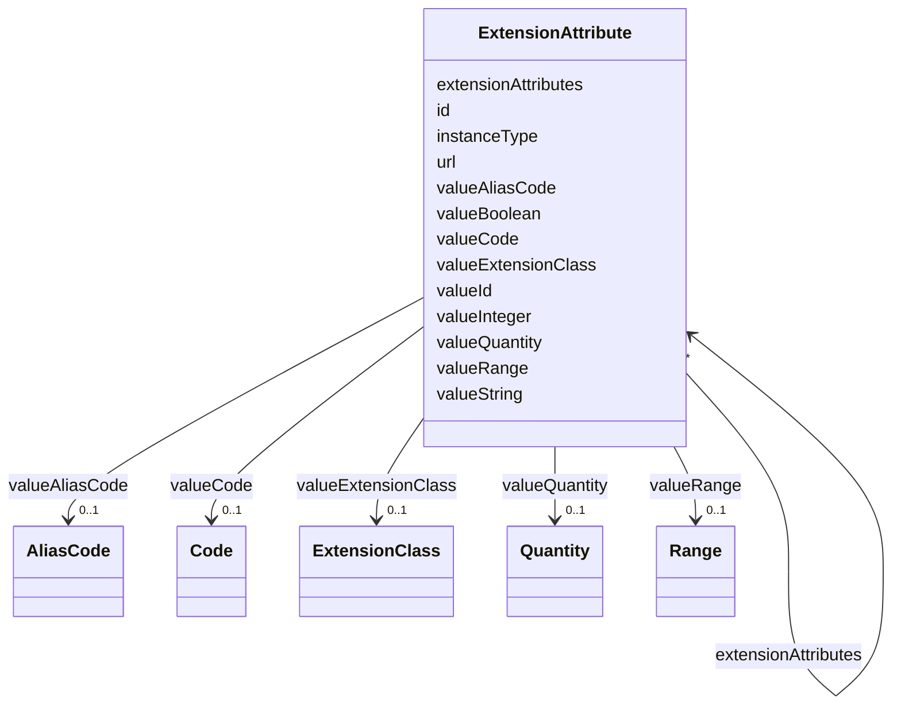

# Class: ExtensionAttribute 


URI: [usdm:class/ExtensionAttribute](https://www.cdisc.org/usdm/class/ExtensionAttribute)





<!-- no inheritance hierarchy -->

## Slots

| Name | Cardinality and Range | Description | Inheritance |
| ---  | --- | --- | --- |
| [id](../slots/id.md) | 1 <br/> [String](../types/String.md) |  | direct |
| [url](../slots/url.md) | 1 <br/> [String](../types/String.md) |  | direct |
| [valueString](../slots/valueString.md) | 0..1 <br/> [String](../types/String.md) |  | direct |
| [valueBoolean](../slots/valueBoolean.md) | 0..1 <br/> [Boolean](../types/Boolean.md) |  | direct |
| [valueInteger](../slots/valueInteger.md) | 0..1 <br/> [Integer](../types/Integer.md) |  | direct |
| [valueId](../slots/valueId.md) | 0..1 <br/> [String](../types/String.md) |  | direct |
| [valueQuantity](../slots/valueQuantity.md) | 0..1 <br/> [Quantity](../classes/Quantity.md) |  | direct |
| [valueRange](../slots/valueRange.md) | 0..1 <br/> [Range](../classes/Range.md) |  | direct |
| [valueCode](../slots/valueCode.md) | 0..1 <br/> [Code](../classes/Code.md) |  | direct |
| [valueAliasCode](../slots/valueAliasCode.md) | 0..1 <br/> [AliasCode](../classes/AliasCode.md) |  | direct |
| [valueExtensionClass](../slots/valueExtensionClass.md) | 0..1 <br/> [ExtensionClass](../classes/ExtensionClass.md) |  | direct |
| [extensionAttributes](../slots/extensionAttributes.md) | * <br/> [ExtensionAttribute](../classes/ExtensionAttribute.md) |  | direct |
| [instanceType](../slots/instanceType.md) | 1 <br/> [String](../types/String.md) |  | direct |


## Usages

| used by | used in | type | used |
| ---  | --- | --- | --- |
| [Abbreviation](../classes/Abbreviation.md) | [extensionAttributes](../slots/extensionAttributes.md) | range | [ExtensionAttribute](../classes/ExtensionAttribute.md) |
| [Activity](../classes/Activity.md) | [extensionAttributes](../slots/extensionAttributes.md) | range | [ExtensionAttribute](../classes/ExtensionAttribute.md) |
| [Address](../classes/Address.md) | [extensionAttributes](../slots/extensionAttributes.md) | range | [ExtensionAttribute](../classes/ExtensionAttribute.md) |
| [AdministrableProduct](../classes/AdministrableProduct.md) | [extensionAttributes](../slots/extensionAttributes.md) | range | [ExtensionAttribute](../classes/ExtensionAttribute.md) |
| [AdministrableProductIdentifier](../classes/AdministrableProductIdentifier.md) | [extensionAttributes](../slots/extensionAttributes.md) | range | [ExtensionAttribute](../classes/ExtensionAttribute.md) |
| [AdministrableProductProperty](../classes/AdministrableProductProperty.md) | [extensionAttributes](../slots/extensionAttributes.md) | range | [ExtensionAttribute](../classes/ExtensionAttribute.md) |
| [Administration](../classes/Administration.md) | [extensionAttributes](../slots/extensionAttributes.md) | range | [ExtensionAttribute](../classes/ExtensionAttribute.md) |
| [AliasCode](../classes/AliasCode.md) | [extensionAttributes](../slots/extensionAttributes.md) | range | [ExtensionAttribute](../classes/ExtensionAttribute.md) |
| [AnalysisPopulation](../classes/AnalysisPopulation.md) | [extensionAttributes](../slots/extensionAttributes.md) | range | [ExtensionAttribute](../classes/ExtensionAttribute.md) |
| [AssignedPerson](../classes/AssignedPerson.md) | [extensionAttributes](../slots/extensionAttributes.md) | range | [ExtensionAttribute](../classes/ExtensionAttribute.md) |
| [BiomedicalConcept](../classes/BiomedicalConcept.md) | [extensionAttributes](../slots/extensionAttributes.md) | range | [ExtensionAttribute](../classes/ExtensionAttribute.md) |
| [BiomedicalConceptCategory](../classes/BiomedicalConceptCategory.md) | [extensionAttributes](../slots/extensionAttributes.md) | range | [ExtensionAttribute](../classes/ExtensionAttribute.md) |
| [BiomedicalConceptProperty](../classes/BiomedicalConceptProperty.md) | [extensionAttributes](../slots/extensionAttributes.md) | range | [ExtensionAttribute](../classes/ExtensionAttribute.md) |
| [BiomedicalConceptSurrogate](../classes/BiomedicalConceptSurrogate.md) | [extensionAttributes](../slots/extensionAttributes.md) | range | [ExtensionAttribute](../classes/ExtensionAttribute.md) |
| [BiospecimenRetention](../classes/BiospecimenRetention.md) | [extensionAttributes](../slots/extensionAttributes.md) | range | [ExtensionAttribute](../classes/ExtensionAttribute.md) |
| [Characteristic](../classes/Characteristic.md) | [extensionAttributes](../slots/extensionAttributes.md) | range | [ExtensionAttribute](../classes/ExtensionAttribute.md) |
| [Code](../classes/Code.md) | [extensionAttributes](../slots/extensionAttributes.md) | range | [ExtensionAttribute](../classes/ExtensionAttribute.md) |
| [CommentAnnotation](../classes/CommentAnnotation.md) | [extensionAttributes](../slots/extensionAttributes.md) | range | [ExtensionAttribute](../classes/ExtensionAttribute.md) |
| [Condition](../classes/Condition.md) | [extensionAttributes](../slots/extensionAttributes.md) | range | [ExtensionAttribute](../classes/ExtensionAttribute.md) |
| [ConditionAssignment](../classes/ConditionAssignment.md) | [extensionAttributes](../slots/extensionAttributes.md) | range | [ExtensionAttribute](../classes/ExtensionAttribute.md) |
| [DocumentContentReference](../classes/DocumentContentReference.md) | [extensionAttributes](../slots/extensionAttributes.md) | range | [ExtensionAttribute](../classes/ExtensionAttribute.md) |
| [Duration](../classes/Duration.md) | [extensionAttributes](../slots/extensionAttributes.md) | range | [ExtensionAttribute](../classes/ExtensionAttribute.md) |
| [EligibilityCriterion](../classes/EligibilityCriterion.md) | [extensionAttributes](../slots/extensionAttributes.md) | range | [ExtensionAttribute](../classes/ExtensionAttribute.md) |
| [EligibilityCriterionItem](../classes/EligibilityCriterionItem.md) | [extensionAttributes](../slots/extensionAttributes.md) | range | [ExtensionAttribute](../classes/ExtensionAttribute.md) |
| [Encounter](../classes/Encounter.md) | [extensionAttributes](../slots/extensionAttributes.md) | range | [ExtensionAttribute](../classes/ExtensionAttribute.md) |
| [Endpoint](../classes/Endpoint.md) | [extensionAttributes](../slots/extensionAttributes.md) | range | [ExtensionAttribute](../classes/ExtensionAttribute.md) |
| [Estimand](../classes/Estimand.md) | [extensionAttributes](../slots/extensionAttributes.md) | range | [ExtensionAttribute](../classes/ExtensionAttribute.md) |
| [ExtensionAttribute](../classes/ExtensionAttribute.md) | [extensionAttributes](../slots/extensionAttributes.md) | range | [ExtensionAttribute](../classes/ExtensionAttribute.md) |
| [ExtensionClass](../classes/ExtensionClass.md) | [extensionAttributes](../slots/extensionAttributes.md) | range | [ExtensionAttribute](../classes/ExtensionAttribute.md) |
| [GeographicScope](../classes/GeographicScope.md) | [extensionAttributes](../slots/extensionAttributes.md) | range | [ExtensionAttribute](../classes/ExtensionAttribute.md) |
| [GovernanceDate](../classes/GovernanceDate.md) | [extensionAttributes](../slots/extensionAttributes.md) | range | [ExtensionAttribute](../classes/ExtensionAttribute.md) |
| [Indication](../classes/Indication.md) | [extensionAttributes](../slots/extensionAttributes.md) | range | [ExtensionAttribute](../classes/ExtensionAttribute.md) |
| [Ingredient](../classes/Ingredient.md) | [extensionAttributes](../slots/extensionAttributes.md) | range | [ExtensionAttribute](../classes/ExtensionAttribute.md) |
| [IntercurrentEvent](../classes/IntercurrentEvent.md) | [extensionAttributes](../slots/extensionAttributes.md) | range | [ExtensionAttribute](../classes/ExtensionAttribute.md) |
| [InterventionalStudyDesign](../classes/InterventionalStudyDesign.md) | [extensionAttributes](../slots/extensionAttributes.md) | range | [ExtensionAttribute](../classes/ExtensionAttribute.md) |
| [Masking](../classes/Masking.md) | [extensionAttributes](../slots/extensionAttributes.md) | range | [ExtensionAttribute](../classes/ExtensionAttribute.md) |
| [MedicalDevice](../classes/MedicalDevice.md) | [extensionAttributes](../slots/extensionAttributes.md) | range | [ExtensionAttribute](../classes/ExtensionAttribute.md) |
| [MedicalDeviceIdentifier](../classes/MedicalDeviceIdentifier.md) | [extensionAttributes](../slots/extensionAttributes.md) | range | [ExtensionAttribute](../classes/ExtensionAttribute.md) |
| [NarrativeContent](../classes/NarrativeContent.md) | [extensionAttributes](../slots/extensionAttributes.md) | range | [ExtensionAttribute](../classes/ExtensionAttribute.md) |
| [NarrativeContentItem](../classes/NarrativeContentItem.md) | [extensionAttributes](../slots/extensionAttributes.md) | range | [ExtensionAttribute](../classes/ExtensionAttribute.md) |
| [Objective](../classes/Objective.md) | [extensionAttributes](../slots/extensionAttributes.md) | range | [ExtensionAttribute](../classes/ExtensionAttribute.md) |
| [ObservationalStudyDesign](../classes/ObservationalStudyDesign.md) | [extensionAttributes](../slots/extensionAttributes.md) | range | [ExtensionAttribute](../classes/ExtensionAttribute.md) |
| [Organization](../classes/Organization.md) | [extensionAttributes](../slots/extensionAttributes.md) | range | [ExtensionAttribute](../classes/ExtensionAttribute.md) |
| [ParameterMap](../classes/ParameterMap.md) | [extensionAttributes](../slots/extensionAttributes.md) | range | [ExtensionAttribute](../classes/ExtensionAttribute.md) |
| [PersonName](../classes/PersonName.md) | [extensionAttributes](../slots/extensionAttributes.md) | range | [ExtensionAttribute](../classes/ExtensionAttribute.md) |
| [Procedure](../classes/Procedure.md) | [extensionAttributes](../slots/extensionAttributes.md) | range | [ExtensionAttribute](../classes/ExtensionAttribute.md) |
| [ProductOrganizationRole](../classes/ProductOrganizationRole.md) | [extensionAttributes](../slots/extensionAttributes.md) | range | [ExtensionAttribute](../classes/ExtensionAttribute.md) |
| [Quantity](../classes/Quantity.md) | [extensionAttributes](../slots/extensionAttributes.md) | range | [ExtensionAttribute](../classes/ExtensionAttribute.md) |
| [Range](../classes/Range.md) | [extensionAttributes](../slots/extensionAttributes.md) | range | [ExtensionAttribute](../classes/ExtensionAttribute.md) |
| [ReferenceIdentifier](../classes/ReferenceIdentifier.md) | [extensionAttributes](../slots/extensionAttributes.md) | range | [ExtensionAttribute](../classes/ExtensionAttribute.md) |
| [ResponseCode](../classes/ResponseCode.md) | [extensionAttributes](../slots/extensionAttributes.md) | range | [ExtensionAttribute](../classes/ExtensionAttribute.md) |
| [ScheduleTimeline](../classes/ScheduleTimeline.md) | [extensionAttributes](../slots/extensionAttributes.md) | range | [ExtensionAttribute](../classes/ExtensionAttribute.md) |
| [ScheduleTimelineExit](../classes/ScheduleTimelineExit.md) | [extensionAttributes](../slots/extensionAttributes.md) | range | [ExtensionAttribute](../classes/ExtensionAttribute.md) |
| [ScheduledActivityInstance](../classes/ScheduledActivityInstance.md) | [extensionAttributes](../slots/extensionAttributes.md) | range | [ExtensionAttribute](../classes/ExtensionAttribute.md) |
| [ScheduledDecisionInstance](../classes/ScheduledDecisionInstance.md) | [extensionAttributes](../slots/extensionAttributes.md) | range | [ExtensionAttribute](../classes/ExtensionAttribute.md) |
| [Strength](../classes/Strength.md) | [extensionAttributes](../slots/extensionAttributes.md) | range | [ExtensionAttribute](../classes/ExtensionAttribute.md) |
| [Study](../classes/Study.md) | [extensionAttributes](../slots/extensionAttributes.md) | range | [ExtensionAttribute](../classes/ExtensionAttribute.md) |
| [StudyAmendment](../classes/StudyAmendment.md) | [extensionAttributes](../slots/extensionAttributes.md) | range | [ExtensionAttribute](../classes/ExtensionAttribute.md) |
| [StudyAmendmentImpact](../classes/StudyAmendmentImpact.md) | [extensionAttributes](../slots/extensionAttributes.md) | range | [ExtensionAttribute](../classes/ExtensionAttribute.md) |
| [StudyAmendmentReason](../classes/StudyAmendmentReason.md) | [extensionAttributes](../slots/extensionAttributes.md) | range | [ExtensionAttribute](../classes/ExtensionAttribute.md) |
| [StudyArm](../classes/StudyArm.md) | [extensionAttributes](../slots/extensionAttributes.md) | range | [ExtensionAttribute](../classes/ExtensionAttribute.md) |
| [StudyCell](../classes/StudyCell.md) | [extensionAttributes](../slots/extensionAttributes.md) | range | [ExtensionAttribute](../classes/ExtensionAttribute.md) |
| [StudyChange](../classes/StudyChange.md) | [extensionAttributes](../slots/extensionAttributes.md) | range | [ExtensionAttribute](../classes/ExtensionAttribute.md) |
| [StudyCohort](../classes/StudyCohort.md) | [extensionAttributes](../slots/extensionAttributes.md) | range | [ExtensionAttribute](../classes/ExtensionAttribute.md) |
| [StudyDefinitionDocument](../classes/StudyDefinitionDocument.md) | [extensionAttributes](../slots/extensionAttributes.md) | range | [ExtensionAttribute](../classes/ExtensionAttribute.md) |
| [StudyDefinitionDocumentVersion](../classes/StudyDefinitionDocumentVersion.md) | [extensionAttributes](../slots/extensionAttributes.md) | range | [ExtensionAttribute](../classes/ExtensionAttribute.md) |
| [StudyDesignPopulation](../classes/StudyDesignPopulation.md) | [extensionAttributes](../slots/extensionAttributes.md) | range | [ExtensionAttribute](../classes/ExtensionAttribute.md) |
| [StudyElement](../classes/StudyElement.md) | [extensionAttributes](../slots/extensionAttributes.md) | range | [ExtensionAttribute](../classes/ExtensionAttribute.md) |
| [StudyEpoch](../classes/StudyEpoch.md) | [extensionAttributes](../slots/extensionAttributes.md) | range | [ExtensionAttribute](../classes/ExtensionAttribute.md) |
| [StudyIdentifier](../classes/StudyIdentifier.md) | [extensionAttributes](../slots/extensionAttributes.md) | range | [ExtensionAttribute](../classes/ExtensionAttribute.md) |
| [StudyIntervention](../classes/StudyIntervention.md) | [extensionAttributes](../slots/extensionAttributes.md) | range | [ExtensionAttribute](../classes/ExtensionAttribute.md) |
| [StudyRole](../classes/StudyRole.md) | [extensionAttributes](../slots/extensionAttributes.md) | range | [ExtensionAttribute](../classes/ExtensionAttribute.md) |
| [StudySite](../classes/StudySite.md) | [extensionAttributes](../slots/extensionAttributes.md) | range | [ExtensionAttribute](../classes/ExtensionAttribute.md) |
| [StudyTitle](../classes/StudyTitle.md) | [extensionAttributes](../slots/extensionAttributes.md) | range | [ExtensionAttribute](../classes/ExtensionAttribute.md) |
| [StudyVersion](../classes/StudyVersion.md) | [extensionAttributes](../slots/extensionAttributes.md) | range | [ExtensionAttribute](../classes/ExtensionAttribute.md) |
| [SubjectEnrollment](../classes/SubjectEnrollment.md) | [extensionAttributes](../slots/extensionAttributes.md) | range | [ExtensionAttribute](../classes/ExtensionAttribute.md) |
| [Substance](../classes/Substance.md) | [extensionAttributes](../slots/extensionAttributes.md) | range | [ExtensionAttribute](../classes/ExtensionAttribute.md) |
| [SyntaxTemplateDictionary](../classes/SyntaxTemplateDictionary.md) | [extensionAttributes](../slots/extensionAttributes.md) | range | [ExtensionAttribute](../classes/ExtensionAttribute.md) |
| [Timing](../classes/Timing.md) | [extensionAttributes](../slots/extensionAttributes.md) | range | [ExtensionAttribute](../classes/ExtensionAttribute.md) |
| [TransitionRule](../classes/TransitionRule.md) | [extensionAttributes](../slots/extensionAttributes.md) | range | [ExtensionAttribute](../classes/ExtensionAttribute.md) |


## Identifier and Mapping Information


### Schema Source


* from schema: https://www.cdisc.org/usdm


## Mappings

| Mapping Type | Mapped Value |
| ---  | ---  |
| self | usdm:ExtensionAttribute |
| native | usdm:ExtensionAttribute |


## LinkML Source

<!-- TODO: investigate https://stackoverflow.com/questions/37606292/how-to-create-tabbed-code-blocks-in-mkdocs-or-sphinx -->

### Direct

<details>
```yaml
name: ExtensionAttribute
from_schema: https://www.cdisc.org/usdm
attributes:
  id:
    name: id
    from_schema: https://www.cdisc.org/usdm
    identifier: true
    domain_of:
    - Abbreviation
    - Activity
    - Address
    - AdministrableProduct
    - AdministrableProductIdentifier
    - AdministrableProductProperty
    - Administration
    - AliasCode
    - AnalysisPopulation
    - AssignedPerson
    - BiomedicalConcept
    - BiomedicalConceptCategory
    - BiomedicalConceptProperty
    - BiomedicalConceptSurrogate
    - BiospecimenRetention
    - Characteristic
    - Code
    - CommentAnnotation
    - Condition
    - ConditionAssignment
    - DocumentContentReference
    - Duration
    - EligibilityCriterion
    - EligibilityCriterionItem
    - Encounter
    - Endpoint
    - Estimand
    - ExtensionAttribute
    - ExtensionClass
    - GeographicScope
    - GovernanceDate
    - Indication
    - Ingredient
    - IntercurrentEvent
    - InterventionalStudyDesign
    - Masking
    - MedicalDevice
    - MedicalDeviceIdentifier
    - NarrativeContent
    - NarrativeContentItem
    - Objective
    - ObservationalStudyDesign
    - Organization
    - ParameterMap
    - PersonName
    - Procedure
    - ProductOrganizationRole
    - Quantity
    - Range
    - ReferenceIdentifier
    - ResponseCode
    - ScheduleTimeline
    - ScheduleTimelineExit
    - ScheduledActivityInstance
    - ScheduledDecisionInstance
    - Strength
    - Study
    - StudyAmendment
    - StudyAmendmentImpact
    - StudyAmendmentReason
    - StudyArm
    - StudyCell
    - StudyChange
    - StudyCohort
    - StudyDefinitionDocument
    - StudyDefinitionDocumentVersion
    - StudyDesignPopulation
    - StudyElement
    - StudyEpoch
    - StudyIdentifier
    - StudyIntervention
    - StudyRole
    - StudySite
    - StudyTitle
    - StudyVersion
    - SubjectEnrollment
    - Substance
    - SyntaxTemplateDictionary
    - Timing
    - TransitionRule
    range: string
    required: true
    pattern: ^[\s\S]+$
  url:
    name: url
    from_schema: https://www.cdisc.org/usdm
    rank: 1000
    domain_of:
    - ExtensionAttribute
    - ExtensionClass
    range: string
    required: true
  valueString:
    name: valueString
    from_schema: https://www.cdisc.org/usdm
    rank: 1000
    domain_of:
    - ExtensionAttribute
    range: string
    required: false
  valueBoolean:
    name: valueBoolean
    from_schema: https://www.cdisc.org/usdm
    rank: 1000
    domain_of:
    - ExtensionAttribute
    range: boolean
    required: false
  valueInteger:
    name: valueInteger
    from_schema: https://www.cdisc.org/usdm
    rank: 1000
    domain_of:
    - ExtensionAttribute
    range: integer
    required: false
  valueId:
    name: valueId
    from_schema: https://www.cdisc.org/usdm
    rank: 1000
    domain_of:
    - ExtensionAttribute
    range: string
    required: false
  valueQuantity:
    name: valueQuantity
    from_schema: https://www.cdisc.org/usdm
    rank: 1000
    domain_of:
    - ExtensionAttribute
    range: Quantity
    required: false
    inlined: true
  valueRange:
    name: valueRange
    from_schema: https://www.cdisc.org/usdm
    rank: 1000
    domain_of:
    - ExtensionAttribute
    range: Range
    required: false
    inlined: true
  valueCode:
    name: valueCode
    from_schema: https://www.cdisc.org/usdm
    rank: 1000
    domain_of:
    - ExtensionAttribute
    range: Code
    required: false
    inlined: true
  valueAliasCode:
    name: valueAliasCode
    from_schema: https://www.cdisc.org/usdm
    rank: 1000
    domain_of:
    - ExtensionAttribute
    range: AliasCode
    required: false
    inlined: true
  valueExtensionClass:
    name: valueExtensionClass
    from_schema: https://www.cdisc.org/usdm
    rank: 1000
    domain_of:
    - ExtensionAttribute
    range: ExtensionClass
    required: false
    inlined: true
  extensionAttributes:
    name: extensionAttributes
    from_schema: https://www.cdisc.org/usdm
    domain_of:
    - Abbreviation
    - Activity
    - Address
    - AdministrableProduct
    - AdministrableProductIdentifier
    - AdministrableProductProperty
    - Administration
    - AliasCode
    - AnalysisPopulation
    - AssignedPerson
    - BiomedicalConcept
    - BiomedicalConceptCategory
    - BiomedicalConceptProperty
    - BiomedicalConceptSurrogate
    - BiospecimenRetention
    - Characteristic
    - Code
    - CommentAnnotation
    - Condition
    - ConditionAssignment
    - DocumentContentReference
    - Duration
    - EligibilityCriterion
    - EligibilityCriterionItem
    - Encounter
    - Endpoint
    - Estimand
    - ExtensionAttribute
    - ExtensionClass
    - GeographicScope
    - GovernanceDate
    - Indication
    - Ingredient
    - IntercurrentEvent
    - InterventionalStudyDesign
    - Masking
    - MedicalDevice
    - MedicalDeviceIdentifier
    - NarrativeContent
    - NarrativeContentItem
    - Objective
    - ObservationalStudyDesign
    - Organization
    - ParameterMap
    - PersonName
    - Procedure
    - ProductOrganizationRole
    - Quantity
    - Range
    - ReferenceIdentifier
    - ResponseCode
    - ScheduleTimeline
    - ScheduleTimelineExit
    - ScheduledActivityInstance
    - ScheduledDecisionInstance
    - Strength
    - Study
    - StudyAmendment
    - StudyAmendmentImpact
    - StudyAmendmentReason
    - StudyArm
    - StudyCell
    - StudyChange
    - StudyCohort
    - StudyDefinitionDocument
    - StudyDefinitionDocumentVersion
    - StudyDesignPopulation
    - StudyElement
    - StudyEpoch
    - StudyIdentifier
    - StudyIntervention
    - StudyRole
    - StudySite
    - StudyTitle
    - StudyVersion
    - SubjectEnrollment
    - Substance
    - SyntaxTemplateDictionary
    - Timing
    - TransitionRule
    range: ExtensionAttribute
    required: false
    multivalued: true
    inlined: true
    inlined_as_list: true
  instanceType:
    name: instanceType
    from_schema: https://www.cdisc.org/usdm
    designates_type: true
    domain_of:
    - Abbreviation
    - Activity
    - Address
    - AdministrableProduct
    - AdministrableProductIdentifier
    - AdministrableProductProperty
    - Administration
    - AliasCode
    - AnalysisPopulation
    - AssignedPerson
    - BiomedicalConcept
    - BiomedicalConceptCategory
    - BiomedicalConceptProperty
    - BiomedicalConceptSurrogate
    - BiospecimenRetention
    - Characteristic
    - Code
    - CommentAnnotation
    - Condition
    - ConditionAssignment
    - DocumentContentReference
    - Duration
    - EligibilityCriterion
    - EligibilityCriterionItem
    - Encounter
    - Endpoint
    - Estimand
    - ExtensionAttribute
    - ExtensionClass
    - GeographicScope
    - GovernanceDate
    - Indication
    - Ingredient
    - IntercurrentEvent
    - InterventionalStudyDesign
    - Masking
    - MedicalDevice
    - MedicalDeviceIdentifier
    - NarrativeContent
    - NarrativeContentItem
    - Objective
    - ObservationalStudyDesign
    - Organization
    - ParameterMap
    - PersonName
    - Procedure
    - ProductOrganizationRole
    - Quantity
    - Range
    - ReferenceIdentifier
    - ResponseCode
    - ScheduleTimeline
    - ScheduleTimelineExit
    - ScheduledActivityInstance
    - ScheduledDecisionInstance
    - Strength
    - Study
    - StudyAmendment
    - StudyAmendmentImpact
    - StudyAmendmentReason
    - StudyArm
    - StudyCell
    - StudyChange
    - StudyCohort
    - StudyDefinitionDocument
    - StudyDefinitionDocumentVersion
    - StudyDesignPopulation
    - StudyElement
    - StudyEpoch
    - StudyIdentifier
    - StudyIntervention
    - StudyRole
    - StudySite
    - StudyTitle
    - StudyVersion
    - SubjectEnrollment
    - Substance
    - SyntaxTemplateDictionary
    - Timing
    - TransitionRule
    range: string
    required: true
    equals_string: ExtensionAttribute

```
</details>

### Induced

<details>
```yaml
name: ExtensionAttribute
from_schema: https://www.cdisc.org/usdm
attributes:
  id:
    name: id
    from_schema: https://www.cdisc.org/usdm
    identifier: true
    alias: id
    owner: ExtensionAttribute
    domain_of:
    - Abbreviation
    - Activity
    - Address
    - AdministrableProduct
    - AdministrableProductIdentifier
    - AdministrableProductProperty
    - Administration
    - AliasCode
    - AnalysisPopulation
    - AssignedPerson
    - BiomedicalConcept
    - BiomedicalConceptCategory
    - BiomedicalConceptProperty
    - BiomedicalConceptSurrogate
    - BiospecimenRetention
    - Characteristic
    - Code
    - CommentAnnotation
    - Condition
    - ConditionAssignment
    - DocumentContentReference
    - Duration
    - EligibilityCriterion
    - EligibilityCriterionItem
    - Encounter
    - Endpoint
    - Estimand
    - ExtensionAttribute
    - ExtensionClass
    - GeographicScope
    - GovernanceDate
    - Indication
    - Ingredient
    - IntercurrentEvent
    - InterventionalStudyDesign
    - Masking
    - MedicalDevice
    - MedicalDeviceIdentifier
    - NarrativeContent
    - NarrativeContentItem
    - Objective
    - ObservationalStudyDesign
    - Organization
    - ParameterMap
    - PersonName
    - Procedure
    - ProductOrganizationRole
    - Quantity
    - Range
    - ReferenceIdentifier
    - ResponseCode
    - ScheduleTimeline
    - ScheduleTimelineExit
    - ScheduledActivityInstance
    - ScheduledDecisionInstance
    - Strength
    - Study
    - StudyAmendment
    - StudyAmendmentImpact
    - StudyAmendmentReason
    - StudyArm
    - StudyCell
    - StudyChange
    - StudyCohort
    - StudyDefinitionDocument
    - StudyDefinitionDocumentVersion
    - StudyDesignPopulation
    - StudyElement
    - StudyEpoch
    - StudyIdentifier
    - StudyIntervention
    - StudyRole
    - StudySite
    - StudyTitle
    - StudyVersion
    - SubjectEnrollment
    - Substance
    - SyntaxTemplateDictionary
    - Timing
    - TransitionRule
    range: string
    required: true
    pattern: ^[\s\S]+$
  url:
    name: url
    from_schema: https://www.cdisc.org/usdm
    rank: 1000
    alias: url
    owner: ExtensionAttribute
    domain_of:
    - ExtensionAttribute
    - ExtensionClass
    range: string
    required: true
  valueString:
    name: valueString
    from_schema: https://www.cdisc.org/usdm
    rank: 1000
    alias: valueString
    owner: ExtensionAttribute
    domain_of:
    - ExtensionAttribute
    range: string
    required: false
  valueBoolean:
    name: valueBoolean
    from_schema: https://www.cdisc.org/usdm
    rank: 1000
    alias: valueBoolean
    owner: ExtensionAttribute
    domain_of:
    - ExtensionAttribute
    range: boolean
    required: false
  valueInteger:
    name: valueInteger
    from_schema: https://www.cdisc.org/usdm
    rank: 1000
    alias: valueInteger
    owner: ExtensionAttribute
    domain_of:
    - ExtensionAttribute
    range: integer
    required: false
  valueId:
    name: valueId
    from_schema: https://www.cdisc.org/usdm
    rank: 1000
    alias: valueId
    owner: ExtensionAttribute
    domain_of:
    - ExtensionAttribute
    range: string
    required: false
  valueQuantity:
    name: valueQuantity
    from_schema: https://www.cdisc.org/usdm
    rank: 1000
    alias: valueQuantity
    owner: ExtensionAttribute
    domain_of:
    - ExtensionAttribute
    range: Quantity
    required: false
    inlined: true
  valueRange:
    name: valueRange
    from_schema: https://www.cdisc.org/usdm
    rank: 1000
    alias: valueRange
    owner: ExtensionAttribute
    domain_of:
    - ExtensionAttribute
    range: Range
    required: false
    inlined: true
  valueCode:
    name: valueCode
    from_schema: https://www.cdisc.org/usdm
    rank: 1000
    alias: valueCode
    owner: ExtensionAttribute
    domain_of:
    - ExtensionAttribute
    range: Code
    required: false
    inlined: true
  valueAliasCode:
    name: valueAliasCode
    from_schema: https://www.cdisc.org/usdm
    rank: 1000
    alias: valueAliasCode
    owner: ExtensionAttribute
    domain_of:
    - ExtensionAttribute
    range: AliasCode
    required: false
    inlined: true
  valueExtensionClass:
    name: valueExtensionClass
    from_schema: https://www.cdisc.org/usdm
    rank: 1000
    alias: valueExtensionClass
    owner: ExtensionAttribute
    domain_of:
    - ExtensionAttribute
    range: ExtensionClass
    required: false
    inlined: true
  extensionAttributes:
    name: extensionAttributes
    from_schema: https://www.cdisc.org/usdm
    alias: extensionAttributes
    owner: ExtensionAttribute
    domain_of:
    - Abbreviation
    - Activity
    - Address
    - AdministrableProduct
    - AdministrableProductIdentifier
    - AdministrableProductProperty
    - Administration
    - AliasCode
    - AnalysisPopulation
    - AssignedPerson
    - BiomedicalConcept
    - BiomedicalConceptCategory
    - BiomedicalConceptProperty
    - BiomedicalConceptSurrogate
    - BiospecimenRetention
    - Characteristic
    - Code
    - CommentAnnotation
    - Condition
    - ConditionAssignment
    - DocumentContentReference
    - Duration
    - EligibilityCriterion
    - EligibilityCriterionItem
    - Encounter
    - Endpoint
    - Estimand
    - ExtensionAttribute
    - ExtensionClass
    - GeographicScope
    - GovernanceDate
    - Indication
    - Ingredient
    - IntercurrentEvent
    - InterventionalStudyDesign
    - Masking
    - MedicalDevice
    - MedicalDeviceIdentifier
    - NarrativeContent
    - NarrativeContentItem
    - Objective
    - ObservationalStudyDesign
    - Organization
    - ParameterMap
    - PersonName
    - Procedure
    - ProductOrganizationRole
    - Quantity
    - Range
    - ReferenceIdentifier
    - ResponseCode
    - ScheduleTimeline
    - ScheduleTimelineExit
    - ScheduledActivityInstance
    - ScheduledDecisionInstance
    - Strength
    - Study
    - StudyAmendment
    - StudyAmendmentImpact
    - StudyAmendmentReason
    - StudyArm
    - StudyCell
    - StudyChange
    - StudyCohort
    - StudyDefinitionDocument
    - StudyDefinitionDocumentVersion
    - StudyDesignPopulation
    - StudyElement
    - StudyEpoch
    - StudyIdentifier
    - StudyIntervention
    - StudyRole
    - StudySite
    - StudyTitle
    - StudyVersion
    - SubjectEnrollment
    - Substance
    - SyntaxTemplateDictionary
    - Timing
    - TransitionRule
    range: ExtensionAttribute
    required: false
    multivalued: true
    inlined: true
    inlined_as_list: true
  instanceType:
    name: instanceType
    from_schema: https://www.cdisc.org/usdm
    designates_type: true
    alias: instanceType
    owner: ExtensionAttribute
    domain_of:
    - Abbreviation
    - Activity
    - Address
    - AdministrableProduct
    - AdministrableProductIdentifier
    - AdministrableProductProperty
    - Administration
    - AliasCode
    - AnalysisPopulation
    - AssignedPerson
    - BiomedicalConcept
    - BiomedicalConceptCategory
    - BiomedicalConceptProperty
    - BiomedicalConceptSurrogate
    - BiospecimenRetention
    - Characteristic
    - Code
    - CommentAnnotation
    - Condition
    - ConditionAssignment
    - DocumentContentReference
    - Duration
    - EligibilityCriterion
    - EligibilityCriterionItem
    - Encounter
    - Endpoint
    - Estimand
    - ExtensionAttribute
    - ExtensionClass
    - GeographicScope
    - GovernanceDate
    - Indication
    - Ingredient
    - IntercurrentEvent
    - InterventionalStudyDesign
    - Masking
    - MedicalDevice
    - MedicalDeviceIdentifier
    - NarrativeContent
    - NarrativeContentItem
    - Objective
    - ObservationalStudyDesign
    - Organization
    - ParameterMap
    - PersonName
    - Procedure
    - ProductOrganizationRole
    - Quantity
    - Range
    - ReferenceIdentifier
    - ResponseCode
    - ScheduleTimeline
    - ScheduleTimelineExit
    - ScheduledActivityInstance
    - ScheduledDecisionInstance
    - Strength
    - Study
    - StudyAmendment
    - StudyAmendmentImpact
    - StudyAmendmentReason
    - StudyArm
    - StudyCell
    - StudyChange
    - StudyCohort
    - StudyDefinitionDocument
    - StudyDefinitionDocumentVersion
    - StudyDesignPopulation
    - StudyElement
    - StudyEpoch
    - StudyIdentifier
    - StudyIntervention
    - StudyRole
    - StudySite
    - StudyTitle
    - StudyVersion
    - SubjectEnrollment
    - Substance
    - SyntaxTemplateDictionary
    - Timing
    - TransitionRule
    range: string
    required: true
    equals_string: ExtensionAttribute

```
</details>